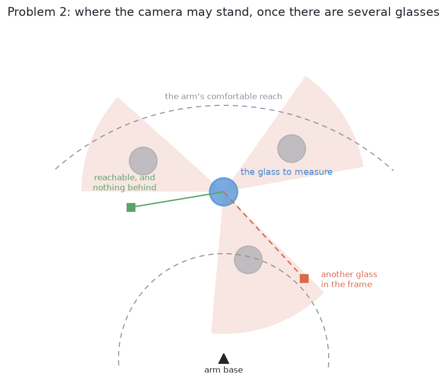

# Problem 2 — segment the glasses

## Introduction

Several glasses stand on the table. The arm photographs them from above. It must
work out **which pixels belong to which glass**, and where each glass stands. It
picks nothing up and measures no shape.

Six methods answer this problem. They can only be compared if they get the same
question. So this page states exactly what goes in and what must come out. It
also sets out three difficulties. The worst one is that **a glass can be absent
from every picture**.

## What is on the table

Four to six glasses stand upright. They are opaque. Each is drawn at random
inside its kind's range of sizes. The cell, camera, table and rack are the same
as in [problem 1](../../01-rack-one-glass/docs/problem.md).

**All the glasses in one arrangement are the same kind, and the kind changes
from one arrangement to the next.** The four kinds are described in [the
cell](../../01-rack-one-glass/docs/the-cell.md#the-glasses). A run meets all four in turn. The kinds are
not equally hard to outline, so every score is also broken down by kind. The
[examiner](the-examiner.md#how-good-was-the-mask) says how.

**The glasses stand apart.** There is a smallest gap between any two centres. It
is wide enough that no two glasses ever touch. Separating glasses that touch is
[problem 3](../../03-push-glasses-apart/docs/problem.md).

**The difficulties below use the tapered kind as the example.** Scores cover all
four kinds. But each difficulty is easiest to see in one kind, so it is told
once.

The tapered kind has the widest range of sizes. Its tallest glass is more than
twice the height of its shortest. That wide range causes the first difficulty
below. A narrow range could not cause it.

## What goes in

Every answer gets exactly this and nothing more.

**The survey pictures.** The arm parks the camera above the glasses at several
overlapping stations, looking straight down. [The
cell](../../01-rack-one-glass/docs/the-cell.md#the-words) describes the survey and its stations. From each
picture an answer may read three things:

- the grey picture, shaded by how far away each surface is;
- the depth reading at every pixel;
- the camera's pose, which the arm knows from its joint encoders.

**Nothing else.** No answer may read the simulator's record of what it spawned.
That record is used only to mark the run afterwards. The [examiner](the-examiner.md)
hands exactly this input to all six.

## What must come out

**For each glass on the table, one record holding three things:**

- its **mask**: which pixels in which picture are that glass and not another;
- its **place** on the table, measured from the arm's base;
- a **rough width** of its footprint.

The place is a position, not a full pose. A glass stands upright on a flat
table, so its axis is vertical. A glass looks the same from every side, so it
has no turn to find.

**And two honest statements, neither of which is a list of glasses:**

- **which glasses could not be separated, and why.** This is a result, not a
  failure. It is the input to [problem 3](../../03-push-glasses-apart/docs/problem.md).
- **where a glass could not have been seen at all.** This follows from the first
  difficulty below.

## The three difficulties

They are ordered by how dangerous they are.

### A glass can be missing from a picture altogether

A camera looking down throws each glass's outline outwards. A taller glass is
thrown further. [The cell](../../01-rack-one-glass/docs/the-cell.md#the-glasses) explains why. So a tall
glass's outline can cover a short neighbour completely. The short glass then
appears in no picture at all.

This is the dangerous one because it leaves no trace. No number looks wrong and
no check fails. The only defence is geometry. The arm must work out in advance
**where** a glass could hide, and then go and look.

### Glasses merge in the picture even when they stand apart on the table

Two glasses with bare table between them can still form one connected shape in
the picture. The same outward throw makes each glass cover more of the picture
than its footprint. A method that treats each shape as one object then reports
one glass where two stand.

The depth readings still hold enough to tell the two apart. So this difficulty
can be solved inside one station's pictures. Most of the six solutions are about
this one.

### The camera can no longer stand wherever it likes

With one glass, the camera can look from anywhere around it. With five, a good
viewpoint for one glass may be inside another glass. Or a third glass may block
the view. So choosing where to look becomes its own small problem. [Looking again
at what was hidden](hidden-glasses.md) solves it.

## Why one method is not enough

The second difficulty can be solved from the pictures already taken. The first
and third cannot. No work on the pixels can find a glass that made no pixels.

So a full answer has three parts. It places what was seen. It works out what
could not have been seen. It goes and looks again. Only the first part differs
between the six solutions. The other two are shared, and they live in [looking
again at what was hidden](hidden-glasses.md).

## What is deliberately not in this problem

**Naming the kind.** All glasses in an arrangement are one kind, and the kind is
known. [Problem 5](../../05-rack-several-kinds/docs/problem.md) drops that.

**Measuring a shape.** That needs a view from the side. Once this problem says
which glasses can be seen from where, problem 1 measures them unchanged.

**Picking anything up.** No grasp, no lift, no rack.

**Moving anything.** If two glasses cannot be separated from any reachable
viewpoint, this problem reports it and stops. Moving them apart is [problem
3](../../03-push-glasses-apart/docs/problem.md).

## What "done" means

A run is **done** when three things hold:

- every glass has a mask, a place and a rough width;
- every glass that could not be separated is listed with the reason;
- every part of the table that could not be seen is listed as unsearched, not
  treated as empty.

The [examiner](the-examiner.md#what-the-examiner-measures) marks a run against
the simulator's record. Two of its measurements decide the comparison:

- **how many glasses were found, missed, merged or split**, which says whether a
  method separated the glasses;
- **how much of each glass the mask covered**, which says how good the outline
  was.

## Where to go next

- [The examiner](the-examiner.md): the scenes, the pictures, and the marking.
  Read it before any solution.
- [Looking again at what was hidden](hidden-glasses.md): the part every
  solution shares.
- [The six solutions](solutions/overview.md): the six answers and their scores.
