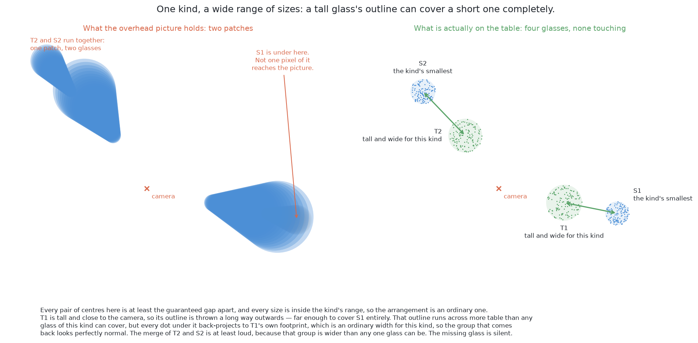
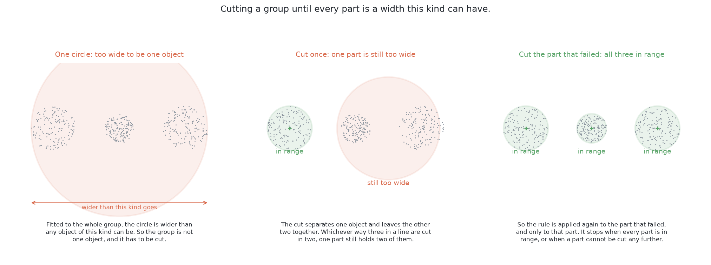
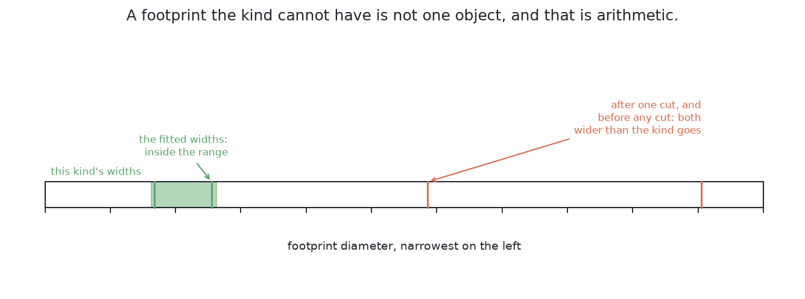
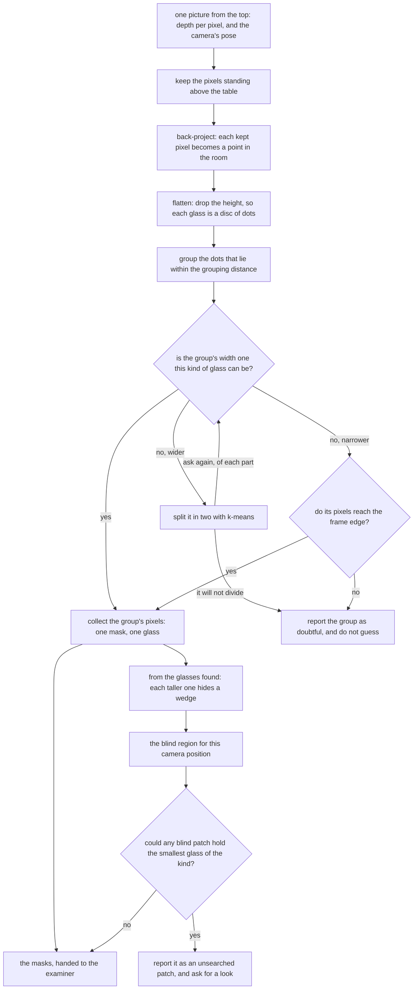

# Solution 1 — rules on the table

> **What it uses** — NumPy for the arithmetic on the depth readings, and OpenCV
> for the picture handling the cell already does. There is no model, no weights
> file and no training data.
> **What it does** — It turns every pixel into a point in the room. It drops
> each point onto the table. It groups the dots by how far apart they are on
> the table. Each group is one glass, and the pixels that fed a group are that
> glass's mask.
> **What it costs** — Nothing but arithmetic. No labels, no training, no
> graphics processor and no licence condition. [What it needs](#what-it-needs)
> gives the detail.

> **The cell is described once, in [the cell](../../../01-rack-one-glass/docs/the-cell.md).** That page
> covers the layout, the camera's two working places, the four sensors and the
> words this project uses. This page covers only what is special to this
> solution.

## Introduction

This page describes the one answer to [problem 2](../problem.md) that has no
model of any kind. It fits nothing. It states a rule that a person can read,
and it applies that rule.

The rule rests on one fact about the input. Every pixel comes with a depth
reading. A pixel with a depth reading is really a point in the room. Once the
picture is a crowd of points, "which glass is this?" becomes a question about
distance on the table. Everything else on this page follows from that.

**The method is built, and the numbers below come from running it.** The code
is in `02-segment-glasses/01-rules-on-the-table/`. It writes its own
`results.json` beside itself. Five things on this page are still design, not
code:

- the grouping distance is a constant, not computed from its two limits;
- the circle fit returns a width but no residual;
- there is no minimum-neighbours guard;
- a group that only one station found is not reported as doubtful;
- the arithmetic for where a glass could hide is set out here but does not run.

**Nothing here quotes a size.** The cell's rule is that no glass's size is
written down anywhere. So this page speaks in relations, such as "wider than
any glass of this kind", and never in figures.

## The rule, in the code

Two short pieces of code carry the whole method. The first is the circle
fitted to a group. The second is the check that asks the fit again of every
part a split produces. The rest of the folder turns pixels into dots and hands
masks to the examiner.

This is the fit, from ``01-rules-on-the-table/find.py``. The first function is
a one-shot least-squares solve with NumPy's `lstsq`. The second gives it the
outside of the patch, found with OpenCV's `convexHull`.

```python
def circle_width(dots: np.ndarray) -> float:
    """How wide the circle through a ring of dots is, in one solve and with no starting guess.
    ...
    """
    terms = np.column_stack([dots, np.ones(len(dots))])
    solved = np.linalg.lstsq(terms, (dots**2).sum(1), rcond=None)[0]
    x, y = solved[0] / 2.0, solved[1] / 2.0
    return 2.0 * float(np.sqrt(max(solved[2] + x * x + y * y, 0.0)))

def footprint(dots: np.ndarray) -> float:
    """How wide the circle round the patch of table a group of dots marks is.
    ...
    """
    return circle_width(cv2.convexHull(dots.astype(np.float32)).reshape(-1, 2).astype(float))
```

This is the check, from the same file. It holds the four outcomes described
below. Its last line asks the first function again, and that is the repetition.

```python
def as_glasses(picture: Picture, one: Found, widths: tuple[float, float]) -> list[Found] | None:
    """The glasses one patch of dots holds, or None if the fitted circles cannot say.
    ...
    """
    width = footprint(dots_of(picture, one.pixels))
    if widths[0] <= width <= widths[1]:
        return [one]
    if width > widths[1]:
        return come_apart(picture, one, widths)
    return [one] if one.cut_off else None

def come_apart(picture: Picture, one: Found, widths: tuple[float, float]) -> list[Found] | None:
    ...
    mine = halve(dots_of(picture, one.pixels))
    if mine.all() or not mine.any():
        return None
    parts: list[Found] = []
    for half in (~mine, mine):
        ...
        got = as_glasses(picture, measured, widths)
        if got is None:
            return None
        parts.extend(got)
    return parts
```

The borrowed work is two library calls: one solve and one hull. Everything
around them is this project's own. The fitted width never leaves these
functions. It decides only whether a patch comes apart. The width in the record
is measured by the examiner, from the pixels these functions hand back.

## The problem this solves

[Problem 2](../problem.md) sets the task: four to six glasses of one known kind
stand on the table, and the camera looks straight down from the top. The job
is to say which pixels belong to which glass. Three words are used throughout
this page.

A **mask** is a picture the same size as the camera's picture. Each pixel holds
yes or no. Yes means the pixel shows a glass.

A **patch** is one group of touching yes pixels. **One patch is not always one
glass.** That gap is the first difficulty.

The **strip of bare table** comes from the problem's promise. There is a
smallest distance between any two glass centres. It is wide enough that two
glasses never touch. So there is always bare table between them, and this
whole method rests on that strip.

### Why a picture from the top joins two glasses that stand apart

A glass's rim is nearer the lens than the table. So its outline is drawn
further out from the point below the camera than the glass really stands. The
taller the glass, the further out it is thrown. This project calls that effect
**splay**, and [the cell](../../../01-rack-one-glass/docs/the-cell.md) derives it. A tall glass's outline
can therefore reach a short neighbour.

[The problem](../problem.md#the-three-difficulties) names the two results. In
the **merge**, the two outlines touch and make one patch. That patch is wider
than any glass of the kind, so something can notice. In the **complete
cover**, the tall outline hides the short glass entirely. The picture then
holds one glass fewer than the table, and nothing in it looks wrong.



Better grouping cannot answer the complete cover, because the pixels are not
there. [When the glasses are completely
hidden](#when-the-glasses-are-completely-hidden) gives the answer.

## The main idea

Turn each pixel into a point in the room, using its depth and the camera's
pose. Then tell the glasses apart by distance on the table. The strip of bare
table that the picture could not show is then there to be measured.

## Turning a pixel into a point in the room

This step is the base for all the others. Its standard name is
**back-projection**. A camera turns a place in the room into a place in the
picture. Back-projection runs that step backwards.

It needs three inputs. The pixel's column and row, measured from the middle of
the picture, give the direction the camera looked. The depth reading gives how
far to travel along that direction. The camera's pose says where the ray starts
and which way it faces. The arm knows that pose exactly from its joint
encoders, so nothing here is estimated.


**A pixel on its own is not a thing. It is a direction with a distance written
on it.** Two details about that distance matter.

First, the depth is measured along the lens axis, not along the slanted line to
that pixel. So a corner pixel is further from the lens than its depth says.
That is why the sideways offsets are needed.

Second, some pixels have no reading. They are dropped, not guessed, because a
pixel with no distance has no place in the room. [Where it is strong and where
it breaks](#where-it-is-strong-and-where-it-breaks) explains why this matters
outside the simulator.

The **focal length** is easy to misread. It is not a length. It converts
between directions and pixels. It follows from the lens's angle and the number
of pixels across it. The one fact this page needs: **how much of the world one
pixel covers depends only on how far away it is.** From the survey height, a
glass is tens of pixels across. That is why counting pixels into groups works.

Doing this for every kept pixel gives a **point cloud**: a list of positions
with no grid and no order. Losing the grid is the point. Being neighbours in
the picture is the misleading idea this method escapes.

## Keeping only what stands above the table

This step chooses which pixels become points. It is the cheapest step.

The table is bolted to the arm's frame, so its height is a known constant. A
pixel is kept when its point stands more than a small clearance above the
table. That clearance is larger than the depth noise and much smaller than the
shortest glass. Two more tests drop pixels: points higher than the tallest
glass (mostly the arm's own fingers), and pixels with no depth reading.

**This test, not the grouping, fixes the outer edge of every mask.** The
grouping never adds back a pixel this test dropped. [The masks are what this
contributes](#the-masks-are-what-this-contributes) explains what that costs.

## Throwing the height away

This step discards information on purpose. Every point is dropped straight
down onto the table. A 3D point becomes a 2D dot.

Look at the shape of the cloud first. From the top, a glass's side wall is seen
almost edge-on and catches few pixels. So there are many points on the top, a
few near the base, and almost none between. The cloud looks like a lid with a
thin ring of crumbs below it.

That shape breaks grouping in 3D. The top and base of the **same** glass are a
whole glass height apart. Two **different** glasses are only a strip of table
apart, and that strip is narrower than a glass is tall. So the gap inside one
glass is larger than the gap between two glasses. No single distance can then
hold one glass together and keep its neighbour out.

Flattening fixes this. Each glass becomes a solid disc of dots. The strip
between two discs keeps its full width, because dropping a point moves it
nowhere sideways. Now the gap inside a glass is zero, and a wide range of
distances works. **Height is the dimension that varies most and tells you
least.**


One caveat. The disc is not the glass's base. It is the glass's widest
horizontal slice, because that slice hides everything below it. For a stemmed
glass, the disc is the bowl. The problem asks only for a rough width, so this is
an honest answer. The exact shape is measured later, from the side.

## Grouping the dots by how close they are

Now the dots are flat, and the grouping rule fits in a few lines.

> Start from a dot nobody has visited. Take every dot within a chosen distance
> of it. Then take every dot within that distance of those. Keep going until
> nothing new joins, and call that clump one glass. Then start again from a dot
> that has not been used.

Its published name is **Euclidean cluster extraction**. Its key property is how
little it is told. The only setting is the distance. Nobody tells it how many
groups to find, or their size or shape. That matters: a method told to find
five groups can never report four or six.

The rule **chains**. If A joins B and B joins C, all three are one group. That
lets it hold a ragged scatter together. It is also its one weakness: a single
stray dot in the strip can link two glasses.

Comparing every dot with every other dot is slow. Sorting the dots into square
bins fixes that, because close dots then share a bin or sit in a nearby one.
The code goes further and never compares dots at all. It marks a fine grid,
grows each marked square by the grouping distance, and joins the squares that
touch. That is two OpenCV calls. The same idea under a grander name is a k-d
tree.

## The one setting, and where it comes from

The one setting is the grouping distance. It does not come from trial and
error. It sits between two limits that are known before a run. This is like a
measurement tolerance: larger than the noise, smaller than the smallest real
difference.

The **lower limit** is the widest gap between dots on one glass. Neighbouring
pixels land on neighbouring bits of surface, so the dots form a mesh about one
pixel apart. A slanted surface, such as a bowl's outer curve, spreads the mesh
wider. If the distance is below the widest gap, one glass breaks into two or
three groups.

The **upper limit** is the narrowest strip of bare table. There is a trap here.
The problem promises a distance between **centres**, but grouping measures
**edge to edge**. So take the smallest centre distance and subtract half of
each of the two widest glasses. What is left is the narrowest strip. If the
distance is above it, two glasses become one.

The window between the two limits is broad. Still, the value should be
computed, not typed in. The two quantities that set it, the widest rim and the
centre distance, live in other parts of the project. So the design says: compute
the distance from them, check it against the measured dot gaps, and print both
ends of the window. A computed value stays right when somebody widens a kind or
moves the glasses closer. A typed value goes quietly wrong.


The design puts the value **low** in the window, because the two mistakes are
not equally bad. A glass split in two usually shows itself: each half is too
narrow, so the width check below catches it. The exception is a glass at the
frame edge. The check must accept a narrow width there, so a split there goes
unnoticed. Two glasses merged into one are quieter everywhere. So the setting
leans towards splitting, the mistake that mostly gets caught.

## Checking a group against the widths the kind allows

This check is what makes the method safe to trust with a moving arm.

From the top, a glass flattens to a disc, so each group should be a filled
circle. A circle fit gives a centre and a width. A standard fit also gives a
**residual**: how far the dots sit from the circle on average. None of the four
outcomes below uses it, so the code computes only the width. It fits the dots
on the outside of the patch, because a circle fitted to a filled disc comes out
too narrow.

The fit has a useful property. A circle's equation is not linear in its centre
and radius. But if you multiply it out and treat certain combinations as the
unknowns, it becomes linear. So it has a direct solution, with no iteration and
no starting guess.

**This fitted width is for the check only, not for the answer.** The examiner
computes the reported place and width from the mask pixels, the same way for
all six solutions. The fit matters only when it says a group is too wide. Then
the group is split, and that changes which pixels go into which mask.

The ruler is tighter than it looks. Across all four kinds, widths vary a lot.
Within one kind they vary much less, and the problem says which kind is on the
table.

The check **repeats**, and it has four outcomes:

1. The width is inside the kind's range. The group is one glass, and its pixels
   are one mask.
2. The width is **wider** than the range. The group is split in two, and each
   part is checked again. A part still too wide is split again.
3. The width is **narrower** than the range. Splitting cannot help. If the
   pixels reach the frame edge, the glass was cut off and is accepted.
   Otherwise it is refused.
4. If any part cannot be settled, the whole group is reported as doubtful,
   with the side of the range it failed on.



The next picture is the ruler for those three steps. It is a line of footprint
widths, with the kind's allowed band marked. The two widths that passed sit
inside the band. The two that failed sit well to the right.



The split uses **k-means with two centres**. Put one seed at each end of the
group's longest direction. Give each dot to the nearer seed. Move each seed to
the middle of its dots. Repeat until nothing moves.

The check is **arithmetic, not judgement**. "Too wide to be one glass" uses two
quantities known before the run, and both can be printed. Nobody adjusted it
until the tests passed.

### Why one split is not enough

One split answers two glasses run together. The examiner's crowded family
often holds more. It puts **three** glasses to a line and two lines to an
arrangement. Over 20 held-out crowded arrangements, 72 groups held more than one
glass, and **47 of those held three or more**. One split leaves at least one
part with two glasses.

Both rules were run on those 20 arrangements. One split only finds **17** of
101 glasses and hands 54 groups over. The repeated split finds **71** of 101
and hands 3 over. The repeated split reports 10 masks covering two glasses,
where one split reports none. Its places sit 6.0 mm from the truth at the
median, against 0.7 mm. On the spawned arrangements, both rules find the same
100 glasses at the same places. Repeating only removes the three groups one
split had to hand over. So repetition costs nothing where it is not needed.

This is not a new rule. "A group too wide for one glass is not one glass" is
true of any patch, including a part from a split.

### Where the repetition stops

No limit is written anywhere. Each split gives both parts fewer dots than
before, so splitting ends on its own. It ends in one of three ways:

- every part has a width the kind allows, which is the answer;
- a part is narrower than the kind allows, which splitting cannot repair;
- a part cannot be divided: the halving puts every dot on one side, or a half
  has too few depth readings for the examiner to fit.

A group with any part left over is handed over **whole**. Reporting only the
parts that fit would claim to know how many glasses the group holds. The fit
has just said it cannot know.

**An older test is dropped: that two circles together cover all the dots.** It
was meant to catch two circles fitted to three glasses. The repeated split
handles that case directly. Keeping the old test as well was measured, and it
is worse. On crowded arrangements it drops the run from 71 found and 3 handed
over to 53 found and 37 handed over. On spawned arrangements it refuses 20
whole glasses. The reason is geometry. A part cut by a straight line is not a
disc, so a circle fitted to it misses the corners.

## The masks are what this contributes

As [the examiner](../the-examiner.md#what-must-come-back) explains, a solution
hands back only masks. The examiner turns them into places and widths the same
way for everybody. This section says what is special about this solution's
masks.

**Here the mask is a by-product of the grouping.** The other five run a model
whose job is to draw an outline. Here no step asks where a glass ends. One step
decides which pixels stand above the table. Another decides which of those
belong together. The mask is just the pixels that fed one group. Nobody chose
its edge.

That has one good result and one bad result. They land on the examiner's two
mask numbers.

**"How much of the mask was not that glass" should be very good.** A pixel
lands in the wrong mask only if its dot chained across a strip of bare table.
Also, every pixel in every mask had a real depth reading. So this solution
never claims a pixel it did not see, and has nothing to declare to the
examiner.

**"How much of the real glass the mask covered" is limited, and better grouping
cannot fix it.** The height test fixed every mask's edge. So each mask loses
two things: a thin band at the bottom, where the wall is too close to the table
to tell apart, and every pixel with no depth reading. Those pixels were gone
before grouping started.

The design expected that band to cost every kind the same. The run found
otherwise: the [code README](../../01-rules-on-the-table/README.md)
shows the two stemmed kinds covered 11 to 13 points less than the others. A
model can learn an outline that runs right down to the table, so it can beat
this solution on coverage. A model can also leak onto the table, which this
solution almost never does. **So the two mask numbers can disagree about which
method is better, and that disagreement is a useful result.**

The band comes from the depth test, so it is a property of the input, not of
the rule. Any method that builds its mask from that test loses it. Keep that in
mind before crediting a model with understanding glasses. It may only have
learned where the table is.

## How the concepts fit together

The steps make one flow with two branches. The left branch groups what was
seen. The right branch works out what could not have been seen. They meet only
in the report.



The right branch takes its input from the **glasses found**, not from the
pixels. It needs only their positions, widths and heights. That is why it can
say something about a glass that left no pixels. The next section works it out.

## When the glasses are completely hidden

A fully covered glass leaves no pixel in any picture. No method that reads
pictures can find it. [Looking again at what was hidden](../hidden-glasses.md)
is the shared answer for all six solutions: work out where a glass could hide,
and go and look. This section covers only what this solution adds.

This solution already holds, in room distances, where each found glass stands,
how wide and tall it is, and where the camera was. Those are exactly the inputs
that arithmetic needs.

Two facts about splay make the hidden region cheap to compute. First, a taller
glass is thrown further out, so only taller glasses can cover a glass. Second,
splay scales a glass's distance from the point below the camera and its radius
by the same factor. So the angle it covers does not change with height. **The
region a glass hides is a wedge.** Height only decides where along the wedge
the outline starts and stops. The union of the wedges, plus the ring outside
the frame, is the blind region. A blind patch matters only if it could hold the
kind's smallest glass.


One limit: **the arithmetic starts from the glasses it found.** So a glass
hidden behind another hidden glass is out of its reach. A badly grouped glass
also casts a badly computed wedge. Neither happens until some glass is hidden
from every station.

## A worked example

This example follows one arrangement through the method. Two of its relations
were chosen as worst cases.

Six glasses of the widest-ranging kind stand in the glass zone. Call them G1 to
G6. The table below gives where each stands and how big it is for its kind.

| | where it stands | how big, as this kind goes |
| --- | --- | --- |
| G1 | middle of the zone, a little to the near side | large: tall and wide |
| G2 | the far corner of the zone, out past G1 on a diagonal | middling |
| G3 | the near corner on the other side | middling |
| G4 | out along the far edge, away from G2 | middling |
| G5 | the near corner on G1's side | middling |
| G6 | on the same diagonal as G1, beyond it | the smallest the kind allows |

First, **G1 and G2 are the closest pair, and only just legally apart.** They
lie on the diagonal running out from the middle, which is the direction splay
throws things.

Second, **G6 is the smallest glass and stands beyond G1, the largest, on that
same diagonal.**

The camera goes to one station above the zone and looks straight down. The
whole zone is in the frame.

### What grouping in the picture would return

Splay throws G1's outline outwards along the diagonal, towards G2. G2 stands
further out, so splay throws it further, and part of it runs past the edge of
the picture. G1's outline reaches what is left of G2's. The two touch, so
grouping touching pixels gives four patches for five visible glasses.

Two outlines can meet by two routes:

- **With the frame edge.** Two glasses of similar height on one diagonal are
  both pushed out, the further one more. The gap between them in the picture
  **grows**. They meet only when one is partly out of frame.
- **Without the frame edge.** If the nearer glass is much taller, its outline
  is pushed out much more. The gap **closes**. So whether outlines meet depends
  on the height difference as much as on position.

The merged patch would be several times wider than any glass of this kind. So
the picture *can* tell something is wrong. It cannot tell *what*: one wide
object, two glasses or three.

### What grouping on the table returns

On the table, G1 and G2 are far from touching. The strip between them is
several times wider than the grouping distance. So they come back as two
groups. Every other pair stands further apart. Five groups come out, and five
masks go to the examiner. The table below lists what each group gives.

| | the group | the mask it gives |
| --- | --- | --- |
| G1 | a full disc of dots | a complete outline, less the band at the base |
| G2 | a partial disc: its top ran past the frame edge | the near part of the glass only |
| G3 | a full disc of dots | a complete outline, less the band at the base |
| G4 | a full disc of dots | a complete outline, less the band at the base |
| G5 | a full disc of dots | a complete outline, less the band at the base |

Four masks are as good as this method can make them. Each lacks only the band
at the base.

G2 is the interesting one. Part of it is outside the picture, so its mask
covers only the near part. Its fitted width still looks ordinary, and **that is
the danger**: one picture gives no reason to object. What makes it safe is
that the camera visits several stations. Each cuts G2 along a different line.
Two stations that put G2 in the same place have fitted the glass, not the frame
edge. The design reports a group seen by only one station as doubtful, because
it has been seen once.

### And the glass that is not in the list at all

There are five rows, and six glasses on the table. G6 is missing. G1's outline
swept over it, so G6 left no pixels: no group, no mask and no flag. **Every
check is a check on something that was found**, and nothing was.

The other branch never looks at pixels. G1 was found, so its position, width
and height are known. Its wedge can be computed, and G6's position falls inside
it. The arithmetic does not know G6 is there. It does know that **a patch large
enough for the smallest glass lies in that wedge and would have left no
trace.** So the patch is reported as unsearched.

The next station settles it. The point below the camera has moved, G1's wedge
has swung away, and G6 is plainly visible. The second station closes the patch
from the first.

The arithmetic did not find G6. **It turned a run that reports five glasses
into a run that reports five glasses and one place it had not looked.** The
first is wrong and silent. The second is incomplete and says so.

### The case the rule cannot answer

The examiner never draws this case, because it always keeps glasses legally
apart. The rule must still behave sensibly here, because [problem
3](../../../03-push-glasses-apart/docs/problem.md) is about it.

If two glasses stood closer than the cell allows, the strip would be narrower
than the grouping distance. They would come back as one group. The width check
then rescues them: the group is about twice too wide, so it is split, and two
parts inside the range mean two glasses.

If the two glasses touched, there would be no strip at all. It is always one
group, and everything rests on the width. The group is cut, and the parts are
believed only if both have allowed widths. With three in a row the cut repeats.
But each cut is a straight line drawn where the dots divide, not where the
glasses divide. So the mask edges are a guess, and the places get worse with
each cut. That is the handover to [problem
3](../../../03-push-glasses-apart/docs/problem.md), and the honest edge of this
method.


## What it needs

**No labelled data.** Nothing is fitted, so the examiner's training half is
never read.

**No training time and no weights file.** There is nothing to train, and
nothing to keep in step with the cell.

**No graphics processor.** The work is a comparison over a grid, one
multiplication per pixel, dropping one column, a spreading step over a grid,
and one least-squares solve per group. It is ordinary processor work.

**Two libraries, both already in the cell, and neither with a licence
condition.** NumPy does the arithmetic on the depth readings. OpenCV grows and
joins the marked squares, and finds the outside of a patch before the circle
fit.

**Three facts from the problem, not from the sensor:**

- the table's height, known because the table is bolted to the arm's frame;
- the smallest distance between two glass centres, which sets the upper limit
  on the grouping distance;
- the range of widths for the kind on the table, which the width check uses.

## Where it is strong and where it breaks

**It can be read.** The rule is one sentence about distance on the table.

**It is exact and repeatable.** The same picture gives the same groups every
time. Nothing samples randomly.

**When it fails, one printed number usually says why.** Each step gives one
number worth printing: pixels passing the height test, bins marked, groups
found, dots per group, and each group's width. A table height set a little too
low turns the whole table into one huge group, and the pixel count shows it at
once. A grouping distance too small gives too many groups with too few dots. One
too large gives too few groups with an impossible width.

**It answers in real distances from the arm's base**, because it works in the
room the whole time.

**It can say where it has not looked**, once that branch is built.

It has one limit on the idea and one on the sensor.

**The limit on the idea: somebody must be able to state the rule.** Two
touching glasses leave no strip, which is why [problem
3](../../../03-push-glasses-apart/docs/problem.md) exists. Two glasses one behind the
other, at the same distance from the camera, stay one group. And with all four
kinds on the table at once, the allowed width range widens, so the width check
weakens. That is [problem 5](../../../05-rack-several-kinds/docs/problem.md).

**The limit on the sensor: the rule needs depth readings, and real transparent
glass does not give them.** Every dot comes from a depth reading. **The cell
gets away with this only because the simulator renders the glasses as opaque
solids.** So this method would not work on real glasses as it stands.

## The general ideas behind this

None of this was invented for glasses. It has been the standard recipe for an
arm over a table for about twenty years: treat the depth picture as a point
cloud, delete the table, and group what is left. It became the default because
it needs no training data and no model, works on objects it has never seen, and
gives positions in real distances.

### The pinhole camera model — turning a pixel and a depth into a point

This is the back-projection described in [turning a pixel into a point in the
room](#turning-a-pixel-into-a-point-in-the-room). It is rarely right for
surfaces a depth sensor reads badly, such as glass, polished metal or black
plastic. There the depth is missing or wrong, and back-projection gives
confident nonsense.

For more, see the [pinhole camera
model](https://en.wikipedia.org/wiki/Pinhole_camera_model), and Hartley and
Zisserman's [Multiple View Geometry](https://www.robots.ox.ac.uk/~vgg/hzbook/).

### Plane segmentation with RANSAC — finding and deleting the table

**RANSAC** means random sample consensus. It fits a model to data full of
stray readings by guessing from small samples (Fischler and Bolles, *CACM*,
1981). For a table: pick three points at random, make the plane through them,
and count how many other points lie on it. Keep the best plane after a few
hundred tries. Deleting that plane leaves just the objects.

It is rarely right when no shape dominates, or when several models fit equally
well.

**This solution skips it**, because the table's height is a known constant.
Finding it is a comparison, not a search. The cost: if the table moved or the
arm were remounted, the constant would be wrong, and a search would not. For
more, see [RANSAC](https://en.wikipedia.org/wiki/Random_sample_consensus).

### Density-based clustering — grouping points by how close they are

This is the grouping rule from [grouping the dots by how close they
are](#grouping-the-dots-by-how-close-they-are). Its better-known cousin in
statistics is **DBSCAN**. DBSCAN adds a minimum-neighbours rule, so scattered
noise cannot form its own clusters (Ester and colleagues, KDD 1996). This code
has no such guard yet.

It is rarely right for objects that really touch, because distance can only
separate things with distance between them.

For more, see [DBSCAN](https://en.wikipedia.org/wiki/DBSCAN) and [cluster
analysis](https://en.wikipedia.org/wiki/Cluster_analysis) for the wider family.

### Least-squares shape fitting — turning a cloud of dots into a number

Fit a shape by minimising an error that can be written as a linear equation.
Then it has a direct solution. Its **residual** is a free measure of how well
the shape explains the data.

It is rarely right for shapes the model does not describe. Then it returns a
confident number with a large residual that nobody checks.

For more, Kåsa's algebraic circle fit with the Pratt and Taubin refinements are
the three standard versions, and the geometry is in [circular
segment](https://en.wikipedia.org/wiki/Circular_segment).

### Visibility reasoning — knowing where you could not have looked

A sensor's view splits space into three parts, not two: seen and occupied, seen
and empty, and **not seen at all**. The mistake is to treat the third as the
second, because both look like absence in the data. Mobile robots keep a map
marking each cell free, occupied or **unknown**. This cell is a lucky case. The
hidden region can be computed exactly, because the objects are upright round
solids on a known plane and the camera looks straight down.

For more, the general form is [occupancy grid
mapping](https://en.wikipedia.org/wiki/Occupancy_grid_mapping), where the
three-way marking is the whole point.

## Where it sits among the other five

It is the only one of the six with **no fitted numbers at all**. Solution 3
fits nothing in this cell either, but it carries a weights file fitted on
somebody else's photographs. Nobody can say what rule that file holds. **This
solution's rule is one sentence.**

That makes it the baseline. The examiner holds everything else fixed, so the
comparison is plain: **if a model cannot beat a written rule, it has earned
nothing.**

It also shows what the problem's *promises* are worth. The rule works only
because the glasses stand apart, the table's height is known, one kind is on
the table, and the glasses return depth readings. Each model needs fewer of
those promises. Later problems remove them one at a time. **A problem that a
written rule can answer is a problem whose promises were generous.** The other
five are worth what they do when the promises stop.

← [Problem 2 — segment the glasses](../problem.md) · [Solution 2 — a network
trained from scratch](02-train-from-scratch.md) →
