# Solution 2 — a network trained here from scratch

> **What it uses** — PyTorch, on this machine's integrated graphics. One small
> convolutional network, written for this cell and trained only on its
> pictures. No downloaded weights, so there is no licence condition.
> **What it does** — at every pixel, the network says whether the pixel is
> glass. At each glass pixel, it also gives an arrow to the middle of that
> pixel's own glass. Each arrow is a vote. One glass makes one pile of votes, so
> two glasses that touch in the picture still make two piles.
> **How it differs from the other five** — [rules on the
> table](01-rules-on-the-table.md) writes its grouping rule by hand; this one
> learns it. The other four learned solutions start from somebody else's
> weights; this one starts from random numbers.
> **What it costs** — labelled pictures, a training run, and a file of weights
> that must match the cell.

> **The cell is described once, in [the cell](../../../01-rack-one-glass/docs/the-cell.md)** — the
> layout, the two camera places, the sensors and the words. This page covers
> only what is special to this solution.

## Introduction

This page answers [problem 2](../problem.md) with a network that is built and
trained inside this cell. It borrows nothing. That is what sets it apart from
the four other learned solutions, which all start from weights fitted to real
photographs.

You will learn four things here:

- why a network helps at all;
- how one small network says both *is this pixel glass* and *which glass is it*;
- where the training labels come from (there are two answers, and the second is
  the interesting one);
- why this solution is the fair test of what borrowed weights are worth.

The last point is why this page exists. A borrowed model has a **domain gap**:
its training pictures differ from this cell's pictures.
[Why nothing is borrowed](#why-nothing-is-borrowed-and-what-that-buys) explains
the gap. This solution has no gap, so it is the baseline the borrowed models
are compared against.

## The network, in the code

The code is in `02-segment-glasses/02-train-from-scratch/`. The network gives
three numbers at every pixel of a shrunk picture. One says whether the pixel is
glass. Two hold the arrow to the middle of that pixel's own glass.

Below is the target it is trained towards, and the network itself, from
`02-train-from-scratch/models.py`. `top_target` builds the target from the
simulator's record of which glass each pixel shows. In `TopNet.forward`, the
two `torch.cat` lines carry copies from the way down across to the way up.

```python
def top_target(picture: Picture, glasses) -> np.ndarray:
    """Per pixel: glass or not, and the offset to its rim's middle."""
    ids = picture.ids[::SHRINK, ::SHRINK]
    target = np.zeros((3, *SMALL), dtype=np.float32)
    target[0] = ids > 0
    rows, columns = np.indices(SMALL)
    for index, glass in enumerate(glasses):
        column, row = rim_middle(picture, glass)
        mine = ids == index + 1
        target[1][mine] = (column - columns[mine]) / VOTE_SCALE
        target[2][mine] = (row - rows[mine]) / VOTE_SCALE
    return target

class TopNet(nn.Module):
    ...
    def forward(self, x: torch.Tensor) -> torch.Tensor:
        full = self.at_full(x)
        half = self.at_half(full)
        quarter = self.at_quarter(half)
        up = nn.functional.interpolate(quarter, size=half.shape[-2:])
        up = self.up_half(torch.cat([up, half], 1))
        up = nn.functional.interpolate(up, size=full.shape[-2:])
        return self.head(self.up_full(torch.cat([up, full], 1)))
```

Next is where the votes become one glass's mask, from
`02-train-from-scratch/pipeline.py`. `SHRINK` is how much the picture was
shrunk. `_BLOCK` holds the offsets of one shrunk pixel's block, so the mask
claims the whole block behind each voting pixel.

```python
def pile_mask(picture: Picture, votes: Votes, middle) -> np.ndarray | None:
    """The pixels that voted for one middle, as a boolean mask, or None if too few did.
    ...
    """
    mine = np.linalg.norm(votes.landed - middle, axis=1) < MIDDLE_RADIUS
    if mine.sum() < MIN_VOTES:
        return None
    corners = np.stack([votes.rows[mine], votes.columns[mine]], 1) * SHRINK
    pixels = (corners[:, None, :] + _BLOCK[None, :, :]).reshape(-1, 2)
    pixels = np.clip(pixels, 0, np.array(picture.depth.shape) - 1)
    mask = np.zeros(picture.depth.shape, dtype=bool)
    mask[pixels[:, 0], pixels[:, 1]] = True
    return mask
```

Two points stand out. PyTorch gives the layers and the training loop. The idea
itself, an arrow instead of a label, lives in the twelve lines of
`top_target`. And a mask here is a set of votes, not a drawn outline. No line
asks where a glass ends. The only boundary in the code keeps a block inside the
picture.

## The problem this solves

The hard part of [problem 2](../problem.md) is telling one glass from another.
Two glasses with table between them can still join into one shape in a picture
from the top. [Glasses merge in the
picture](../problem.md#glasses-merge-in-the-picture-even-when-they-stand-apart-on-the-table)
states this, and [solution 1 shows
why](01-rules-on-the-table.md#why-a-picture-from-the-top-joins-two-glasses-that-stand-apart).

A better-trained network does not fix this on its own. The limit is in the
shape of the answer. Two terms explain why:

- **Semantic segmentation** gives each pixel a class, such as "glass".
- **Instance segmentation** gives each pixel a class *and* the object it
  belongs to.

This problem needs the second. A perfect class map still merges two joined
glasses. It holds only one value, "glass", and one value cannot mark a
boundary. So the fix is a **different output**. That is the network's second
head.

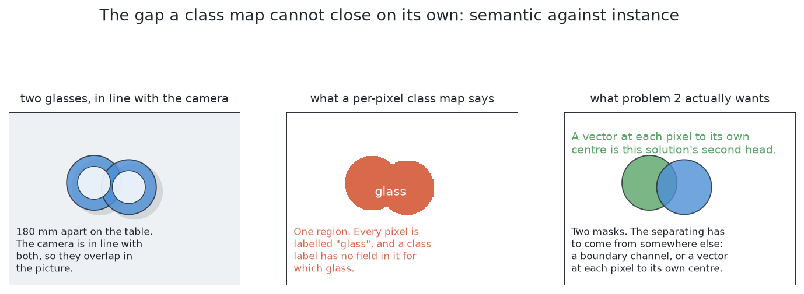

## The main idea

The idea has two halves.

**This cell is narrow, so the network can be small.** Little changes here.
There is one class, glass. There is one kind of glass at a time, one camera and
one lighting setup. The glasses are always upright and opaque. A general model
is built to handle far more. So a small network is enough, and a small network
can be trained from nothing on an ordinary machine.

**Each glass pixel gives an arrow, not a label.** The arrow points to the
middle of that pixel's own glass. The pixel's position plus its arrow is a
**vote** for where that middle is. All pixels of one glass point at one middle,
so one glass makes one pile. Two glasses make two piles. Counting glasses
becomes counting piles.

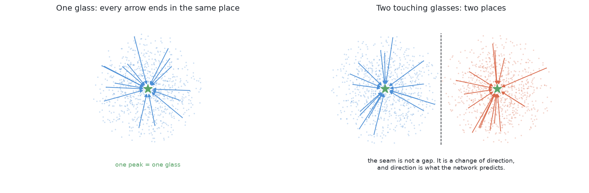

This design has two strong points.

**Nothing has to find a boundary.** Where two glasses meet in the picture, the
pixels look the same. Only the arrows change direction. The seam follows from
that; nothing has to locate it.

**A wrong vote is outvoted.** A glass covers many pixels, so it casts many
votes. A few stray votes do not move the pile. Compare a method that draws the
seam directly: one missing seam pixel joins the two objects again.

The rest of this page builds this up in order: what is built, what a network
is, its shape and two heads, where the labels come from, and where it fails.

## What exists in code, and what is a design

**What is built.** The network described below exists in PyTorch, with both
heads: one channel for glass or not, and two for the arrow. It runs on this
machine's integrated graphics through the **MPS backend**, which is how
PyTorch reaches the graphics chip on this kind of Mac. No graphics card is
needed. Its labels come from the simulator's record of which glass each pixel
shows. The votes go into a tally, and the tally's peaks are taken one at a
time, largest first. The pixels that voted near a peak are that peak's glass.

It runs as one of the six solutions on the shared
[examiner](../the-examiner.md). It trains on the examiner's training
arrangements, half of them crowded. It is scored on held-out arrangements and
writes its own `results.json`. The scores are in the [code
README](../../02-train-from-scratch/README.md#results--20-held-out-scenes-from-each-family-three-stations-each).

**What is only a design.** Five things on this page are not built:

- the two fixes for the rare class in the loss;
- the check on a pile's fitted width;
- the second alarm, on how far a pile's votes sit from their peak;
- domain randomisation of the training pictures;
- the whole of the second way, which takes labels from the arm's movement.

Where the page prescribes a check or a threshold, it says so. It quotes no
measurement for them.

## What a network is, and what training from scratch means

Three terms are used from here on.

A **neural network** is a program whose behaviour comes from numbers fitted to
examples, not from written rules. Those numbers are **weights**. They start as
random noise. **Training** shows the network an example and compares its answer
with the right one. Then it nudges every weight in the direction that would
have helped. Nobody writes the rule the network ends up with, and nobody can
read it back out.

**Fine-tuning** does not start from random numbers. You take a network somebody
else trained on many labelled photographs. You replace its last layer and keep
training on your own pictures. This is the usual advice, because labelled
pictures are scarce. Someone must draw round every object by hand. A borrowed
network needs far fewer labels.

**Training from scratch** starts from random numbers and learns everything from
your own examples. It is usually the worse choice. Here it is the right one,
for the reasons below.

## Why nothing is borrowed, and what that buys

Fine-tuning helps when labels are scarce. Here they are not.

**Labels in this cell are free and exact.** The examiner renders every picture.
So it also knows which glass each pixel shows. That record costs no more than
the picture. There is no person drawing outlines, so there are no drawing
mistakes and no limit on the count. Training from scratch on endless exact
labels is very different from training on a few hundred hand-drawn ones.

**Borrowing brings a domain gap.** The **domain gap** is the difference between
the pictures a model learned from and the pictures it is given. A borrowed
model learned from photographs of real rooms. This cell is a simulator with
one table, one lens and four kinds of glass. No one can say in advance how
much of the borrowed knowledge still applies. The only way to know is to
measure it. This solution has no gap at all, because it learned only from this
cell. So the score difference between it and the four borrowed models measures
what borrowing was worth.

**A third, smaller reason.** Many ready-made models expect a graphics card.
This machine has none. A small network written for this cell does not need
one.

The costs are listed in [what it needs](#what-it-needs). Rules on the table
pays none of them.

## The shape of the network

The network uses the standard shape for labelling every pixel of a picture. It
has a **down path** and an **up path**, joined across the middle.

The down path applies **convolutions**. A convolution slides a small square
window over the picture. At each place it multiplies the values in the window
by a set of weights and adds them up. One set of weights gives one output
channel; many sets give many channels. Between groups of convolutions, the
block is **halved**: half as wide and half as tall, with twice the channels.

Each halving has a cost and a gain. The cost: one unit now stands for a patch
of the picture, so exact position is lost. The gain: the next window covers
four times as much of the picture. So deep units know less about *where* and
more about *what is around*. **That is why the network goes down.** A pixel
must see enough of its glass to know which way the middle lies.

The up path undoes the halving step by step, back to the input size, with
fewer channels at each step. A last convolution, one pixel wide, turns the
channels into the few output values wanted at each pixel.

The up path alone cannot restore exact position. Enlarging cannot invent
detail that was thrown away. So before each halving, a copy of the block is
kept. On the way up, the copy is attached as extra channels. The copy brings
the fine detail; the path from below brings the context. These copies are
**skip connections**. A network built this way is a **U-Net** (Ronneberger,
Fischer and Brox, 2015, [arXiv:1505.04597](https://arxiv.org/abs/1505.04597)).

### What goes in

The network gets three channels:

- the depth reading, turned into height above the table;
- two channels that say where in the frame each pixel sits.

All three are at half size. That trains four times faster, and a glass is
still many pixels across.

The position channels need a reason. A camera looking down throws a glass's
outline outwards from the point below the lens. Taller glasses are thrown
further. [The cell](../../../01-rack-one-glass/docs/the-cell.md#the-words) calls this **splay**. So the
direction from a pixel to its glass's middle depends on where the pixel is in
the frame. A pixel cannot see that from its own looks. The position channels
give the network that one fact.

### The warning worth checking before training

Do one sum **before** trusting this shape. The **receptive field** of a deep
unit is how much of the picture it depends on. Each convolution grows the field
a little. Each halving doubles the scale of that growth. So the field grows
slowly at first and then fast.

Turn the deepest layer's field into a distance on the table. Use how much table
one pixel covers at the camera's height. Compare it with the smallest gap the
cell allows between two glasses. **If the field is smaller than the gap, the
deepest layer can never see two glasses at once.** It cannot make the
comparison you hoped for. One more halving fixes this. The cost is several
times more weights in the deepest block, because a convolution's weight count
grows with the product of its two channel counts.

It is not known whether the extra depth is needed here. Two things may save
the shallower shape. The up path's convolutions widen the field further. And
the evidence for a split may sit right at the seam, so no unit needs to see
both glasses. The warning is here because the sum is cheap. Finding the
problem after training is hard: the network just never separates anything.

## The first head: which pixels are glass

The first head is the simpler one. It gives one number per pixel: how sure the
network is that the pixel is glass. A squashing function turns that number into
a probability between zero and one. A threshold on the probability gives the
**mask**, the set of pixels called glass.

Training needs a **loss**: one number that says how wrong an answer was.
Training tries to make it smaller. The usual loss for a yes-or-no answer per
pixel is **binary cross entropy**. Sure and right costs almost nothing. Sure
and wrong costs a lot. The cost is then averaged over all pixels.

**The average is the trouble.** From the top, glasses cover a small part of the
picture. Most pixels are bare table. So a network can lower the average a lot
by saying "not glass" everywhere. The many table pixels then cost almost
nothing, and the few glass pixels are few. The network is rewarded for an
empty answer. This is worst early in training.

There are two standard fixes. **Both are designs here, not built.**

The first fix **weights the rare class up**. Each glass pixel's cost is
multiplied by the ratio of table pixels to glass pixels. Then glass and table
count equally, and an empty answer no longer helps.

The second fix **adds an overlap loss**. The **Dice coefficient** is twice the
pixels both the answer and the truth call glass, divided by all pixels either
calls glass. It is one for a perfect match and zero for no overlap. It ignores
the table. The usual recipe adds one minus Dice to the weighted cross entropy
(Milletari and others, 2016,
[arXiv:1606.04797](https://arxiv.org/abs/1606.04797)).

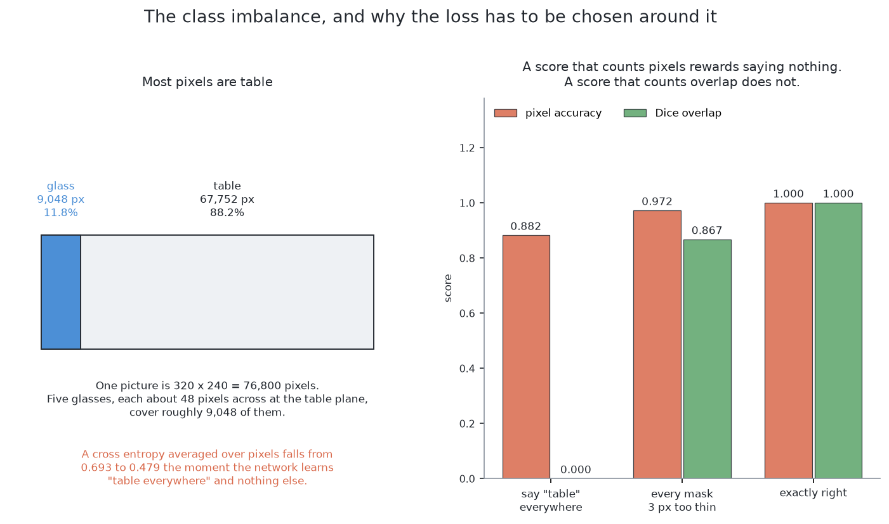

The general lesson: **a score that rewards saying nothing will be won by a
network that says nothing.**

## The second head: which way is the middle of my own glass

The first head cannot say which glass is which. The second head adds that. It
adds two output channels, the two parts of an arrow. The shape and the training
recipe stay the same. That is why the two heads are one network.

### Why the arrow is an easier question than it looks

The arrow goes from a pixel to its glass's middle. So the longest possible
arrow is half the widest glass footprint. Every target is a pair of numbers in
a small, known range. **A bounded target is much easier to fit.** The network
never has to produce a large number.

The arrow loss counts **only glass pixels**. A table pixel has no glass to
point at, so it has no correct arrow. The arrow loss is multiplied by the mask
before it is summed.

The loss also limits the pull of a few wild pixels. Pixels at a glass's edge
may belong to either of two glasses, so their arrows can be far off. A loss
that squares every error would let them drown out the many good pixels.

### Which frame the arrow is measured in

There are two sensible choices, and they give the network two different jobs.

**The arrow can be measured in the picture**, as so many pixels across and
down. The built network does this. That is why it gets the position channels:
the same glass needs a different arrow near the middle of the frame and near
the edge.

**Or the arrow can be measured on the table.** Depth plus the camera's pose
turns a pixel into a point on the table. An arrow measured there does not
depend on the camera. The same glass gets the same arrow wherever it appears.
The cost is that the arrow then needs depth at run time. The picture-frame
arrow does not. That matters because real glass returns almost no depth.

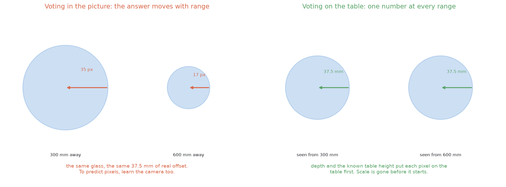

## From votes to glasses

Each glass pixel now has a vote. The next step turns the cloud of votes into a
count of glasses.

**What is built.** Every vote is added to a tally the size of the picture. The
tally is smoothed a little, so nearby votes add up. The highest point is taken
as a middle, and its votes are set aside. Then the next highest is taken. This
stops when no point has enough votes for a glass. The pixels whose votes landed
near a middle form that glass.

**The published method is mean shift** (Comaniciu and Meer, 2002). Put a round
window on one vote. Move it to the average of the votes inside. Repeat until
it stops. Votes whose windows stop at the same place are one pile. Mean shift
does **not** need to know how many piles to expect. That matters here, because
the count is the answer.

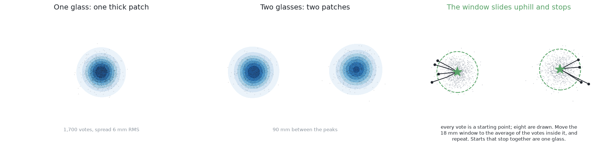

Both methods have one setting: how close two votes must be to count as one
pile. It has a floor and a ceiling, fixed before any run.

- **Floor**: the spread of one glass's votes. A smaller window finds lumps
  inside one pile, so one glass becomes several.
- **Ceiling**: half the closest distance two middles can have. That is two of
  the narrowest glasses standing as close as the cell allows. A larger window
  covers both middles, so two piles merge.

There is plenty of room between the two. A careless choice fails quietly. A
window too large merges exactly the pairs this solution exists to split. The
merged pile still looks tight, so nothing complains.

Two checks go with the counting. The first is built; the second is a design.

**A pile needs enough votes.** A whole glass casts many votes. A pile with only
a small part of that is doubtful, even if it is tight. This catches a glass
seen only as a crescent down one edge. Its votes agree with each other but are
wrong together.

**A pile needs a believable width.** Fit a circle on the table to the pile's
pixels. If the width is outside the kind's range, do not report a glass. The
network proposes; a written rule decides. This keeps the solution inside the
same safety argument as rules on the table. The [code
README](../../02-train-from-scratch/README.md#what-this-does-not-do)
says why this check, tried inside one picture, did worse than nothing.

## The two ways: where the labels come from

Nothing so far says where the training labels come from. There are two answers.
The network, the heads, the votes and the checks stay the same in both. **Only
the source of labels changes.** So they are two ways of one solution, not two
solutions.

The first way takes labels from the examiner's answer key. They are free and
exact. The second way takes labels from the arm's own movement. They are
neither free nor exact, but they buy something else. The second way is the
main point of this page.

## The first way — labels from the answer key

The examiner renders every picture, so it also has an **id image**. At each
pixel it says which glass that pixel shows, or none. [What the examiner keeps
to itself](../the-examiner.md#what-the-examiner-keeps-to-itself) gives the
rule: a method may train on id images from the training arrangements, and
never sees one while answering.

Both heads' labels come from the id image by arithmetic:

- **First head**: the id image with the identities dropped. A pixel is glass if
  the id image names any glass there.
- **Second head**: a subtraction. The target arrow is the glass's middle minus
  the pixel's position. The examiner placed each glass, so both are known
  exactly.

So the labels are free and contain no judgement. That is why training from
scratch makes sense here.

The weakness is what the labels depend on. The id image is the simulator's
record of what it drew. A real camera has no such record. So on the day the
cell meets real glasses, someone must draw labels by hand. The second way
removes that need.

## The second way — labels from the arm's own movement

The second way trains the same network with no answer key. It reads nothing
from the simulator's record, not even in training.

It uses one fact about this cell. **The camera is on the wrist, so the arm
knows exactly how it moved the camera between two pictures.** The movement is
commanded and read back from the joint encoders, not estimated from pictures.
Take two pictures of a still scene. Geometry then says where each surface point
must land in the second picture, given its distance. Points on one glass move
together. Points on a glass at another distance move by another amount. **That
agreement is the label.**

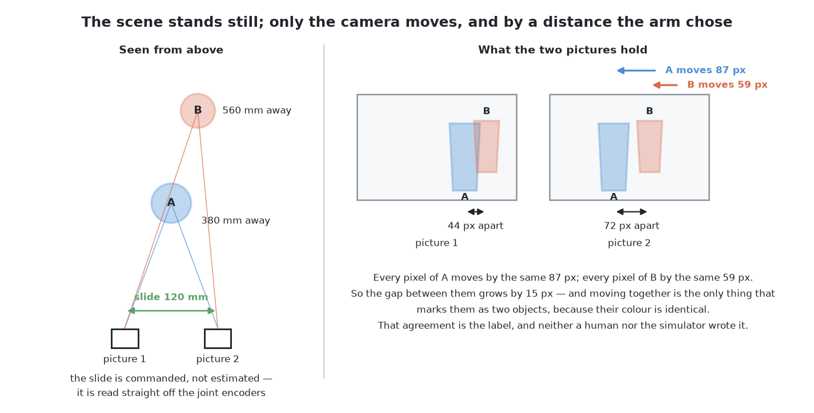

### Parallax: the shift goes as one divided by the depth

This effect is **parallax**. When the camera slides sideways, a surface moves
across the picture by the slide divided by its distance. Near things move a
lot. Far things move a little.

Two facts follow. First, the shift goes as one over depth. So a depth
difference matters a lot close up and very little far away. Second, the gap
between two surfaces' shifts grows in step with the slide. **A longer slide
gives proportionally more separation.** So the arm can choose in advance how
far to move to settle a doubt.

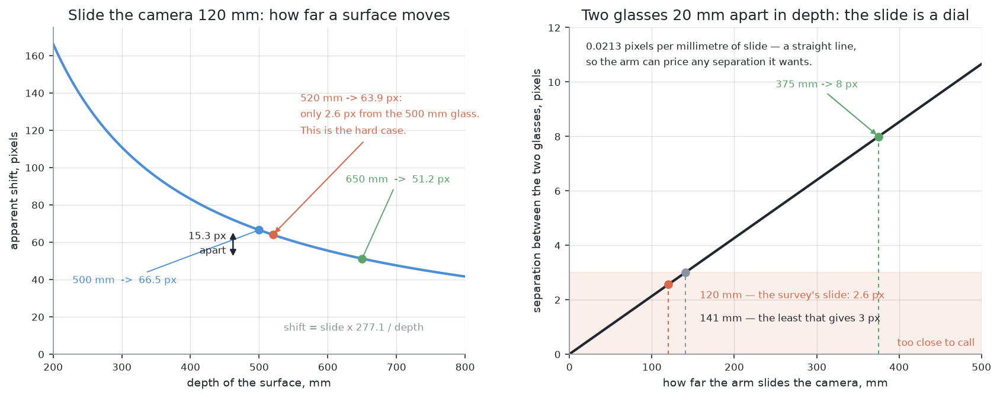

### Why the slide has to be sideways, and why the top view is the weak case

Parallax separates two glasses only if the depth gap *between* them is much
larger than the range of depths *within* each one.

**From the top, this fails twice.** Two glasses of one kind have rims at about
the same height, so there is almost no depth gap between them. And each glass
runs from its rim down to the table, so each covers a wide range of depths, the
same range for both. Two overlapping ranges of shifts cannot be told apart,
however far the camera slides.

**From the side, it works.** A glass behind another is much further back than
either is wide. The gap between them is large, and each covers only its own
width in depth. The two sets of shifts land far apart. The arm already slides
the camera sideways at each survey station, because a station takes two
pictures a short distance apart. A slide for labels is the same movement, just
longer and from the side.

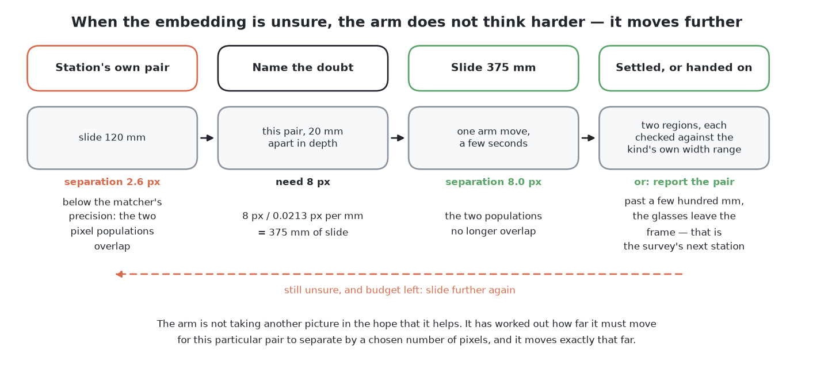

So this way's labels come mostly from side pictures. **That means its labels
are weakest for the hardest case: the merge in a picture from the top.** It
still trains the top-view network, because training and running are separate.
At run time it gets the same input as every other solution. But its
supervision for the merge is weaker than the answer key's. That is the price of
not reading the answer key.

### What an embedding is

The first way could build the arrow targets directly, because the answer key
names each pixel's glass. Movement gives less. It says only whether two pixels
belong together. It does not say which glass, or how many glasses. So the
network's output changes shape to an embedding.

An **embedding** is a short list of numbers the network gives at every pixel.
**Two lists close together mean the two pixels belong together.** The numbers
mean nothing on their own. Only the distances between lists carry information.

Think of a map with no names and no scale. Each pixel gets a spot on the map.
Pixels of one surface share a neighbourhood. Pixels of another surface sit in
another one. Grouping pixels means reading the neighbourhoods off the map.

### What contrastive training does

Movement gives labels of exactly the right kind for an embedding.

Two pixels whose shifts agree within the noise form a **positive pair**: same
surface. Two pixels whose shifts differ by clearly more than the noise form a
**negative pair**: different surfaces.

**Contrastive training** turns those pairs into a loss. Pick a pixel, its
positive partner and a few negatives. The loss is low only when the partner is
closer on the map than every negative. So training **pulls** positive pairs
together and **pushes** negative pairs apart. Over many pairs, each surface's
pixels gather in one place. Nobody ever says what a glass is.

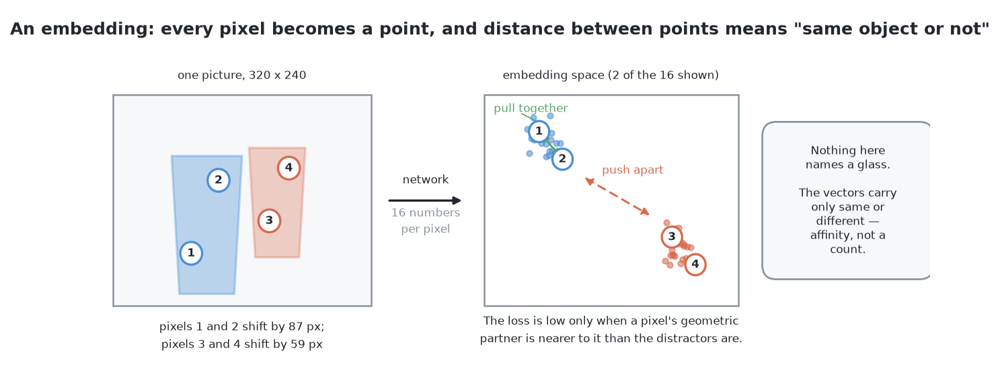

What it gets right: the embedding splits where the **depth jumps**, not where
brightness changes. So two identical glasses are no harder than two different
ones. A method based on looks fails on exactly that case.

What it misses: **an embedding does not name or count glasses.** Something else
must decide how many neighbourhoods there are. So the lists are grouped, and
each group goes through the same checks as the first way's piles: enough
pixels, a circle fitted on the table, and a believable width. The grouping
step plays the part of mean shift, with the same one setting and the same two
limits.

So the check after the network matters most here. A merged pair comes back
from an embedding as one tidy region, with no warning at all.

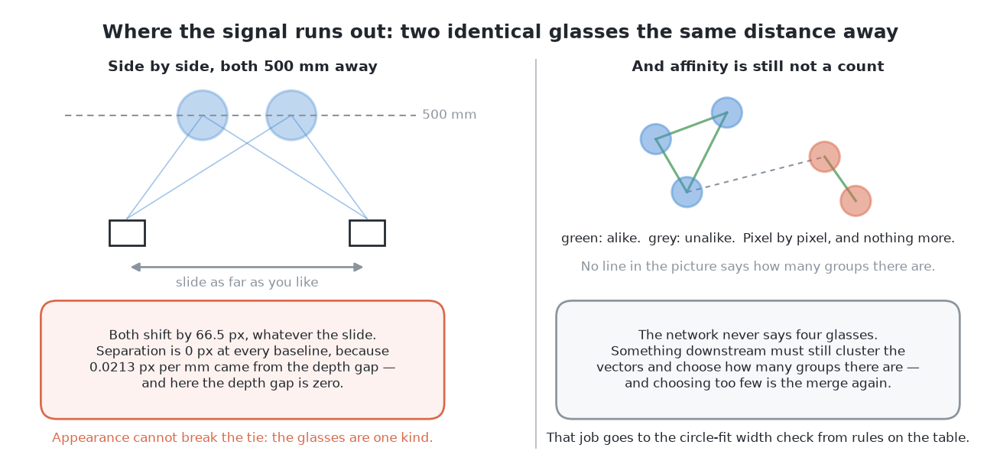

### What this way buys and what it costs

It buys one thing, for the future. **This is the only way whose labels a real
arm also has.** A real arm has joint encoders and a wrist camera. That is all
this way needs. Every other solution trained in this cell, including the first
way, uses labels that exist only because the pictures were rendered. All of
them would need new hand-drawn labels on real hardware. This one would not.

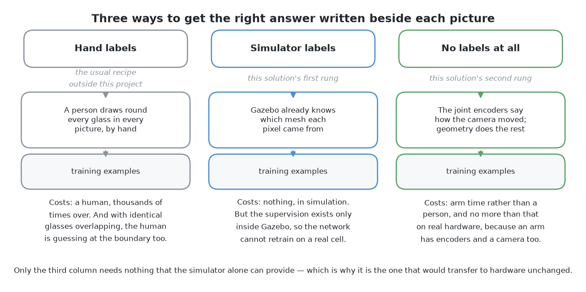

It costs three things:

- The labels are **weaker**, and weakest where the problem is hardest.
- The labels are **not free**. Each needs an arm movement, which takes seconds,
  where a render takes milliseconds.
- It needs texture to match between two pictures. A plain surface of one shade
  gives it nothing.

The conclusion: build the first way for this problem. Use the second way when
the cell leaves the simulator. This cell has a working depth camera, which
already measures what parallax would infer. The second way earns its place
only when that stops being true.

## The training set

Both ways need a set of arrangements to learn from. Two choices about that set
decide whether the network works.

**Include the hard case.** The cell's own rule keeps glasses well apart. A
training set drawn only from that rule never shows a pair that simple
arithmetic could not split. So the network must see pairs much closer than the
rule allows. That is what the examiner's crowded arrangements are for. Keep
easy cases too, or the network learns that there is always a pair to find. **The
edge of the specification should sit in the middle of the training set**, so
the network has seen worse than it will meet in use.

**Vary everything that is not shape.** A simulator renders the same table under
the same light every time. A network will use any constant as a clue. If the
table is always one shade, the network can learn "glass is whatever is not that
shade". That scores perfectly on held-out pictures from the same renderer. Then
someone changes a light, and it fails, and no number showed the risk. **Domain
randomisation** is the fix. Vary the lighting, the table's colour and texture,
the glass tint, the exposure, the noise, the camera pose and the number and
placement of glasses. Vary them more widely than expected. Then shape is the
only reliable clue (Tobin and others, 2017,
[arXiv:1703.06907](https://arxiv.org/abs/1703.06907)). This is a design; the
built training set uses one fixed setting.

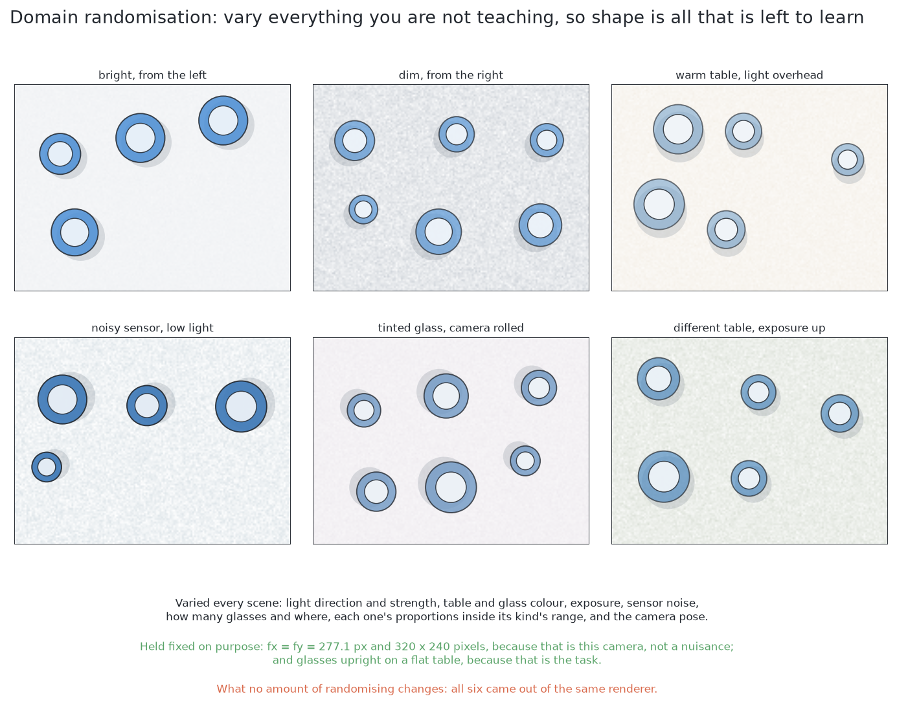

One thing is **not** varied: the lens. The focal length and picture size are
facts of this camera. Teaching the network other lenses would waste its small
capacity.

The split between training and test is the examiner's. A network is never
tested on an arrangement it learned from.

## The masks are what this contributes

This solution hands over only the masks. The examiner turns each mask into a
place and a width, the same way for all six. [What must come
back](../the-examiner.md#what-must-come-back) explains this, and why no model
here produces a pose.

## How the concepts fit together

Here is the whole chain in order:

1. A survey picture goes in, with height and two position channels.
2. The network gives a glass **probability** and an **arrow** at every pixel.
3. The probability, thresholded, is the **mask**.
4. Each mask pixel adds its arrow to its position and casts a **vote**.
5. The votes form one pile per glass. Nothing says how many to expect.
6. A pile with too few votes is doubted. A pile with an impossible width would
   be refused, once that check is built.
7. Each surviving pile is one mask, handed to the examiner.

Three ideas carry the chain:

- **The output shape makes the merge answerable.** A class map has no room to
  say which glass. An arrow does.
- **The loss is what most often goes wrong.** A pixel-count loss rewards an
  empty answer; an overlap loss fixes it.
- **The written checks after the network keep it honest.** The network
  proposes; the vote count and the width range decide.

## When the glasses are completely hidden

A glass can be fully covered in every picture. [Looking again at what was
hidden](../hidden-glasses.md) is the shared answer for all six solutions. This
section covers only what is special to this one.

**This solution is good at a partly covered glass.** Other methods split two
glasses by finding something between them: a gap, a strip of table, a seam.
Here each glass pixel votes for its own middle. A glass left with only a
crescent still votes. Its votes need not touch each other or form a shape.

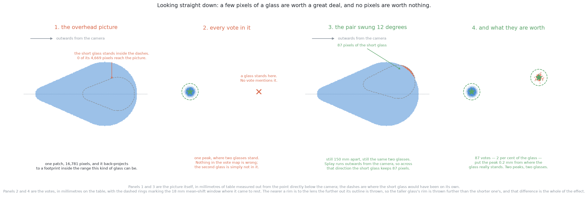

**Fully covered, it has no alarm.** Both of its warnings measure votes: how
many a pile holds, and how far they spread. A hidden glass casts no votes. The
tally just has one peak where two glasses stand.

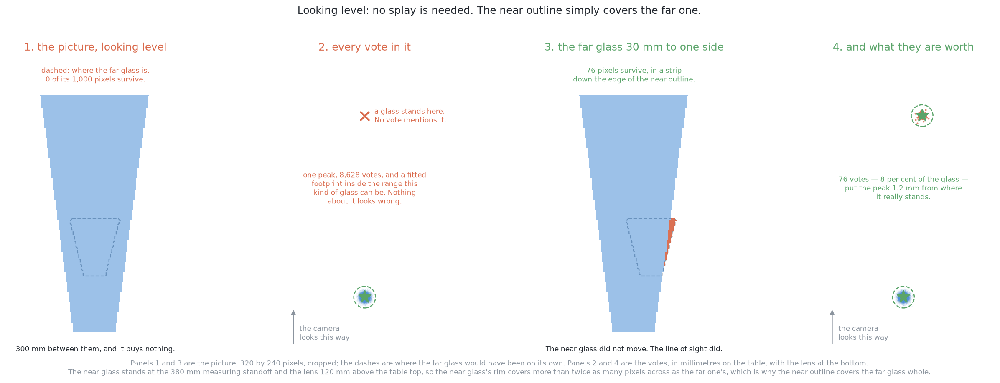

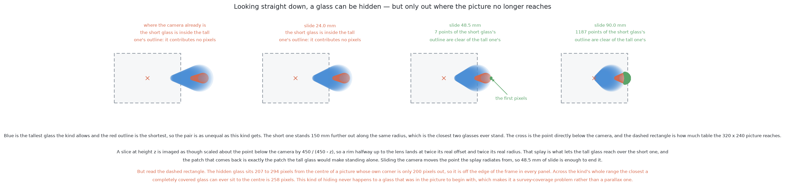

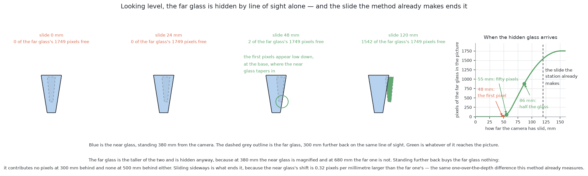

## A worked example

This follows one crowded arrangement, the case this solution exists for.

**On the table.** Two glasses of one kind stand much closer than the cell's
rule allows. This is the examiner's crowded family. A little bare table is left
between their rims.

**In the picture.** Splay throws both outlines outwards, and they join. A flood
fill on the mask gives **one** shape. It is wider than any glass of this kind.
A width rule notices something is wrong, but a class map cannot say where to
cut.

**In the votes.** The pixels are still joined. The votes are not. Each glass's
pixels point at their own middle. So the votes form two piles, a full
middle-to-middle distance apart. That is well beyond the counting window. Both
piles are tight and full, and both fitted widths are believable. **Two
glasses, two masks, from pixels that never came apart.**

**The case that beats the votes.** Now stand one glass mostly behind the other.
Only a crescent of it shows. It casts few votes, and they all come from that
crescent, so they are wrong in the same direction. The pile lands off the true
middle and spreads wide. The short count is the built alarm. The wide spread is
the second, designed alarm. Both measure the votes, not the network's own
opinion. The pair is reported as one the arm could not separate, with the
reason. The problem counts that as a result, not a failure.

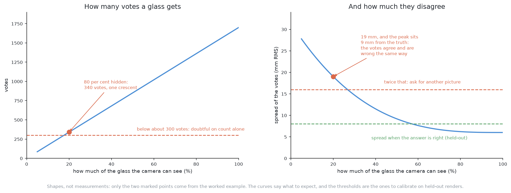

**Time.** One network pass takes milliseconds. One arm move takes seconds. So
this solution computes freely and moves rarely. Its cost is in building it, not
running it.

## What it needs

This is the hardest of the six to set up.

- **PyTorch**, on the integrated graphics. Nothing is downloaded, so there is
  no licence condition.
- **A training set.** The first way needs examiner renders with id images,
  which cost only render time. The second way needs picture pairs with the
  camera's movement logged, which cost arm time.
- **A training run** before it can answer anything. The network and pictures
  are small, so the run is short and can be repeated whenever the cell changes.
  The [code README](../../02-train-from-scratch/README.md#what-it-costs)
  gives the time.
- **A file of weights that matches the cell.** This cost is easy to forget. The
  code says what the cell is. The weights say what the cell looked like when
  they were trained. Change the lighting, the camera or a kind's range, and the
  weights are out of date. No code test will notice.

At run time it needs one pass of a small network, which is tiny beside an arm
move.

## Where it is strong and where it breaks

Strong:

- **No domain gap.** It learned only from this cell, so it is the fair
  baseline for the borrowed models.
- **It splits glasses that touch in the picture**, because [nothing has to find
  a boundary](#the-main-idea).
- **It handles a partly hidden glass**, because a crescent still votes.
- **Its doubt is measured from the votes**, not taken from the network's own
  opinion. The built code measures the count.

Weak:

- **It cannot see a fully hidden glass.** No pixels means no votes. That is a
  limit of the input, not the model.
- **It needs a training set and a training run** before it answers anything.
  [YOLO as it downloads](03-yolo-zero-shot.md) works on day one.
- **It cannot explain itself.** A wrong circle fit can be traced to one number.
  A wrong network can only be guessed at. The written checks around it make
  this bearable.
- **Its weights are a second copy of the cell** that must be kept in step.
  Rules on the table has no such job.

## The general ideas behind this

Each idea below is standard. Two things here are unusual: training from random
weights on rendered pictures, and asking one network both a class question and
an instance question.

### Semantic segmentation — a class label at every pixel

Label every pixel instead of drawing a box. **Fully convolutional networks**
made this practical (Long, Shelhamer and Darrell,
[arXiv:1411.4038](https://arxiv.org/abs/1411.4038)). They map a picture of any
size to a label map of the same size. It is used in medical, aerial and
inspection images. It cannot separate objects of one class, which is what the
second head adds. See [image
segmentation](https://en.wikipedia.org/wiki/Image_segmentation).

### The encoder–decoder with skip connections

This is the U-Net from [the shape of the network](#the-shape-of-the-network).
It was designed for medical images with very few training examples, which is
why it suits a small rendered training set. It is still the default for small
segmentation problems. A large pre-trained network does better when a problem
needs a broad view of many classes.

### Overlap losses — scoring the shape rather than the pixel count

The Dice loss is explained in [the first
head](#the-first-head-which-pixels-are-glass). **Intersection over union** is a
close cousin. Both are used where one class is rare, as in most medical and
industrial work. They are usually added to cross entropy, not used alone,
because an overlap score says nothing about how sure each pixel was.

### The Hough transform — local evidence for a global claim

One edge pixel cannot say where a shape is. But it can vote for every shape
that would explain it. Sum the votes, and the peaks are the real shapes.
Hough's 1962 patent did this for straight lines. The **generalised Hough
transform** (Ballard, 1981) extended it to any shape with a table of offsets.
Voting copes well with hidden parts, because the visible part still votes
right. It does badly for shapes with many parameters, because the vote table
grows too fast. See the [Hough
transform](https://en.wikipedia.org/wiki/Hough_transform).

### Learned voting — replacing the table of offsets with a model

**Hough forests** (Gall and Lempitsky, 2009) first learned the table of
offsets. Neural versions followed. In **VoteNet**
([arXiv:1904.09664](https://arxiv.org/abs/1904.09664)), depth points vote for
object middles. In **PVNet** ([arXiv:1812.11788](https://arxiv.org/abs/1812.11788)),
pixels vote for landmark points, because voting survives hidden parts. These
suit cluttered scenes and bin picking. They suit objects with no clear middle
badly, and also large offsets, because the votes then scatter.

### Mean shift — finding peaks without being told how many

Explained in [from votes to glasses](#from-votes-to-glasses). It is used in
tracking and colour segmentation. It is slow with many dimensions, and one
window size cannot suit groups of very different density. See [mean
shift](https://en.wikipedia.org/wiki/Mean_shift).

### Self-supervised learning — labels from the structure of the data

Instead of labelling by hand, build a task whose answer is already in the data.
The labels are then free and unlimited. The second way does this, with the
arm's encoders as the source of labels. It suits robotics well, because a robot
always knows its own position. The hard part is a task with no shortcut, one
the network cannot solve without the understanding you wanted. See
[self-supervised
learning](https://en.wikipedia.org/wiki/Self-supervised_learning).

### Geometry as supervision, and depth without depth labels

If the camera's movement between two pictures is known, a point's place in the
first picture and its depth fix its place in the second. This is the
**epipolar constraint**. It turns a depth guess into a prediction that can be
checked. **SfMLearner** (Zhou and others,
[arXiv:1704.07813](https://arxiv.org/abs/1704.07813)) trained depth this way
with no depth labels. **Monodepth2** (Godard and others,
[arXiv:1806.01260](https://arxiv.org/abs/1806.01260)) fixed most of its
practical faults. Those methods must *estimate* the camera's movement, and
much of their error comes from that. Here the movement is commanded, so that
error is gone. The approach fails on plain surfaces and on scenes that move
between pictures. See [structure from
motion](https://en.wikipedia.org/wiki/Structure_from_motion).

### Grouping by shared motion — common fate

Points on one rigid surface move together; points at another distance do not.
Gestalt psychology calls this **common fate**: birds that turn together are one
flock. It needs no model of looks, so it works on two identical glasses. It
fails where nothing moves relative to anything else. That is why the second
way is weak from the top.

### Contrastive training — turning "these belong together" into a loss

Explained in [what contrastive training does](#what-contrastive-training-does).
The standard references are **SimCLR** (Chen and others,
[arXiv:2002.05709](https://arxiv.org/abs/2002.05709)) and **MoCo** (He and
others, [arXiv:1911.05722](https://arxiv.org/abs/1911.05722)). Giving each
pixel an identity code and grouping the codes is **associative embedding**
(Newell and others, [arXiv:1611.05424](https://arxiv.org/abs/1611.05424)). On
its own it cannot count groups. The checks after the network fill that gap.

### Training from scratch against fine-tuning a large model

Fine-tuning wins when labels are scarce, which is almost always. Training from
scratch wins only when labels are free, the problem is small, and borrowed
weights would bring knowledge of a different world. This cell is that rare
case. Do not generalise from it.

## Where it sits among the other five

This solution's place in the comparison comes from borrowing nothing, not from
its score.

Against [rules on the table](01-rules-on-the-table.md), the question is whether
a learned grouping rule beats a written one. The written rule explains its own
failures and needs no training. When depth readings work, it is the easier
tool. This solution earns its place where two glasses leave no gap to find.

Against the four borrowed models, this solution is the baseline. [YOLO as it
downloads](03-yolo-zero-shot.md) borrows everything and trains nothing. [YOLO
fine-tuned](04-yolo-fine-tuned.md) and [RF-DETR
fine-tuned](06-rf-detr-fine-tuned.md) borrow a start and then train on this
cell. [SAM 2 with a keeper](05-sam2-with-a-keeper.md) borrows a large model and
trains only a small decider. **If they do no better than this network, their
size and licences bought nothing here.**

One pair is especially clear. The two YOLO solutions share the same model and
starting weights. The only difference is training on this cell's pictures. So
the gap between those two measures what training bought. The gap between this
solution and the pair measures what the starting weights bought. The full
table is in [the results](../../results/README.md#the-results).

← [Rules on the table](01-rules-on-the-table.md) · [YOLO as it
downloads](03-yolo-zero-shot.md) →
