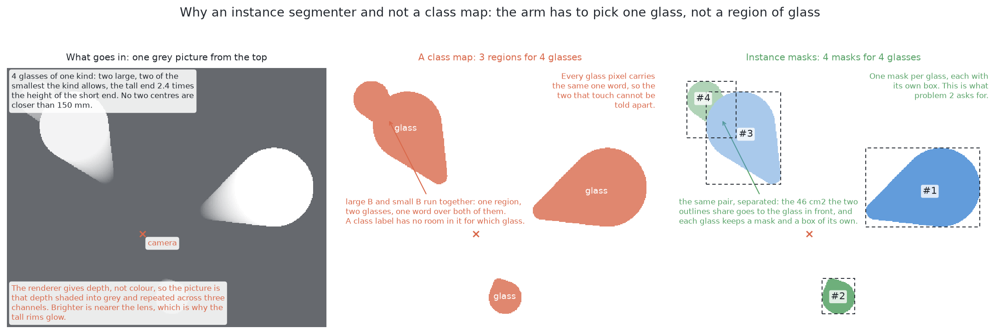
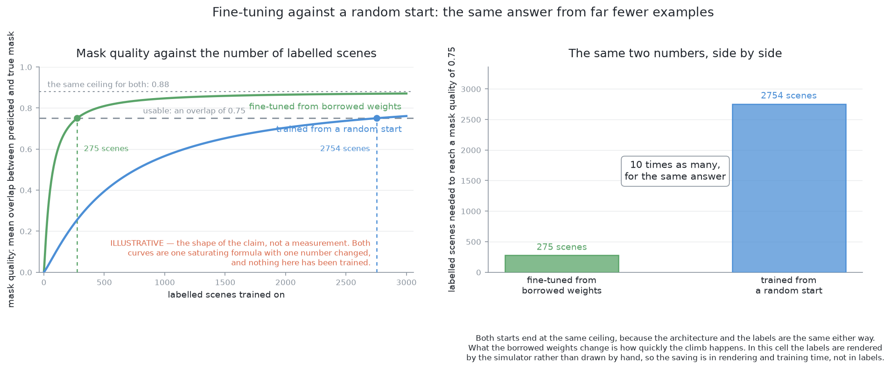

# Solution 4 — the same model, fine-tuned here

> **What it uses** — the Ultralytics package, with PyTorch running on this
> machine's integrated graphics through its MPS backend. The model is
> Ultralytics YOLO26-seg. It is the same library, model and downloaded weights
> as [solution 3](03-yolo-zero-shot.md). Here its training continues on this
> cell's own pictures, and its list of everyday categories becomes one class,
> "glass".
> **What it does** — it keeps the borrowed model's numbers and trains them
> further on pictures of this cell. The model stops being a general describer of
> photographs. It becomes a finder of glasses in this room. Its outlines are the
> answer to problem 2.
> **How the output is produced** — the examiner hands over three survey pictures
> from the top, one per station, and each is asked about on its own. For each
> thing it finds, the model returns a box, a confidence number and an outline.
> Candidates that overlap a better one too much are dropped. Outlines above a bar
> are kept, and each one is a mask. The examiner's shared arithmetic turns a mask
> into a place and a width.
> **How it differs from the other five** — it is solution 3 with training added,
> so the two form a matched pair. [Where it sits among the other
> five](#where-it-sits-among-the-other-five) compares it with the rest.
> **What it costs** — labels are free, because the examiner's id image gives an
> exact mask for every glass. Training takes 39 minutes on this machine. The
> licence is the expensive part: YOLO26-seg is AGPL-3.0, and so is any weights
> file fine-tuned from it.

> **The cell is described once, in [the cell](../../../01-rack-one-glass/docs/the-cell.md)** — the
> layout, the two places the camera works from, from the top and from the side,
> all four sensors, and the words this project uses them with. What follows is
> only what is specific to this solution.

## Introduction

This document answers problem 2 with **fine-tuning**. Fine-tuning takes a model
already trained elsewhere and continues its training on pictures of this cell.
It is the standard way to put a borrowed model to work. This document writes it
out in full so that its value can be measured.

Most of this document was written before the solution ran. Its scores are in
[`04-yolo-fine-tuned/README.md`](../../04-yolo-fine-tuned/README.md)
and in that folder's `results.json`. Where the text says what the method would
do, read it as what the design expected. The places where the marking has since
answered a question say so.

**This solution is one half of a matched pair.** [Solution
3](03-yolo-zero-shot.md) is this model with no training here. This is the same
model with training here. The [examiner](../the-examiner.md) holds the
pictures, the output and the marking still. The two solutions also share the
library, the model and the starting weights. Only the training differs. The
training brings one more change: the list of everyday names becomes the single
class "glass". You cannot train towards this cell's labels and keep the old
names, so that change is part of the training. **So the gap between solution 3
and this one measures what fine-tuning buys, and nothing else.**

By the end you will know what fine-tuning is and why it needs little data. You
will know what one class removes, where the training set comes from, and what
training repairs and what it cannot. You will also know the two ways training on
one cell's pictures can go wrong.

## The code that does the work

Training is the one thing that separates this solution from [solution
3](03-yolo-zero-shot.md). So the piece to read first is the fitting step.

The fitting step is in
[`04-yolo-fine-tuned/yolo_fine_tuned.py`](../../04-yolo-fine-tuned/yolo_fine_tuned.py).
`borrowed()` is the downloaded file, the same one solution 3 runs untouched.
`dataset.build` writes the examiner's scenes out as pictures and label files, in
the shape Ultralytics reads. `model.train` is the one line where the borrowed
library does the training.

```python
def fit(examples: Iterable[data.Example], *, amodal: bool, save: Path, epochs: int = EPOCHS) -> Mapping:
    ...
    from ultralytics import YOLO

    described, counts = dataset.build(fitting, checking)
    model = YOLO(str(borrowed()), task="segment")
    model.train(
        data=str(described),
        epochs=epochs,
        imgsz=PICTURE,
        batch=BATCH,
        device=device.pick(),
        ...
        seed=FITTING_SEED,
        deterministic=True,
        plots=False,
        verbose=False,
    )
    shutil.copy(model.trainer.best, save)
```

The fitted model's answers then go through `Finder.find`, in the same file. It
is short because there is one class, so there is no filter on names. The only
check left is the width check against the kind, with an exemption for a glass
the frame cut short.

```python
    def find(self, picture, kind: str) -> tuple[list[Found], list[str]]:
        ...
        narrowest, widest = data.widths(kind)
        kept: list[Found] = []
        doubts: list[str] = []
        for mask in self.candidates(picture)[0]:
            found = masks_to_glasses.one_glass(picture, mask)
            if found is None:
                doubts.append(TOO_LITTLE)
            elif narrowest <= found.width <= widest or found.cut_off:
                kept.append(found)
            else:
                doubts.append(NO_SUCH_WIDTH)
        return masks_to_glasses.one_per_place(kept, narrowest), doubts
```

Solution 3 calls the library once, to ask about a picture, and then filters
borrowed names. This one calls it twice: once to train and once to ask. It
holds no list of names. The width check is the one difference the training did
not bring. [The masks are what this contributes](#the-masks-are-what-this-contributes)
says what it is for.

## The problem this solves

Problem 2 asks for one record per glass: a mask, a place and a rough width. Its
second difficulty is the one a model attacks. Two glasses that stand apart can
still [merge into one shape in the
picture](../problem.md#glasses-merge-in-the-picture-even-when-they-stand-apart-on-the-table).

A model that finds objects returns **one outline per object**, not one per
connected shape. Solution 3 already borrows such a model. So the question here
is narrower: **once the finding is borrowed, what is still wrong, and does
training fix it?**



Solution 3 has three problems, and they share one cause. The model learned on
photographs, and this cell renders grey pictures shaded from depth. First, the
model may find the glasses poorly. Second, its names belong to somebody else, so
a glass can be named twice or named out of the answer. Third, its confidence
number was set on photographs, so a bar on it means little here. [The domain
gap](03-yolo-zero-shot.md#the-domain-gap-which-is-the-main-risk) in solution 3
explains the cause. Training on this cell's own pictures is the standard repair
for all three.

## The main idea

Keep the borrowed numbers. Continue training them on the pictures the model
will really see. Use one class instead of the general list.

Three things follow.

**The numbers do not start from nothing.** The borrowed weights already know
basic things, such as that an edge matters. Training starts from them. That is
why a model of this size can be trained on this machine, which has no separate
graphics card.

**The pictures are this cell's pictures.** Solution 3 shows a photograph model
a grey depth picture. This solution shows the model grey depth pictures during
training. So at run time it sees the kind of picture it was trained on. This
closes the domain gap.

**The class list has one entry.** The model no longer decides which everyday
object it sees. It only finds instances, and each one is a glass or a mistake.

The model's outline is still built coarsely, and training cannot make it fine.

## Fine-tuning — continuing somebody else's training

Fine-tuning is the one thing that separates this solution from its partner, so
this section explains it. [Solution
2](02-train-from-scratch.md#what-a-network-is-and-what-training-from-scratch-means)
explains what weights and training are.

**Training from a random start** begins with weights that are noise. Training
has to build every part of the model. **Fine-tuning** begins with weights that
somebody else's training already settled. Training has much less to do.

Why is it cheaper? Every weight is a number the data has to pin down. If the
data cannot pin a weight down, the weight fits accidents of the examples. So the
data needed grows with the number of weights learned from nothing. In
fine-tuning, most weights already work. The data only has to adjust them.

A maths comparison helps. A random start is like finding every coefficient of a
long polynomial with no idea of any of them. Fine-tuning is like adjusting a
polynomial that already fits a similar curve. The second needs far fewer points.



There is also a saving in time. The early layers of a picture model detect
edges, corners and smooth shading. Those carry over almost fully. A grey depth
picture is full of edges. A rim against the table is a big jump in depth, and
so a big jump in grey. A random start spends much of its training
finding those detectors again. Fine-tuning does not. Only the later layers have
to change: what counts as an object, and where its edge lies.

That is an expectation, not a result. The early layers carry over best. The
later layers carry over worst, because they judge by colour and texture, which
this cell does not render. So fine-tuning has more work to do here than usual,
but still far less than a random start.


## What one class does

The class list is the other change, and its effect is large.

Solution 3 must accept a group of everyday names, as [its filter on
names](03-yolo-zero-shot.md#why-the-borrowed-names-are-a-filter-and-never-the-kind-of-glass)
explains. One class removes that whole step. The model is no longer asked
**what** it sees, only **where the instances are**.

Two of solution 3's failures go away.

**A glass can no longer be reported twice under two names.** With one class,
two candidates on one glass have the same class. The model's own step for
dropping overlaps keeps one of them. The duplicate never leaves the model.

**A glass can no longer be lost to a name the filter does not accept.** In
solution 3, a glass called a bowl or a vase is dropped. [The
examiner](../the-examiner.md) says **missed** is the count to watch hardest,
because a missed glass leaves no trace. With one class, no found object can be
named out of the answer.

One class does not give the kind of glass. That is not a loss. Every glass in
one arrangement is the same kind, and the kind is known.

## Where the training set comes from

Fine-tuning needs pictures with every glass already outlined. Here they cost
nothing.

The examiner renders an **id image** beside every picture. It says which glass
each pixel shows. A solution may train on it, but only on the training half of
the arrangements, and may never read it at run time. [What the examiner keeps to
itself](../the-examiner.md#what-the-examiner-keeps-to-itself) gives the rule.

The mask for one glass is the set of pixels with that glass's id. The label is
the outline round those pixels, with the class "glass". No person draws
anything.

**This is a privilege of the simulator.** On real photographs, labelling is the
most expensive part of the work. A person outlines every object by hand, slowly,
and two people never agree. [Solution
2](02-train-from-scratch.md#why-nothing-is-borrowed-and-what-that-buys) makes
the same point. Any judgement about whether fine-tuning is worth its price here
should carry that with it.

Free labels still need a good mix. The training set holds crowded arrangements
as well as ordinary ones, so the model meets pairs that are hard to separate.
[The training set](02-train-from-scratch.md#the-training-set) in solution 2
explains why the hard case belongs in the middle of the training set.

## What training closes, and what it cannot touch

The matched pair exists for this section. Training repairs some of solution 3's
weaknesses and leaves others alone.

**The domain gap closes.** A model used across a domain gap gives confident,
wrong answers. Fine-tuning removes the gap, because the model trains on the
same kind of picture it is asked about. The grey shading, the missing
transparency and the leaning outline are simply what a glass looks like to this
model.

**The naming failures close.** There is one class, so a glass cannot be named
twice or named out.

**The confidence number becomes good enough to set a bar on.** The next section
says more.

**The coarse outline does not close.** The model builds each outline from a
short weighted sum of coarse patterns, then enlarges it. [How the outline is
produced](03-yolo-zero-shot.md#how-the-outline-is-produced-and-why-it-is-approximate)
in solution 3 explains this. Training cannot make a coarse outline fine.

Two results were expected from that. The marking tested both. One was wrong and
one was right.

**A thin stem was expected to be lost first.** It is not. After training, the
model covers the stemmed glass as fully as the two kinds with no stem. A
solution of hand-written rules does lose the stem. Teaching the model that the
stem is part of the glass is enough.

**The edge stays approximate, and the width is read from the edge.** An outline
a little too wide reports a glass a little too wide. The enlargement step errs
the same way each time, so the error does not average out. Training moves the
error. It does not remove it.

The marking confirms this. The masks almost always cover the whole glass. They
also almost always carry a thin margin of pixels that are not glass. That margin
is the approximate edge. The written rule of solution 1 does better here: it
claims less of the glass, but nothing that is not glass.

**A partly hidden glass stays a problem.** The outline is **modal**: it marks
only pixels the camera saw. A glass partly behind another gets an outline that
is a slice of its silhouette. The examiner then reports a smaller glass in the
wrong place. The training labels have the same limit, so training cannot repair
it. Training towards the whole silhouette would, and that is [solution
6](06-rf-detr-fine-tuned.md)'s choice.

**A completely hidden glass stays invisible.** That has its own section below.

## The number beside each outline

Each outline comes with a confidence number. Training changes what it is worth,
a little.

Solution 3's number was set on photographs, so a bar on it is only a hand-set
knob. [The number beside each
outline](03-yolo-zero-shot.md#the-number-beside-each-outline-and-why-it-is-not-a-probability)
in solution 3 explains calibration and why. Here the number comes from weights
trained on this cell's pictures, so it has a better claim to mean something.
That claim should be checked: choose the bar on the training half, and measure
on the test half. A low bar reports bare table as glass. A high bar drops faint
glasses.

The bar was left at solution 3's value, 0.25, so that a moved bar is not
mistaken for what training bought. The
[README](../../04-yolo-fine-tuned/README.md) gives the
details.

One warning still holds. The same weights produce the outline and the number.
So the number says whether the thing is a glass, not whether its outline is
right. A glass whose mask was cut short by a neighbour can still score high.


## Two ways training on one cell's pictures goes wrong

Fine-tuning is cheap, but it has two risks.

**Catastrophic forgetting.** Training on a narrow set of pictures moves the
weights away from what they knew. The model gets better at this cell and worse
everywhere else. The everyday names are gone anyway. But the weights now
describe only grey depth pictures of opaque glasses. That is not a loss here,
because the model only ever sees this cell. It does mean the weights file must
be kept in step with the cell.

**Overfitting.** A model trained on few examples can learn the examples instead
of the glasses. It might learn where glasses tend to stand, or how many there
tend to be. It then scores well on its training pictures and badly on new ones.
Two things guard against this. The examiner marks only on the test half, so
overfitting shows as a gap between the halves. And free labels let the training
set be large and varied, at the cost of rendering time only.

The two risks share one point. Longer training closes the domain gap further,
but makes forgetting and overfitting more likely. So there is a right amount of
training, not a maximum. The test half decides where it is.

## The masks are what this contributes

The examiner, not the solution, turns a mask into a place and a width. So a
difference in score belongs to the mask. [What must come
back](../the-examiner.md#what-must-come-back) explains this step. This solution
and solution 3 both contribute only masks, so the gap between them is clean.

**One check stands between the model and the examiner, and solution 3 has
none.** The kind of glass is known, so the narrowest and widest footprint for
that kind are known. A candidate outside that range is reported as a doubt, not
kept. This is a limit on the kind, never the size of one glass. It can only turn
a reported glass into a doubt, never the reverse. So it cannot flatter this side
of the comparison.

**The check stands down when the frame cut the glass short.** One picture at
the survey height does not hold the whole glass zone. So a mask that reaches the
picture's edge is kept, whatever its width. A width read off part of a footprint
is not the glass's width. Two measurements showed this. With the examiner's own
exact masks, one station at a time over 20 held-out spawned scenes, the kind's
range refuses 66 of 297 glass sightings. Every one of those 66 reaches the frame
edge. And of this model's own refusals over eight of those scenes, all eleven
too-narrow ones touched that edge. So the check was refusing the view, not the
mask. Standing down is safe because the three stations overlap. Where another
station saw the glass whole, the examiner keeps that report.

So **this solution produces no pose.** [The examiner](../the-examiner.md) says
why, once for all six.

## How the concepts fit together

The whole pipeline is short, because almost all of it is borrowed.

Before anything runs, the model is trained once. Its weights came from everyday
photographs. Training continued on the training half of the arrangements, with
labels from the id image and with one class, "glass". At run time the examiner
hands over a grey depth picture, its depth readings and the camera's pose. The
model returns candidates, each with a box, a number and a coarse outline.
Overlapping candidates are reduced to one. Outlines above the bar are the masks.
The examiner turns each mask into a place and a width, and marks the result.

Three points matter.

**The finding was borrowed and the fitting was local.** The general part came
from somebody else's training. The specific part was learned here from free
labels.

**The domain gap closed and the coarse outline did not.** So this solution
should find glasses far more reliably than solution 3, while measuring their
edges in much the same way.

**The comparison is the product.** A measured answer to "what does fine-tuning
buy on this kind of picture?" is worth more than an opinion.

## When the glasses are completely hidden

A glass can be fully covered and leave no pixel in any picture. [Looking again
at what was hidden](../hidden-glasses.md) is the shared answer for every
solution.

**This is the one case where this solution and solution 3 must score the
same.** Training changes what a model does with pixels, and here there are none.
Nothing in the output raises a doubt either. The visible pixels belong to the
glass in front, which reports its own true footprint.

## A worked example

Follow one arrangement through, and compare it with solution 3.

**The arrangement.** Five stemmed glasses of different heights stand in the
glass zone. Two of them stand as close as the cell allows, roughly on a line
out from the point below the camera. The taller one is nearer that point. In the
picture from the top, the close pair makes one connected shape.

**What solution 3 would return.** The model would find shapes, and every
outline would have to pass the filter on names. A glass might arrive twice under
two names. Another might be named as something the filter drops, and be lost
without a trace. The model has never seen a picture like this, so how many it
finds at all is in doubt.

**What this solution would return.** The model sees the kind of picture it was
trained on, and the five glasses are five instances of its only class. Each
glass makes several candidates, and the overlap step reduces each group to one.
So five entries are expected. None can be lost to a name. The marking shows
that bowls and stems are both covered, with a thin margin of extra pixels at
the edge.

**Where the two would still agree.** The nearer glass of the close pair covers
part of the one behind it. Both solutions return modal masks, so both hand the
examiner a slice of that glass. The examiner reports it too narrow and in the
wrong place. Its width may still fit the stemmed kind's range, so nothing refuses
it.

**And the case neither can answer.** Full covering needs a kind with both short
and tall glasses, which is the tapered glass. So take tapered glasses instead.
Stand a short one just beyond the tallest, on the line out from the point below
the camera, close enough to be fully covered. It makes no pixels, so neither
solution reports it. The count comes back one short, and nothing looks wrong.
Only the shared geometry on [the hidden-glasses page](../hidden-glasses.md) can
raise that question.

So fine-tuning changes the first half of the example and not the second. The
finding becomes reliable and the naming failures go. The edge margin, the slice
of a hidden silhouette and the glass with no pixels stay.

## What it needs

It needs the **Ultralytics package** and the model's weights. The package
fetches the weights by itself. The file is large and comes from outside, so it
is not committed.

It needs **PyTorch** on this machine's integrated graphics, through MPS. Memory
is shared between the graphics and the main processor. That is what lets a model
this size train here at all.

It needs a **training set**, which the examiner renders and labels for free. It
needs **time on the machine** for training: far less than a random start, but
not nothing. It needs a **held-out half** to check the model learned glasses,
not arrangements. The examiner provides that.

Once trained, it needs **a weights file kept in step with the cell**. Change the
camera, the grey shading or a kind's range, and the file goes out of date. No
test of the code would notice. At run time it needs only one pass per picture.
The cost of this solution is in building it, not running it.

## The licence

YOLO26-seg is AGPL-3.0. [The licence](03-yolo-zero-shot.md#the-licence-which-is-the-real-cost-here)
in solution 3 explains what that means, including the network clause.

**This solution carries the condition twice.** Solution 3 only runs the
downloaded weights. This one makes a new weights file from them. A file derived
from an AGPL work is bound by the same terms. So the trained file is not an
asset the project owns outright, and training it here does not change its
licence.

That is accepted, because this folder only compares methods. If the method went
into a product, a permissively licensed model could replace it. [Solution
6](06-rf-detr-fine-tuned.md) already uses one, under Apache 2.0. What is tested
here is what fine-tuning buys, and that answer carries over to any model.

## Where it is strong and where it breaks

**It answers the question asked.** It returns one outline per object. No step
has to find a seam in a joined region.

**It is trained on the pictures it will see.** That is its main strength, and
solution 3 cannot claim it.

**Its labels cost nothing.** So the usual reason not to fine-tune does not
apply.

**It has little to set by hand.** Its two settings are the bar on the
confidence number and the overlap allowed. Both are plain numbers, and neither
is a length tied to the cell.

**It is one half of the cleanest comparison in the folder.** That is a strength
of the design, not of the model.

It has three kinds of weakness.

**From the model.** The edge is approximate, so the width carries an error that
does not average out. The masks are modal, so a partly hidden glass is reported
smaller and in the wrong place. A fully hidden glass is invisible. The
confidence number is about the class, not the mask.

**From training.** The weights are good only for this cell and must be kept in
step with it. A small or uniform training set would teach the arrangements, and
only the test half would show it. And the model cannot explain itself. When
solution 1's rules are wrong, you can print a number and see why. When this
model is wrong, you can only look at the picture and guess.

**From the licence.** The AGPL covers both the library and the trained weights.
No engineering removes that.

## The general ideas behind this

Every part of this solution is standard practice. Each idea below says where it
is the right tool and where it is not.

### Transfer learning and fine-tuning

Take a model trained on a large general task. Keep its weights, reshape the last
layers for the new task, and keep training on the new data. It works because the
early layers learn things common to all pictures: edges, corners, gradients and
textures. Only the later layers learn the original task. Yosinski and colleagues
([arXiv:1411.1792](https://arxiv.org/abs/1411.1792)) measured this. They showed
that how well a layer transfers falls with its depth.

It is the right choice when labelled data is scarce, which is almost always. It
can be the wrong choice when labels are free **and** the new pictures look
nothing like the borrowed ones. This cell is both. [Solution
2](02-train-from-scratch.md#training-from-scratch-against-fine-tuning-a-large-model)
argues for the other side. For more, see [transfer
learning](https://en.wikipedia.org/wiki/Transfer_learning).

### Domain adaptation

A model trained on one kind of data and used on another works across a
**domain gap**. Methods for closing it are called **domain adaptation**.
Fine-tuning on labelled data from the new domain is the simplest of them, and
the strongest when such data exists.

It works whenever you can get labelled examples of the real input, as here.
Without them you need harder methods. One adapts with no labels at all. Another,
**domain randomisation**, varies the training data so widely that the new
domain falls inside it. [Solution 2](02-train-from-scratch.md#the-training-set)
uses it. It is the usual answer when a model trained in a simulator must work on
real pictures, which is the reverse of the problem here.

### Single-class detection, against a closed vocabulary

A detector with a fixed list of names has a **closed vocabulary**, as [solution
3](03-yolo-zero-shot.md#closed-vocabulary-detection--a-fixed-list-of-things-that-can-be-named)
explains. Cutting the list to one entry turns naming into pure finding.

One class is right when the question is "where are the instances of this one
thing", as in problem 2. No capacity is spent telling names apart. It is wrong
when the categories matter, because it throws that information away. Here the
kind is known in advance, so nothing is lost.

### Catastrophic forgetting

A network trained on a new task tends to lose what it knew of the old one. The
same weights hold both, and the new training moves them. McCloskey and Cohen
first described it for simple networks. A modern fix protects the weights that
mattered most to the old task (Kirkpatrick and colleagues,
[arXiv:1612.00796](https://arxiv.org/abs/1612.00796)).

It matters when a model must stay good at several things. It matters little
here, because the model is wanted for one cell only. That is why no precaution
is taken. The effect is real, but its cost here is zero.

### Overfitting and the held-out split

A model can fit accidents of its examples instead of what they show. The
standard defence is to split the data: train on one part and measure on the
other. Any accident then shows as a gap between the two scores.

It is right everywhere. Its usual difficulty is that data is scarce, so the
split hurts. That does not apply here, because arrangements are rendered and
more cost only time. For more, see
[overfitting](https://en.wikipedia.org/wiki/Overfitting).

### Non-maximum suppression

When many overlapping candidates describe one thing, sort them by confidence.
Keep the best, drop everything that overlaps it too much, and repeat on the
rest. Every detector does this, because every detector makes more candidates
than there are objects. Its only setting is the overlap allowed. That is a ratio
of areas, not a distance, so it needs no link to the size of anything in the
room.

It is right when candidates cluster on one object. It needs care in crowded
scenes, because it cannot tell a duplicate from a real overlap. This cell is
such a case: a leaning outline from the top can cross another glass. **Soft-NMS**
(Bodla and colleagues, [arXiv:1704.04503](https://arxiv.org/abs/1704.04503))
lowers an overlapping candidate's score instead of deleting it, for exactly
this case.

## Where it sits among the other five

[The six solutions](overview.md) form a ladder, ordered by how much of each was
fitted in this cell. This one stands near the top. The [results
table](../../results/README.md) compares all six.

Against [solution 3](03-yolo-zero-shot.md), only training differs. Same
library, model, weights, input, output and marking. Whatever separates the two
scores is what fine-tuning bought. On spawned layouts, solution 3 finds 6.4
glasses per 100 and this one finds 99.4. If you read this document for one
reason, read it for that.

Against [solution 1](01-rules-on-the-table.md), it is a model against rules.
Solution 1 is a page of arithmetic that explains its own failures. It needs no
training set, no weights file and no licence. This solution needs all three.

Against [solution 2](02-train-from-scratch.md), it is borrowing against
building. Solution 2 trains a small network from random numbers, so the project
owns and can remake every number. This one borrows the general machinery and
adjusts it, so it trains in less time. The price is a large downloaded file the
project cannot remake, and its licence.

Against [solution 5](05-sam2-with-a-keeper.md), it is how much to fit. Solution
5 borrows a larger model untouched and trains only a small keeper. Its borrowed
weights never see this cell's pictures, so its domain gap stays open. This
solution trains the whole model.

Against [solution 6](06-rf-detr-fine-tuned.md), it is the architecture. Both
are fine-tuned here with one class and free labels. So the pair tests whether
the architecture still matters once both are trained.

← [A borrowed model, as it downloads](03-yolo-zero-shot.md) · [SAM 2 with a
keeper](05-sam2-with-a-keeper.md) →
