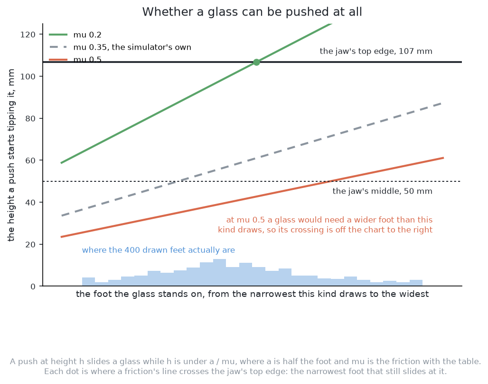
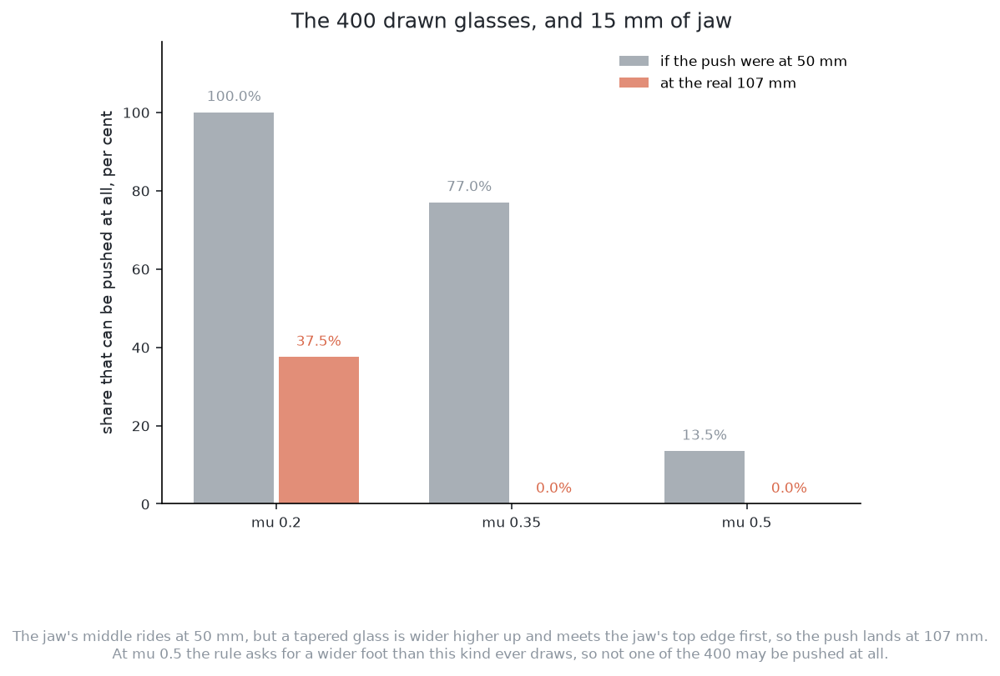

# Solution 1 — one fixed nudge

> **What it uses** — NumPy for the arithmetic, and nothing else. There is no
> model, no weights file, no training set and no licence condition. Not one
> number in this solution was fitted to anything. Moving the jaw is the cell's
> job: the physics engine does it on the examiner's tables, and MoveIt does it
> in the real cell.
> **What it does** — It finds a glass that has no room for the gripper. It
> finds the neighbour whose edge reaches furthest into that room. It pushes the
> glass straight away from that neighbour, by a fixed fraction of the missing
> room, as low as the gripper can reach. Then it looks again and repeats. It
> never predicts where a glass will land. It stops when every glass has room,
> when the push budget is spent, or when the only safe answer is a refusal.
> **How the output is produced** — For each glass, compute how much room it is
> short of. Take the worst glass and the neighbour that causes it. Refuse the
> glass if it fails the tipping rule. Point the jaw along the line from the
> neighbour's middle through the glass's middle. Set the travel to a fixed
> fraction of the missing room. Hand this over as one parameterised push. The
> examiner turns it into a jaw path. Then look again.

> **What it costs** — No data and no training time, because nothing learns. No
> hardware to rent, because the whole decision is a few hundred arithmetic
> operations. No licence condition. The only cost is arm time: pushes and looks.

> **The cell is described once, in [the cell](../../../01-rack-one-glass/docs/the-cell.md)** — the
> layout, the two places the camera works from, from the top and from the
> side, all four sensors, and the words this project uses them with. What
> follows is only what is specific to this solution.

## Introduction

This is the simplest way to move a crowded glass away from its neighbour. It
is one subtraction, one multiplication and a loop. It measures how much room a
glass is short of. It pushes the glass a fixed fraction of that, straight away
from whatever crowds it. Then it looks again.

This solution is **the control**. The other solutions pay for their answers
with data, training and hardware. Those prices only mean something next to a
method that costs nothing. Every other solution has to beat this fixed nudge.
If it cannot, it has earned nothing.

This page explains four things. What the shortfall is. Why the loop is a
proportional controller. Why a fraction of the gap is safe and the whole gap
is not. And what never predicting costs.

**Part of this solution is built and part of it is a design.** [What is built
and what is a design](#what-is-built-and-what-is-a-design) separates the two.
The examiner, the room test, the tipping rule and the loop exist and have
been run. The rule for choosing a direction and a distance is a design.

**No glass's size appears below.** The project never writes down a glass's
dimensions. This page uses relations, such as "wider than its neighbour". It
quotes numbers only for the gripper, the cell, or a results file.

## A film of one table

Here is this solution on one table. It was recorded in the simulator and plays
at one and a half times real speed.

[Watch the film (13 s)](../../videos/01-one-fixed-nudge.mp4)

The table is number 10025 of the held-out fifty. It was chosen to be
**typical rather than flattering**. The rule was written down before it was
applied. On the chosen table, every one of the six solutions must reach its own
commonest outcome and rack at least one glass. Exactly one table of the fifty
passes, and this is it. It holds six glasses, one more than the average of
five.

Five of its six glasses have no room at the start. That is normal: over the
fifty tables, 203 of the 251 glasses begin without room.

In the film the arm racks the one glass that already had room. It makes two
pushes. Then it refuses the other five, each with a reason. Two tip before they
slide. Two tipped when the push was tried. One has nowhere clear to be pushed
to. Nothing is knocked over. Most tables look like this with this gripper: one
or two glasses taken, the rest refused, none broken.

Two things in the film are easy to misread. **The hand never opens while it
pushes.** The gripper is held shut and the whole hand is the pusher. **The pick
at the end is drawn, not simulated.** The bench racks a glass by lifting it off
the table in one instant, so the film draws a stand-in pick and says so on
screen. [The examiner](../the-examiner.md#what-push-does-and-what-it-reports-back)
explains the drawn pick and how the film checks the hand's way in.
[The bench](../../bench/README.md) explains why the
hand is drawn twice, as solid pieces and as a faint shell.

All six solutions are filmed on this same table, so the films can be compared.
How each one does over all fifty tables is in
[the comparison](../../results/README.md).

## The code at the heart of it

Two pieces of this solution are built and running. The first decides whether a
glass can be pushed at all. It answers "yes", "no" or "try". The second is the
small fixed push the method makes when the answer is "try". [Solution
2](02-geometry-ranked.md) and three other solutions reuse this arithmetic.

The tipping test is in
[`03-push-glasses-apart/01-one-fixed-nudge/plan.py`](../../01-one-fixed-nudge/plan.py).
No library decides anything in it. It is a few divisions, two comparisons and
two arctangents from Python's `math`.

```python
# Glass on a dry wooden top is somewhere in here. Nothing in the cell measures
# it, so the tipping check is made at both ends.
MU_LOWEST = 0.2
MU_HIGHEST = 0.5
...
def slides(glass: Seen) -> str:
    """Whether a push at the jaw's top edge slides this glass: "yes", "no" or "try".

    It slides while the push is lower than a / mu: half the foot, over the
    friction. The top edge, because a glass wider higher up meets the jaw
    there first. "try" means it depends on the friction, and a probe is safe.
    """
    half_foot = glass.foot / 2
    if half_foot / MU_HIGHEST > JAW_TOP:
        return "yes"
    if half_foot / MU_LOWEST <= JAW_TOP:
        return "no"
    falls_past = math.atan2(half_foot, CENTRE_OF_MASS_SHARE * glass.height)
    return "try" if math.atan2(PROBE, JAW_TOP) < PROBE_LEAN_SHARE * falls_past else "no"
```

A glass that comes back "try" gets the same file's `probe`. This is the chosen
push cut down to one fixed length, on the same line. The arm looks before and
after it. NumPy appears only to turn a heading into a unit vector.

```python
# A glass that slides only at the low end is tried with a push this long, and
# looked at before and after. Short pushes lose up to 2.5 mm to the contact
# taking up and the glass settling onto its far edge, so this is well over that.
PROBE = 0.005
...
def probe(push: Push) -> Push:
    """The same push, cut down to PROBE."""
    u = np.array([math.cos(push.heading), math.sin(push.heading)])
    middle = np.array(push.aim) - push.travel * u
    aim = middle + PROBE * u
    return Push(push.glass, push.start, push.heading, push.reach, PROBE, (float(aim[0]), float(aim[1])))

def needs_probe(glass: Seen, proven: set[int]) -> bool:
    return slides(glass) == "try" and glass.id not in proven
```

Together the two blocks show the bargain. Where the arithmetic can answer, it
answers. Where it cannot, because the friction is unknown, the method spends
one short push to find out. Note that `PROBE` is a real constant in the code.
The proportional nudge of [the main idea](#the-main-idea) has no constant in
the code yet.

## The problem this solves

[Problem 3](../problem.md) starts where problem 2 ended. The arm knows where
each glass stands, how tall it is, and how wide it is at its widest and at its
foot. Every reading carries some error. Some glasses stand too close for the
open jaw to get round them, so the arm must drag them apart.

One number is missing: the friction between glass and table. Nothing in the
cell measures it, and no solution is told it. So nobody knows in advance how
far a push will move a glass. [Pushing without
toppling](../pushing-without-toppling.md#the-number-nobody-has) explains this
gap.

A solution can try to fill the gap. It can estimate the friction, learn a model
of pushing, or learn pushes from examples. Or it can refuse to fill it and
recover by measuring. This solution refuses. It predicts nothing and assumes
nothing about friction.

## The main idea

The method rests on one claim. **Pushing a glass away from a neighbour
increases the distance between them, whatever the friction is.** The friction
decides how far the glass goes. It does not decide which way. So the method is
sure about direction and modest about distance. It fixes the distance by
repeating, not by knowing.

It makes four decisions, each one line of arithmetic.

**Which glass.** The glass that is short of the most room. The next sections
define that shortfall.

**Which direction.** Straight away from the neighbour whose edge reaches
furthest into that glass's room. The heading runs from the neighbour's middle
through the glass's middle and onwards.

**How far.** A fixed fraction of the shortfall. The fraction is less than one,
so each push closes only part of the gap. The next pass does the rest.

**How high.** As low as the gripper can reach, always. A lower contact is
always further from tipping, so there is never a reason to push higher. The
only question is whether the lowest contact is low enough. [When a glass
cannot be pushed safely](#when-a-glass-cannot-be-pushed-safely) answers it.

Then the arm looks again and makes the four decisions afresh. It remembers
nothing between passes except how many pushes it has spent.

**"Fixed" means a fixed fraction, not a fixed distance.** Glasses on a crowded
table are short of anything from almost nothing to several tens of
millimetres. One distance cannot serve both. So the fraction is fixed: one
constant for every glass on every table. It is chosen once by argument and
never changed. It is the only free number in the method.

## Open loop and closed loop

The four decisions work because of the loop around them. [Pushing without
toppling](../pushing-without-toppling.md#the-loop-plan-feel-look-again)
explains the loop that every solution runs. This section gives its control
engineering names, because the rest of this page uses them.

A plan computed once and carried out without reading anything back is **open
loop**. A plan that measures, acts, and measures again is **closed loop**. A
closed loop has three parts. A **measurement** says how things are. An
**error** says how far that is from the goal. A **correction** tries to reduce
the error.

Newton's method is a useful comparison. It finds the root of a function with no
formula for the root. It only needs a way to measure how wrong a guess is and a
rule that makes the guess less wrong. This solution is in the same position.
Nobody can say where a glass will land. Anybody can measure how much room it is
short of.

The three parts map onto the cell. The measurement is `look()`, which the
examiner provides. The error is the shortfall. The correction is the nudge. The
fraction that turns the error into the correction is the **gain**. A
correction equal to the error times a fixed gain is a **proportional
controller**. That is all this method is.

All six solutions run inside a loop like this. In the other five, the loop
holds something substantial. Here **the loop is the method**.

## The shortfall, and why it is measured to the neighbour's edge

The loop needs an error, so the shortfall comes next.

A glass has room when every other glass's edge is at least 76 mm from its
middle. [The problem](../problem.md#the-gap-that-matters-is-not-the-gap-between-the-glasses)
explains where the 76 mm comes from. It also explains why the test is measured
to the neighbour's **edge**, which makes it asymmetric. A narrow glass beside a
wide one can lack room while the wide one has plenty.


The shortfall of one glass against one neighbour is

    76 mm  +  half the neighbour's widest width  −  the distance between
    their middles

It is zero or less when that neighbour is not in the way. A glass's shortfall
is the largest of these values over all other glasses. The neighbour that
gives the largest value is also the one whose edge reaches nearest the glass's
middle. So **the blocking neighbour and the deepest intruder are the same
glass**. No separate rule is needed to find it.

**The test is on an ordered pair.** A may be crowded by B while B is not
crowded by A. So the method checks the shortfall in both directions for every
pair.

**The shortfall is already in the code.** `shortfall()` in
[`03-push-glasses-apart/01-one-fixed-nudge/plan.py`](../../01-one-fixed-nudge/plan.py)
computes the expression above and sums it over the table. This solution uses
the same quantity one glass at a time, as its error.

## Why the push is a fraction of the shortfall rather than all of it

With the error defined, the next question is how big a correction to make.
Here the missing friction shapes the design.

Call the shortfall `s` and the gain `k`. The jaw is told to travel `k · s`. The
glass moves some other distance. The jaw may slip on a curved wall. The glass
may turn. The friction under the foot may vary. The glass may slide on a
little, or stop a little early. Write that unknown as a factor `g`, so the
glass moves `g · k · s`. **Nothing in the cell measures `g`, and nothing
bounds it tightly.** It depends on the friction, which may vary by more than
two to one.

The shortfall after the push is

    s'  =  s − g · k · s  =  s · (1 − g · k)

So the shortfall shrinks whenever `g · k` lies between zero and two.

**A confident push is unstable.** Set `k` to one, to close the whole gap at
once. Then the method converges only while `g` stays below two. It overshoots
whenever `g` is above one. Since nobody knows `g` within a factor of two, that
is a coin toss. An overshoot is also harmful. It carries the glass past where
it needed to be. It can move the glass into a new crowd. And extra travel is
extra chance to knock something over.

**A modest push converges.** Set `k` well below one, and `g · k` stays in the
safe range even if `g` is several times larger than expected. The shortfall
then falls step by step. If `g · k` is a half, each push halves the shortfall.
Three pushes take it to an eighth. The method does not need to know the exact
rate. It only needs the shortfall to keep falling.

The cost of a small gain is **more steps**. The number of pushes grows as the
logarithm of the reduction divided by the logarithm of `1 − g · k`. A smaller
gain is safer and slower. The price is arm time, not risk.

The gain is argued, not fitted. Trying many values on the training tables and
keeping the best would be fitting a number to data. A baseline tuned that way
is no longer a baseline. So the gain is chosen small enough to converge across
the whole plausible friction range, and then frozen.

## Why repeating replaces predicting

The small gain gives convergence. The loop gives correctness. So the method
never says where a glass will land, and **it cannot be wrong about physics it
never claimed to know**.

Here is exactly what it claims. It claims a direction, which needs no friction.
It claims the shortfall can be measured, which `look()` makes true up to
problem 2's error. It claims that a glass pushed away from a neighbour ends up
further from it. It does not claim how far the glass goes, or that it will not
turn. A solution whose pushing model is wrong fails on a claim this one does
not make.

The price is arm time. [The
examiner](../the-examiner.md#what-push-does-and-what-it-reports-back) describes
the steps of one push. Each push takes seconds, and then the arm looks again.
**The scorecard counts pushes against a fixed budget.** A method that needs
four pushes where another needs one has not failed. But it spent four times the
time and four times the travel, and travel is where glasses get knocked.

So this solution moves its cost from error into time. The other solutions buy
ways to shorten the loop. Solution 4 learns a model of pushing and plans
through it. Solutions 3 and 6 fit a policy on many pushes. Solution 2 ranks
many candidate pushes. **Comparing this solution with the others measures what
that shortening is worth.**

Repeating has a limit. Giving one glass room can take room from another. That
glass then needs a push, which may take the room back. The loop can swing back
and forth until the budget runs out. [A worked example](#a-worked-example)
shows this.

## What is built and what is a design

This section says plainly which parts exist as code, so nothing is
over-claimed.

**Built, in the repository, and run against the examiner:**

- the examiner itself, in [`03-push-glasses-apart/bench/`](../../bench/), with the
  crowded tables, the measurement error, `look()`, `push()`, `take()` and the
  scorecard;
- the room test, as `has_room()` in
  [`03-push-glasses-apart/bench/common_bench.py`](../../bench/common_bench.py), which holds the
  76 mm as the gripper's constant and applies it to the neighbour's edge;
- the shortfall, as `shortfall()` in
  [`03-push-glasses-apart/01-one-fixed-nudge/plan.py`](../../01-one-fixed-nudge/plan.py);
- the tipping rule, as `slides()` in the same file, checked at the jaw's top
  edge and at both ends of the friction range, with the small test push for
  glasses the range cannot settle;
- the loop, in [`03-push-glasses-apart/01-one-fixed-nudge/run.py`](../../01-one-fixed-nudge/run.py):
  look, rack every glass that has room, choose one push, make it, look again,
  with a push budget per glass and per table;
- the refusal reasons, and the scorecard that counts them.

**A design, not code:**

- the four decisions of [the main idea](#the-main-idea). The planner that
  exists searches many headings and distances instead. It keeps the shortest
  push that frees a glass. If none frees one, it keeps the push that most cuts
  the table's total shortfall. [Solution 2](02-geometry-ranked.md) uses that
  same search to make its candidates. This solution would replace the search
  with one heading and one multiplication;
- the gain, which has no value in the code;
- the shared target layout, which this solution does not use;
- the top view of the table, and the path for a chunk of waypoints, which this
  solution does not need;
- the repeats and the compute column that [the examiner](../the-examiner.md)
  describes for the scorecard.

One figure from the built code is worth quoting. The run in
[`03-push-glasses-apart/01-one-fixed-nudge/results.json`](../../01-one-fixed-nudge/results.json)
uses the searching planner, not this solution's rule. So it is not this
solution's score. Its pushed glasses stopped a median of 1.7 mm from where they
were aimed, and 57.6 mm at worst. This says something about the simulator: a pushed glass follows the
jaw closely, so `g` is near one here. No solution is told this. On a real table
with a cloth or a spill it would not hold.

## It produces nothing anybody can learn from

Solutions 3 and 6 learn from demonstrations, and [solution 2 is the
teacher](02-geometry-ranked.md#it-is-the-teacher) that supplies them. This
solution cannot be a teacher. It makes one push per pass and scores nothing, so
its records hold no comparison between pushes. A ranker cannot be fitted to
them. A policy fitted to them could learn only the one rule that made them.

So this solution is a control and only a control. That is not a complaint. A
control that also supplied training data would be doing two jobs, and the
second would make the first suspect.

## The pushes are what this contributes

What this solution hands over is a **parameterised push**. It says which glass
to move, where the fingertips come down, which way the jaw points, how far to
feel forward, how far to push, and where the glass should arrive. [The
examiner](../the-examiner.md#the-shared-output-and-why-it-is-a-jaw-trajectory)
owns the macro that turns those numbers into a jaw path. Every solution's push
goes through the same macro, so this step neither helps nor hurts any of them.

The "where it should arrive" field looks like a prediction, but it is not. The
examiner asks for it to measure how far each glass ended from its aim. This
solution fills it with the place the fingertips are carried to. It does
nothing with the answer. It just looks again.

The jaw does not drive to a computed contact point. It comes down a little
outside the glass's widest part and feels forward slowly until the force
passes a small threshold. A motion that a sensor can stop early is a **guarded
move**. It is used because the glass's wall position combines two errors: the
error in its middle and the error in its width. Driving to that point would
either stop short or hit the wall at speed. [Pushing without
toppling](../pushing-without-toppling.md#the-loop-plan-feel-look-again) shows
this in a picture.

The push then reports what the jaw felt. **This solution reads almost none of
that report.** It uses only whether the jaw touched anything. [The
examiner](../the-examiner.md#what-push-does-and-what-it-reports-back) explains
why the force reading is the only clue about friction. Every solution that
beats a blind nudge reads it in some way. This one ignores it, and that is why
it is the floor of the set.

Racking the glasses that already have room is shared machinery, not part of
this method. This page describes what happens to the glasses that are left.

## How the concepts fit together

Here are the pieces in the order the arm uses them.

1. Look at the table.
2. Rack every glass that already has clear room, which is shared machinery.
3. For each glass that is left, compute its shortfall against every
   neighbour's edge, and keep the worst.
4. Take the glass with the largest shortfall, and the neighbour that caused it.
5. Check that glass against the tipping rule. If it fails, refuse it with the
   reason and go back to step 3 without that glass.
6. Push it away from that neighbour, a fixed fraction of the shortfall, at the
   lowest height the gripper reaches, feeling forward for the contact rather
   than driving to it.
7. Go back to step 1.

The loop ends when no glass is short of room, when the push budget is spent,
or when every glass left has been refused.

## When a glass cannot be pushed safely

A glass tips instead of sliding when its foot is too narrow for the push
height. The height that counts is the jaw's top edge, at 107 mm. Such a glass
must be refused with its reason, which marks the run *correct but incomplete*.
[Pushing without
toppling](../pushing-without-toppling.md#the-limit-slide-or-tip) sets out the
rule in full. What follows is only this solution's own part.

**This solution has a second reason to refuse, and it costs the most.** The jaw
pushes along the direction it points. So to push a glass away from its
neighbour, the jaw must come in from the neighbour's side. The tool behind the
fingertips is 266 mm long, all at push height. In a tight group, the blocking
neighbour stands exactly where the tool must go.

The hand is not one width. Turned on its side to fit between glasses, a
Robotiq 2F-85 is 27 mm across for the first 132 mm behind the fingertips. Then
its body is 75 mm across, and the force sensor behind that is 89 mm. So the
arm can reach a hand's length into a gap and no further. Each part of the tool
is checked against its own width.

This method has only one heading. When that heading is blocked, it must say
there is nowhere clear to push from. **A solution that searches over headings
can try another approach. This one cannot.** That is the clearest cost of its
simplicity.

The first picture shows the tipping rule. The height at which a push starts to
tip a glass rises with the glass's foot. It falls as the friction rises. So
there is one line per friction. The jaw's two heights are ruled across them. A
glass can be pushed when its line is above the jaw's contact height. The dot
on each line is the narrowest foot that still slides at that friction.



The second picture shows what the gap between 75 mm and 107 mm costs. It takes
400 glasses of one kind and asks what share could be pushed at each friction.
At the simulator's own friction, the share falls from 77 in 100 to 25. At the
highest friction, not one of the 400 may be pushed.



The arm never knows which friction is real. So the three lines are three
possible answers for the same glass, and the method must stay safe under all
of them.

## A worked example

This section follows two tables through the loop. On the first the method
works. On the second it does not. Both use tapered glasses, because the
tipping rule bites hardest on them.

### A table where it works

Three glasses stand in the glass zone. Call them A, B and C. The table says
where each stands and how it compares with others of its kind.

| | where it stands | as this kind goes |
| --- | --- | --- |
| A | the middle of the zone | narrow, standing on a broad foot |
| B | close beside A, further from the arm | the widest the kind allows, on a broad foot |
| C | the far corner of the zone, clear of both | middling |

**The room test.** A needs 76 mm plus half of B's width. B is very wide, so
B's rim reaches deep into A's ring. A is short by some tens of millimetres. B
needs 76 mm plus half of A's width. A is narrow, so B has room. C is clear.
**So only A is on the list.** One gap gives two answers, and the narrow glass
has the problem.

**Can A be pushed?** A has a broad foot, so it passes the tipping rule even at
the low end of friction. But it still gets the test push. With this gripper,
every glass does. Being certainly safe would need a foot wider than 107 mm,
and the widest foot of any kind is 95 mm.

**The push.** B is the blocking neighbour. The heading runs from B's middle
through A's middle. The travel is the gain times A's shortfall. The fingertips
come down on that line, just outside A, and feel forward. The push is made.
The jaw backs off and lifts.

**Look again.** A has moved, so its shortfall is smaller but not zero. Nothing
else changed. The second pass makes a shorter push. The third pass finds A's
shortfall at zero or below. A, B and C are racked.

**What that cost.** Three pushes and four looks. A method that knew the right
distance would need one push and two looks. Each push was shorter than the one
before. Nothing fell over and nothing left the glass zone. The method paid in
arm time and never had to be right about friction.

### A table where it does not

Four glasses. One of them is crowded from two sides.

| | where it stands | as this kind goes |
| --- | --- | --- |
| A | the middle of the zone | middling, on a broad foot |
| B | close beside A, further from the arm | wide |
| C | close beside A on the opposite side, nearer the arm | wide |
| D | a corner of the zone, clear of everything | middling, on the narrowest foot the kind allows |

**A is short of room against both B and C.** Say B reaches further in. The
heading is straight away from B, which is straight towards C. The push
reduces A's shortfall against B and adds about as much against C. The next
look finds C is now worst and pushes A back. **The method swings between two
directions and spends its budget.** No gain fixes this, because the problem is
the direction. When the budget runs out, the remaining glasses are refused
with a reason. The table scores as correct but incomplete.

A sideways push, out of the gap between B and C, would free A in one go. The
measurements hold everything needed to find it. But finding it needs a search
over directions, which this method gave up.

**The same table shows the approach failure.** If B and C stand closer to A
than the tool is long, both headings put the tool where a neighbour stands. The
method has no third heading. It refuses A before any push, with the reason
that there is nowhere clear to push from. Nothing is knocked over.

**D shows a refusal that is nobody's fault.** D is clear, so it is simply
racked. But if D had been crowded, it would be refused. Its foot is so narrow
that it tips before it slides at any friction in the range. No method in the
set can push D.

## What it needs

**The measurements, and nothing more.** From `look()` it uses each glass's
position and widest width for the room test. It uses the foot width and height
for the tipping rule. It does not use the top view or the force report, apart
from whether the jaw touched. It never reads the simulator's own record.

**The gripper's own numbers.** These are the 76 mm of room and the 75 mm the
jaw's middle rides at. The 63 mm leading stretch puts the top edge at 107 mm. They also include the 266 mm tool length and the width of each part.
They belong to the hardware, not to any glass. None is tuned and none is typed
in. `arm/robotiq_2f85.py` works them out from Robotiq's published link offsets
and collision meshes. A different gripper changes them in one place.

**One constant of its own**, the gain. It is chosen by the convergence argument
above and then frozen.

**One library, NumPy.** It is permissively licensed. Nothing is fitted, so no
weights file and no inherited licence exist.

**Compute to rent: none.** The room test compares every pair of glasses, and
there are four to six glasses. The whole decision is a few hundred
floating-point operations. It finishes long before the arm moves. On the
compute column of [the examiner](../the-examiner.md)'s scorecard, this
solution is the zero the others are read against.

**What it does need is arm time.** The push budget bounds it.

## Where it is strong and where it breaks

The strengths and the weaknesses both come from how little the method claims.

**It cannot be wrong about pushing, because it says nothing about it.** Its
direction is right for any friction. Its distance is kept small on purpose.

**Its answer can be read.** Every step is a number that can be printed. Every
refusal has a reason that can be checked with a ruler.

**One run is a measurement.** Nothing is fitted and nothing is random. So it
needs none of the repeats that [the examiner](../the-examiner.md) asks of
trained solutions. Its number has no spread.

**It tests the whole contact sequence.** Closing the jaw, coming down, feeling
for the glass, pushing and backing off are where real glasses get knocked. This
method runs all of them with no planning code in the way. If a glass falls,
the fault was in the contact.

**Short pushes are safe pushes.** Less travel means less chance to knock
something. The small gain gives that for free.

The weaknesses:

**It has nowhere to stand.** In a tight group the one heading is blocked, and
it refuses. **The approach is a harder limit than the push itself**, and this
solution cannot choose its approach.

**It cannot help a glass crowded from two sides.** It swings between them until
the budget runs out.

**It never looks at the free table.** It does not ask whether the destination
is empty, inside the zone, within reach or clear of the rack. It does not check
for a glass in the path. Driving one upright glass into another is how a glass
falls over.

**It does not use the shared target layout.** [The target
layout](../the-target-layout.md#the-displacement-floor) gives the least travel
the task needs. This method pushes away rather than towards a goal, so its
travel will sit well above that floor.

**It does not choose the safer glass of a pair.** The glass with the wider foot
is safer to push. This rule always pushes the glass short of room. If that one
fails the tipping check, it refuses instead of pushing the other. That is safe
but costs glasses. A baseline has to decline easy improvements like this.

**It ignores the force report**, which is the only evidence about friction.

**It pays in pushes, and the budget is limited.** On a table that needs many
pushes, it can run out.

## The general ideas behind this

None of this was invented for glasses. Knowing the older ideas shows where the
method should work and where it should not.

### Proportional control

A correction equal to the error times a fixed gain is a **proportional
controller**. It is the simplest member of the PID family. PID stands for
proportional, integral and derivative. The other two terms add the summed
error and the rate of change of the error. **Where it is right:** the error can
be measured, the correction acts in the right direction, and its effect is at
least bounded. Then a small gain is stable with no model at all. That is why
proportional control is everywhere. **Where it is not:** it is slow when a good
model exists, because a model can do in one step what it does in several. It
also leaves a steady error when a constant force pulls against it. That second
problem does not apply here: the measurement and the correction are both
position. The first applies exactly, and the other five solutions exist to
measure it.

### Singulation

Separating crowded objects so they can be picked one at a time is called
**singulation**. Chang, Smith and Fox's *Interactive Singulation of Objects
from a Pile* (ICRA 2012) named the problem. It already has this solution's
shape: act on the pile, look again, repeat. **Where it is right:** bin picking
and warehouse work. **Where it is not:** that work assumes walls that keep
objects in, and flat objects that cannot fall over. An open table of upright
glasses has neither. The structure carries over. The safety does not.

### Fixed push policies

A short push in a direction chosen by a simple rule is a real method.
Danielczuk and colleagues' *Linear Push Policies to Increase Grasp Access in
Dense Clutter* (IEEE CASE 2018) states it most clearly. They found such pushes
are cheap and often open enough space for a grasp. **Where it is right:** dense
clutter in a bin, where a push does little harm. **Where it is not:** here, for
the reasons above and one more. A flat object can be pushed from an easy side.
An upright glass must be pushed from the side, and the side is where the
neighbour stands.

### Quasi-static planar pushing, which this solution deliberately does not use

There is a well developed theory of how a pushed object moves on a table.
Mason's *Mechanics and Planning of Manipulator Pushing Operations* (IJRR 1986)
gave its central result, the voting theorem. Which way a pushed object turns
depends on where the push line passes its centre of friction. This can be
worked out without knowing the pressure under the object in detail. Lynch and
Mason's *Stable Pushing: Mechanics, Controllability and Planning* (IJRR 1996)
used it to plan pushes along a chosen path. **Where it is right:** when the
friction and the weight under the foot are known or measured. **Where it is
not:** here, because nothing in this cell measures either. Yu, Bauza, Fazeli
and Rodriguez's *More than a Million Ways to Be Pushed* (IROS 2016) measured the
cost. They pushed the same objects the same way thousands of times. The
outcomes scattered widely, and the scatter did not average away. So the choice
is between a prediction that needs a missing number and no prediction. This
solution takes no prediction. [Solution 4](04-a-world-model.md) learns a model
instead.

### Guarded moves

Ending a motion on a sensed condition, not at a computed point, is a **guarded
move**. It is one of the oldest ideas in robot assembly. Lozano-Pérez, Mason
and Taylor's *Automatic Synthesis of Fine-Motion Strategies for Robots* (IJRR
1984) explains why. When a thing's position is uncertain, a motion that stops
on a sensor is reliable. A motion that stops at a coordinate is not. **Where it
is right:** every contact with an object measured from a distance, which is
every contact in this project. **Where it is not enough:** it tells the arm
where the surface is, but not what to do next. It prevents collisions. It does
no planning.

### Baselines, as a discipline

A **baseline** is the simplest method that does the job at all. It is built
first and kept as the number everything else is scored against. A method that
beats nothing has not been shown to be good. **Where it is right:** whenever
several methods are compared, especially expensive ones. **Where it goes
wrong:** a baseline improved bit by bit until it competes is no longer a
baseline. This method has one place where that could happen: the gain. That is
why the gain is argued, not tuned. A baseline must also be scored on the same
tables in the same way as the others. [The examiner](../the-examiner.md) does
that.

## Where it sits among the other five

This solution answers one question: **does any learning beat a fixed nudge?**
The full table of all six is in [the
comparison](../../results/README.md). Here is what
each pairing tests.

**Against [solution 2](02-geometry-ranked.md)** the gap is a search and a
ranker. Solution 2 uses the same inputs, room test and tipping rule. It
searches many pushes and ranks them. Searching directions fixes two of this
solution's weaknesses: it can push out of a gap between two neighbours, and it
can find an approach the tool fits into.

**Against [solution 3](03-imitation-from-demonstrations.md)** the gap is
everything fitted. Solution 3 fits ACT, and then Diffusion Policy, to
demonstrations, and emits a chunk of waypoints. Its training ran on this laptop. If it does not clear more tables
than a fixed nudge, the training bought nothing.

**Against [solution 4](04-a-world-model.md)** the question is sharpest.
Solution 4 learns what a push does and plans through it. It buys the prediction
this solution refuses to make. It pays in training data and in planning time
per push. So the pair asks: **is a prediction worth more than a repetition?**

**Against [solution 5](05-smolvla-as-it-downloads.md)**, these are the only two
that fit nothing in this cell. This one carries one argued constant. Solution 5
carries SmolVLA as it downloads: about 450 million parameters, pretrained on
487 community datasets of real teleoperation. **Against [solution
6](06-smolvla-fine-tuned.md)**, which continues that training here with
low-rank adaptation, the fixed nudge is the floor both must clear first.

So this method is **the first thing to build and the last thing to ship**.
Build it first: it is the cheapest way to get a real push against a real
glass, and everything after it needs the same contact steps and refusals. Do
not ship it: it has one heading, it cannot help a glass crowded from two sides,
and it never checks where it sends a glass.

Read it both ways. If a model cannot beat a fixed nudge, it has earned
nothing. But this method works only because problem 3 promises a lot. The
glasses stand upright on a flat table. The gripper's room is a known constant.
Problem 2 reports every glass's position and width. A refusal is allowed. The
other five need fewer of those promises. Their value shows when the promises
stop.

---

← [Problem 3 — push the glasses apart](../problem.md) · [Solution 2 — geometry
generates, a model ranks](02-geometry-ranked.md) →
