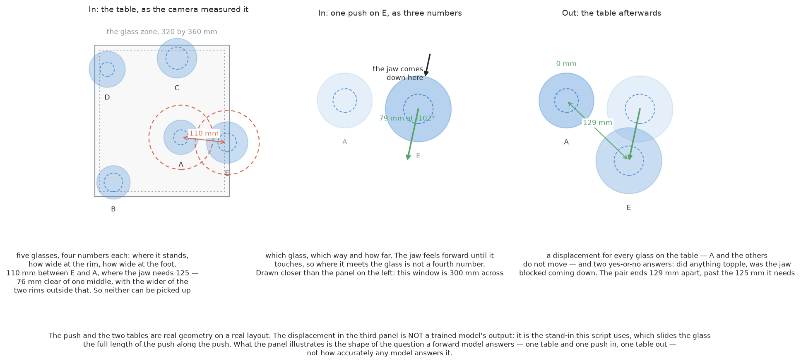
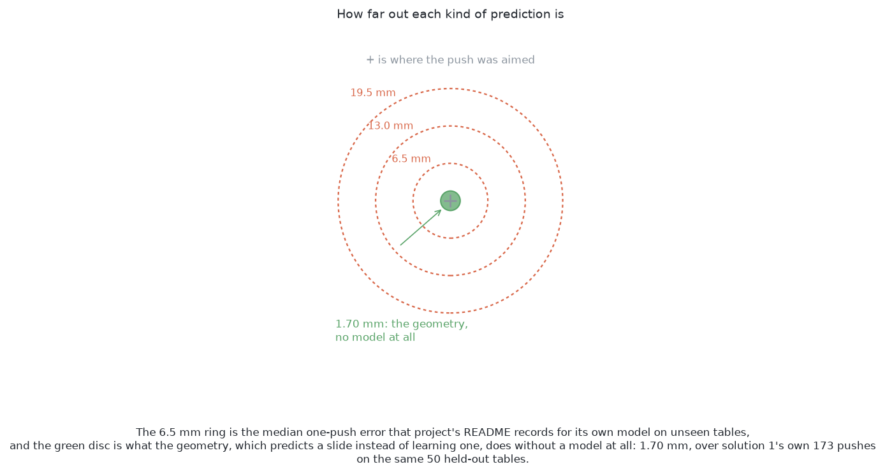

# Solution 4 — a world model, then plan with it

> **What it uses** — PyTorch, and MuJoCo through [the test
> examiner](../the-examiner.md). The first way is a small network written and
> trained here. Five copies of it are kept. No weights are downloaded. The
> second way would be TD-MPC2, also trained here. **The second way is not
> built**, so every number in this document belongs to the first way.
> **What it does** — it learns what a push does. Then it tries many candidate
> pushes against that learned model, not against the table, and makes the best
> one. [How the concepts fit together](#how-the-concepts-fit-together) gives the
> steps in order.
> **How it differs from the others** — it learns *what will happen*. The other
> solutions write down or learn *what to do*. [Where it sits among the other
> five](#where-it-sits-among-the-other-five) has the comparisons.
> **What it costs** — recorded pushes from the simulator, which nobody has to
> label. The first way trains in about half an hour on a laptop processor. At
> run time it is slow, because it asks the model about some 1,500 candidate
> pushes for each crowded glass.

> **The cell is described once, in [the cell](../../../01-rack-one-glass/docs/the-cell.md).** This page
> covers only what is specific to this solution.

## Introduction

This document answers [problem 3](../problem.md) with a learned model of what a
push does. The arm chooses each push by trying candidates against that model,
not against the table.

The key idea is small. Every other solution learns or writes down **what to
do**. This one learns **what will happen**, and works out what to do from it.
The model's answer is a table, and a table can be asked about again. So this
is the only solution that could plan a *sequence*: move glass B first, so that
glass A has somewhere to go.

By the end you will know five things:

- what a forward model is, and how it differs from a policy;
- how the cross-entropy method picks a push by sampling, and why it suits a
  cost with hard limits;
- why planning ahead but making only one push forgives a model that is a little
  wrong;
- why disagreement between five copies of one model measures what the model
  does not know;
- what a small hand-built model and an off-the-shelf one each buy.

Read [the examiner](../the-examiner.md) first. It defines what `look()` hands
over and what `push()` accepts. Then read [pushing without
toppling](../pushing-without-toppling.md), which states the refusal rule.

## A film of one table

Here is this solution on one table, recorded in the simulator at one and a half
times real speed.

[Watch the film (44 s)](../../videos/04-a-world-model.mp4)

It is held-out table 10025, the same table every solution is filmed on.
[Solution 1's film section](01-one-fixed-nudge.md#a-film-of-one-table) says how
that table was chosen, and what the drawn hand and the drawn pick show.

In this film all six glasses are racked in three pushes. Nothing topples. This
solution finishes more tables than any other, and this is one of them. But the
same planner topples a glass on 19 of the 50 tables. The film shows what
happens when its guesses about toppling are right.

All the films use this table, so they can be watched side by side. The scores
over all fifty tables are in [the
comparison](../../results/README.md).

## The code at the heart of it

Two pieces of code hold the whole idea. The first is the model: five copies of
a small network. Each takes a table and a candidate push and says what the push
would do. The second is the arithmetic that turns the five answers into one
decision: keep the candidate or drop it, and at what cost.

The library does its work in the four `nn.Linear` lines. Everything around them
is the ensemble, in
[`03-push-glasses-apart/04-a-world-model/model.py`](../../04-a-world-model/model.py):

```python
ENSEMBLE = 5
HIDDEN = 256

class PushNet(nn.Module):
    def __init__(self) -> None:
        super().__init__()
        self.net = nn.Sequential(
            nn.Linear(features.INPUTS, HIDDEN), nn.SiLU(),
            nn.Linear(HIDDEN, HIDDEN), nn.SiLU(),
            nn.Linear(HIDDEN, HIDDEN), nn.SiLU(),
            nn.Linear(HIDDEN, features.OUTPUTS),
        )  # fmt: skip
...
class Ensemble:
    """ENSEMBLE copies, asked together."""
    ...
    def predict(self, x: np.ndarray) -> np.ndarray:
        """(copies, rows, outputs), raw: movements scaled, yes-or-no as logits."""
        with torch.no_grad():
            x_t = torch.as_tensor(x)
            return np.stack([net(x_t).numpy() for net in self.nets])
```

The five answers are used in
[`03-push-glasses-apart/04-a-world-model/plan.py`](../../04-a-world-model/plan.py).
Every candidate push is scored at once. An unacceptable one gets a cost of
infinity:

```python
def score(model: Ensemble, seen: list, target, kind: str, heading, offset, travel, rng: np.random.Generator):
    """Expected crowding after each candidate push, and why any were dropped.
    ...
    """
    rows = features.encode(seen, target, kind, heading, offset, travel)
    out = model.predict(rows)
    move = out.mean(0)
    topple = sigmoid(out[:, :, features.TOPPLED]).max(0)
    blocked = sigmoid(out[:, :, features.BLOCKED]).mean(0)
    for _ in range(JITTERS):
        shifted = jittered(seen, rng)
        mine = next(s for s in shifted if s.id == target.id)
        out = model.predict(features.encode(shifted, mine, kind, heading, offset, travel))
        topple = np.maximum(topple, sigmoid(out[:, :, features.TOPPLED]).max(0))
    ...
    cost = blocked * here + (1 - blocked) * crowding + TRAVEL_COST * travel

    dropped = {
        "topple": ~(topple <= TOPPLE_LIMIT),
        "map": ~(inside & reachable),
        "unsure": moved_far,
    }
    cost[dropped["topple"] | dropped["map"] | dropped["unsure"]] = math.inf
    return cost, landing, {k: int(v.sum()) for k, v in dropped.items()}
```

These two blocks explain both the good and the bad results. The movements are
**averaged** over the five copies. The topple chance is the **worst** copy's,
and it is checked again on shifted copies of the table. So a push has to look
risky only once to be dropped. That is why this solution racks the most glasses.
It is also why it topples twenty. `topple` is only the model's opinion. When all
five copies are sure and all five are wrong, nothing in this code disagrees.

## The problem this solves

[Problem 3](../problem.md) states the task. This section narrows it to the part
this solution attacks.

[The target layout](../the-target-layout.md) already says where the glasses
should end up. That part is plain geometry. What is left is the part with
unknowns: **what a given push will really do**.

The main unknown is friction. Whether a glass slides or tips depends on it, and
**nothing in this cell measures friction**. [Pushing without
toppling](../pushing-without-toppling.md#the-number-nobody-has) explains this.
So any written rule has a guessed number in it.

[One fixed nudge](01-one-fixed-nudge.md) and [geometry generates, a model
ranks](02-geometry-ranked.md) guess carefully, act, look, and correct. This
solution does something else: **it never writes the rule down. It learns the
rule's results instead.** It pushes glasses thousands of times, records what
happened, and fits a function to it. Friction is then not a number the solution
holds. It is a pattern in the recorded pushes. The model also learns other
things nobody wrote down. The jaw has a body behind its fingers. A tapered glass
meets the jaw's top edge. A glass turns as well as slides.


There is a second difficulty. A glass pushed out of one crowd can land in
another. A glass pushed into its own clear spot can block the next glass's
route. **Choosing which glass to move, and in which order, needs the whole
table.** Only a method that can say what the table will look like afterwards
can answer that.

## The main idea

**Keep "what will happen" apart from "what is good".**

1. Fit one function that answers: *given this table and this push, what is the
   table afterwards?* It holds no opinion about good pushes.
2. Write the opinion as plain arithmetic over tables. Every glass with its
   76 mm of clear room is good. A toppled glass is unacceptable. A shorter push
   is better.
3. Put a search between the two. Propose pushes, ask the model about each,
   score its answers, and make the best push.

The two halves come from different places. What will happen is a fact about
the world. It can only be learned from pushes in the simulator. What is good is
a fact about the task, and [the problem](../problem.md) already states it. Kept
apart, **the same model can serve a new goal by changing only the
arithmetic**. If the task became "spread the glasses evenly", the model would
not change. A trained policy would need training again.



## What exists in code, and what is a design

This section says which parts run and which parts are only described.

**The first way is built.** It is in `03-push-glasses-apart/04-a-world-model/`.
It collects its own data and trains on it. The examiner has run it on the
held-out tables. Its results are in that folder's `results.json`, and beside the
others in `03-push-glasses-apart/results/README.md`. The model is `model.py`,
its inputs are `features.py`, and the search and loop are `plan.py`.

**The sequence is a design.** The built planner chooses one push at a time. It
scores each candidate by the table one push later, makes the best push, and
looks again. It never asks about a second push after a first. The model makes a
sequence possible, and this document explains how. The reason the built horizon
is one push is in [compounding error over a
rollout](#compounding-error-over-a-rollout).

**The second way is a design, and it claims nothing.** It is not wired to the
examiner, and it has not been trained or run. One fact matters before anyone
starts. LeRobot, the library this project uses elsewhere, ships **TD-MPC**, the
older method, not TD-MPC2. So TD-MPC2 must come from its own project. The
examiner pieces it would need already exist: the top view `bench/top_view.py`
and the waypoint path `Bench.follow`, built for [imitation from
demonstrations](03-imitation-from-demonstrations.md). What is missing is the
wiring and the training.

## What a forward model is

A **forward model** maps a situation and an action to the situation after it.
Its signature is `(state, action) -> state`. It has no goal and no preference.
It cannot be asked what to do. It can only be asked what happens.

In programming terms it is a **pure function**. The same arguments give the
same answer, and calling it has no side effects. **You can call it as often as
you like.** That is what makes it searchable. Each real push risks a glass.
Each model call is only arithmetic. So a search that would be reckless on the
table is safe on the model.

A pure function of this type also returns the same type it takes. So
`(state, action) -> state` can be fed its own output. Give it the returned
state and a second action, and you get the state two actions later. **That is
the whole of the sequence capability.** It comes from the type, not from how
good the fit is.

A **policy** is the other kind: `state -> action`. It answers *what should I
do* in one pass, with no search. [Imitation from
demonstrations](03-imitation-from-demonstrations.md#behaviour-cloning--learning-a-policy-by-copying)
explains policies. It and the SmolVLA solutions are policies. In short, a
policy is fast and narrow, and a forward model is slow and general.

## What this model is shown, and what it answers

The design question is what goes into the states and the action. The answer is:
only what the arm has.

**In go thirty-four numbers:**

- the table's glass kind, as four yes-or-no columns;
- the pushed glass's height, widest width and foot width, as `look()` reports
  them, with problem 2's error;
- the push, as two numbers: how far across the glass the jaw meets it, and how
  far it pushes;
- up to five other glasses, nearest first: where each stands relative to the
  pushed glass, how wide it is and how tall. The examiner never draws more than
  six glasses, so five others is all of them.

**Out come fourteen numbers:**

- a movement for the pushed glass;
- a movement for each of the five others, because a push also moves neighbours;
- two yes-or-no answers: did anything topple, and was the jaw blocked on the
  way down?

Three points about these lists matter.

**They hold only what the arm has.** No friction, no mass, no tipping rule, no
simulator record. If the model finds the slide-or-tip rule, it finds it in the
data.

**The two yes-or-no answers matter most.** A movement a few millimetres out
costs one more push. A missed topple costs a glass, and nothing here can stand
a glass back up. So the model is really a safety check with a movement
predictor attached. Toppling is the rarer answer, and a model can score well by
always saying "no". So training weighs the topple examples up until both
answers count the same.

**The labels come from two looks, not from the truth.** One example is: look,
push, look again. The label is the difference between the two looks. So the
model predicts what the *camera will report*, error included. That is what the
planner will see next, so it is the right thing to predict.

## The push's own frame, and why direction carries no information

One choice in those thirty-four numbers makes the problem much smaller.

Every position and every movement is measured **in the push's own frame**: one
number along the jaw's path, and one across it to the left. Nothing is in the
table's north and east.

So **a push to the north and the same push to the east are one example, not
two**. A glass 40 mm ahead and 20 mm to the left gives the same row whichever
way the jaw points.

This is right because **the table's friction is the same everywhere and in
every direction**. There is no slope and no sticky patch. So the push's heading
says nothing about what the push will do. Giving the heading to the model would
make it learn the same thing once per heading. That wastes recorded pushes,
which are this solution's scarcest resource.

The same fact gives a second gain. The physics has no preferred side, so a push
and its mirror image are both real pushes. Each recorded push is used twice:
as made, and mirrored left to right. That doubles the training set with real
examples.

**The frame removes only what is safe to remove.** The arm's reach and the
glass zone's edges are not the same in every direction. The model knows nothing
about either. So the map, meaning where a glass may stand and where the arm can
reach, stays as written arithmetic. It is checked against the model's predicted
table, not learned.

## Ensembles as a measure of ignorance

The hardest thing to get from a trained model is an honest "I don't know".
This section shows how to get one, and it is the idea from this document most
worth reusing.

A plain network always answers. Shown a push unlike its training data, it
answers in the same format and with the same confidence as for a familiar one.
That is dangerous for a planner, because **a search works against its own
model**. It tries hundreds of candidates and keeps the one the model likes
best. So it finds exactly the places where the model is wrong in a hopeful
direction.

The fix is simple. **Train the same network several times, from different
random starting weights, on the same data. Keep every copy.** The first way
keeps five. Where they agree, the data fixed the answer. Where they disagree,
the data did not, and each copy filled the gap in its own way. So **the spread
between copies measures what the data did not say**. It costs only four more
small training runs.

The planner uses the spread in two different ways:

- For movements it takes the **average** of the copies. Errors here are small,
  and the next look corrects them.
- For toppling it takes **the worst copy's chance**. If any copy gives a push
  more than a 1% chance of toppling something, the push is dropped. So a push
  passes only when all five agree it is safe.

This is lopsided on purpose. Refusing a good push costs a refusal, and [the
problem](../problem.md#what-done-means) counts a refusal as a result. Making a
push that tips a glass costs the glass, for good.

A second check answers the same danger. Among thousands of candidates, the
search can find a push that looks safe only by luck in the measurements. So
each candidate is also checked on four copies of the table, with every reading
moved by about the camera's error. The worst topple chance over all of them
counts. **A hole in the model that luck finds does not survive a one-millimetre
shift.** A truly safe push does.

## Planning by sampling: the cross-entropy method

There is now a model and a signal for where it is unsure. The next question is
how to find a good push. The answer is to try many.

A candidate push is three numbers: which way the jaw points, where across the
glass it meets it, and how far it travels. **Random shooting** draws many
candidates from the allowed range, asks the model about each, scores the
predicted tables, and keeps the best. That already works. But most draws land
in parts of the range the first round already ruled out.

The **cross-entropy method** adds one step: use the good draws to decide where
to draw next. It runs in rounds:

1. Draw a batch spread over the whole allowed range.
2. Score every candidate.
3. Keep the best few. These are the *elite*.
4. Take the elite's average and spread. Draw the next batch around that
   average, with that spread.
5. Repeat.

Each round the cloud of candidates shrinks onto the region that keeps scoring
well.

The first way draws 600 in the first round and 300 in each of three more. It
keeps the best 30 each time. That is about 1,500 candidates per crowded glass.
This is cheap. One candidate is one row of thirty-four numbers through five
small networks, and the whole batch goes in one call.


Two properties make this the right search here.

**It needs no gradients.** It only asks which candidate scored better, not how
the score changes with a tiny change in the push. So the map test, the reach
test and the topple veto can be plain yes-or-no conditions.

**It copes with a cost that is not smooth.** A push that topples a glass is not
slightly worse than one that does not. It is unacceptable. A glass a hair
outside the zone is not slightly worse than one a hair inside. A method that
follows a slope needs slopes. This one only compares, so a cost of infinity is
an ordinary value. Many rules in this problem are hard limits, so this property
decides the choice.

The score is plain arithmetic over the predicted table:

- Add up, over every glass, how much clear room is still missing. That is how
  far each neighbour's edge reaches inside the 76 mm the glass needs.
- Add a small cost per millimetre pushed, so the shortest push that works wins.
- Drop the candidate if any copy gives it more than the topple limit.
- Drop it if a moved glass lands outside the glass zone or outside the arm's
  reach.
- Drop it if the model predicts a move longer than the push itself. That is the
  model guessing outside what it has seen.

The best push over all the crowded glasses on the table is the one made.

## Receding horizon: plan several, make one

The search returns one push. It is tempting to let it return several and make
them all. That is a mistake, and the fix has a name.

**Receding horizon** means: plan several steps ahead, make only the first, then
drop the rest and plan again from a new look. The plan always reaches further
than the arm acts, and its far end moves away as the arm moves on.

This suits a model that is a little wrong. A deep plan rests on predicted tables
the arm has never seen. If the arm made every step, each step would act on a
table further from the truth. If the arm makes one step and then **looks**, a
measurement replaces the prediction, and the model's error is thrown away. The
plan was still useful, because it chose a first push with the later pushes in
mind.

This is the closed loop that [one fixed
nudge](01-one-fixed-nudge.md#open-loop-and-closed-loop) explains. Here the
state is the table and the re-reading is `look()`.

So the model does not need to be accurate. It needs to **rank the pushes
available now** in the right order. It can be several millimetres out about a
landing and still pick the better push. The next look fixes the millimetres.

## Compounding error over a rollout

A receding horizon limits the damage from a wrong plan. It does not make a deep
plan right. This section says why a plan gets worse the further it reaches.

A **rollout** feeds the model its own output: predict the table after one push,
then ask about a second push on that predicted table, and so on. Each step adds
its own error. Each step also starts from a table the last step got slightly
wrong. So errors compound rather than add. [Imitation from
demonstrations](03-imitation-from-demonstrations.md#compounding-error) explains
compounding error in full. The same effect happens here, inside the model.

The numbers show the size. The first way's README records a median error of
**6.5 mm** for where a pushed glass lands, on tables it never trained on. That
is a useful one-step model. If the error only added up, it would be 13.0 mm
after two pushes and 19.5 mm after three. Compounding makes it worse than that.
The clearances in this problem are tens of millimetres. **So a model good at one
step can be useless at five.**

The picture draws those sizes as rings round the point a push was aimed at. The
inner ring is the one-step error. The two outer rings are the straight sums
after two and three pushes. The small green disc is the geometry's error from
[one fixed nudge](01-one-fixed-nudge.md), which predicts a slide without any
learned model.



The millimetres matter because the clearances are tight. In the table the
planning picture came from, the push aims to leave glass E 129.0 mm from glass
A. The jaw needs 125.3 mm. If the model's median error falls in the worst
direction, the glass lands 122.5 mm away, which is 2.7 mm short. The next look
has to catch that. With the geometry's error it lands 127.3 mm away, which is
still enough.

That is why the built planner looks one push ahead. Every training example is a
single push. The model was never asked to be right about a table it predicted
itself.

**The main remedy is to train on multi-step rollouts.** Start from a measured
table, roll the model forward several pushes, and score it on the whole
sequence against what really happened. The fit is then punished for drifting at
step two, so it learns to produce tables it can handle as input. This is the
standard remedy in the learned-world-model papers. The second way does it by
design, which is a main reason to want the second way.

The first way uses two cheaper habits. **It keeps the horizon short**, because
compounding grows with depth. And **it collects data from its own planner**,
not only from random pushes. In the second round of collection, the first model
plans. The planner finds pushes where that model is wrong in its own favour.
Those pushes are really made, and the results join the training set. That fills
the holes the search would otherwise use.

## Planning a sequence, which only this solution could do

This section is the reason for all the machinery above.

Take a table where glass A is crowded and has nowhere to go. Every direction
hits glass B, leaves the zone, or puts A out of reach. A planner that judges
one push at a time will say no push helps, and refuse. It is wrong. The answer
is to push B first. B did not need moving, and moving it frees no glass for
picking. But it opens the route A needs.

**A push whose only value is what it lets the next push do** is invisible to a
one-at-a-time planner. On its own it clears no room and costs a push. Only a
method that can ask *and then what?* can see its value. That question needs a
function that returns a table.


The change to the built planner is small:

- Draw six numbers per candidate instead of three: a first push and a second.
- Roll both through the model in turn, and score the table after the pair.
- Apply the topple veto at both steps. A pair that topples a glass halfway is
  dropped.
- Make only the first push, then look again. That is the receding horizon.

The model does not change at all. Only the number of calls changes. The cost of
the search grows fast with depth, so the horizon should be as short as the
answer allows.

Two limits apply.

**The useful depth is small.** Compounding error caps how far a rollout can be
trusted. For the first way's model, two pushes is reasonable, three is
hopeful, and more is planning against a guess.

**On this examiner a sequence mostly saves pushes.** Tables where only a
two-deep planner succeeds are real but rare with four to six glasses. The usual
gain is fewer pushes on the same table. That matters for one reason: **touching
a glass is the only step that can topple one**. Four pushes instead of six is
two fewer chances of the one failure that cannot be undone.

## The second way: TD-MPC2 off the shelf

The first way is a model written for this cell. The second way asks what a
model written by specialists would do. Comparing the two is the reason to have
both.

**TD-MPC2** is the better-known method of this family. Like the first way, it
learns how the world changes and plans through that at run time. It does not
learn a policy. So the shape is the same: learn what happens, search actions
against it, make only the first.

The difference is what the model predicts.

**The first way predicts the next table directly, in measured quantities.** Its
outputs are movements in millimetres and two yes-or-no answers. A person can
check every number against a photo.

**TD-MPC2 plans in its own internal code.** It turns the situation into a vector
whose entries mean nothing to a person. It learns how that vector changes under
an action and plans there. It never turns the vector back into positions. The
vector is trained to keep what predicts rewards, not what rebuilds the table.

Each way buys something different.

**The hand-built model is small and can be inspected.** Every input has a name
and every output has a unit. When it is wrong, you can print the thirty-four
inputs, each copy's fourteen outputs, and what really happened. The first way's
traces do exactly that. It trains in minutes with no accelerator, and its
ensemble gives a clear signal of ignorance. But it knows only what it was told.
It sees five neighbours at most, it knows nothing of the arm's body, and it
knows only this table.

**The off-the-shelf model is stronger and comes maintained.** It is built to
work across many tasks without retuning. It trains on multi-step rollouts by
design, which answers compounding error. Many people have tested its code and
defaults, and its published results give a reference. But it is larger, needs
an accelerator, cannot be read, and its failures are hard to trace.

**Comparing them shows whether building your own was worth it.** Suppose
TD-MPC2 does no better than five small networks trained in half an hour. Then
the cell is narrow enough for the hand-built model, and the thirty-four numbers
were a good encoding. If TD-MPC2 does clearly better, the encoding left out
something real. Problem 2 makes the same argument with [a network trained here
from scratch](../../../02-segment-glasses/docs/solutions/02-train-from-scratch.md).

## The pushes are what this contributes

This solution hands over a **parameterised push**, as [the
examiner](../the-examiner.md) defines it. It names the glass and where the
fingertips come down. It gives the jaw's heading, how far it feels forward, and
how far it pushes.
The examiner's own macro turns that into a jaw trajectory, the same for every
solution. [One fixed
nudge](01-one-fixed-nudge.md#the-pushes-are-what-this-contributes) describes
that hand-over in full.

Two of those numbers are arithmetic, not model output. The fingertips come down
behind the glass's widest edge, with a margin for the camera's error. The jaw
feels forward far enough to pass the glass's middle. A stemmed glass is met at
its stem, well inside its widest edge, and a jaw that stops short can lift the
bowl and tip it. Neither number depends on anything unknown, so neither is
learned.

The push height is not a choice: [pushing without
toppling](../pushing-without-toppling.md) sets it for every solution. The
destination is not this solution's either: [the target
layout](../the-target-layout.md) sets it. **This solution decides only which
push, of all the allowed pushes, is worth making.**

## How the concepts fit together

Here are the steps in the order they run, once per push.

1. **Look.** `look()` returns one reading per glass: position, height, widest
   width, foot width, and whether it stands. Each reading carries problem 2's
   error.
2. **Apply the shared topple limit.** [Pushing without
   toppling](../pushing-without-toppling.md) works this out from each glass's
   foot width. It is the same for every solution. **The built planner does not
   have this step yet.**
3. **Take anything that can be taken.** A glass with clear room, plus a small
   margin, is racked at once. The model is not asked.
4. **Search, for each glass still crowded.** Run the cross-entropy method
   against the five copies, as [planning by
   sampling](#planning-by-sampling-the-cross-entropy-method) describes.
5. **Make one push.** The best push over all crowded glasses goes to the
   examiner's macro. The jaw reports what it felt.
6. **Look again**, and start over from step 1.

The loop ends when every glass is racked, when the table's push budget is
spent, or when no helpful push survives the filters. Each glass left behind is
reported with its reason.

Two counters stop the loop running for ever. A glass may be pushed only four
times. A table gets 16 pushes in all. Both belong to the loop, not the model.
The budget must be the same for every solution, or push counts cannot be
compared.

## When a glass cannot be pushed safely

[Pushing without toppling](../pushing-without-toppling.md#the-limit-slide-or-tip)
sets out when a glass slides and when it tips, and why some glasses must be
refused. The height that counts is the jaw's top edge at 107 mm, not its middle
at 75 mm. In the other solutions that check is **arithmetic applied before any
model is asked**.

**This solution does not apply that check. That is a gap, not a second
opinion.** The built planner holds no friction value and no tipping formula. The
shared rule belongs in front of it and is not there yet.

What the model adds is a **second** refusal, from evidence. A glass is refused
when the search dropped every push it tried, and the planner reports which
reason dominated. That is a strong statement. About 1,500 pushes were tried,
each by five copies, each on five versions of the table. **No push survived all
of that.** This adds to the rule. It does not replace it.

**The weakness is that the model can be confidently wrong.** The copies
disagree only where the data was thin in a way they notice. A kind of failure
missing from the data entirely gives five copies that agree, wrongly. That is
what happened: 20 glasses toppled on the 50 held-out tables, and **the model
had rated every one of those pushes as safe**. A lower limit does not fix that,
because the model was sure. More examples of those situations would.

## A worked example

The first way can be traced step by step on any held-out table. Here is one
run.

A table has six glasses of one kind. Several pairs are closer than the 76 mm
the gripper needs, so nothing can be taken yet.

For the first crowded glass, the search draws 600 pushes. They cover every
heading, every offset across the glass, and travels from 1 cm to 10 cm. All go
to the five copies. Most are dropped on the predicted table: the glass lands
outside the zone, the jaw leaves the arm's reach, or the predicted move is
longer than the push. The topple veto drops more. Some of those really look
like tipping, such as a short jab at a wide part of the glass. Others are
dropped because the copies disagree. The rest are scored by the room still
missing.

Three more rounds shrink the cloud onto the best region. The winner is a push
of a few centimetres. It moves the glass away from its nearest neighbour
without pushing it towards another. The same search runs for each crowded
glass, and the best push over all of them is made.

The jaw comes down behind the glass, feels forward until it touches, pushes,
and backs off. Then the arm looks again. The glass did not land exactly where
the model said. That does not matter, because the planner plans again from the
measurement, not from the prediction.

After this push one glass has room and is taken. Two pushes later the rest are
clear and taken too. The table is done.

The traces also show two other endings. In one, the jaw is blocked on the way
down. It goes back up without pushing, and the loop looks again and replans. A
blocked push costs one push and nothing else. In another, two pushes are made
and then no push survives the filters. Three glasses are refused with reasons,
and the table ends **correct but incomplete**, which [the
problem](../problem.md#what-done-means) counts as correct.

Over all fifty held-out tables, the first way's `results.json` records: 146 of
251 glasses racked, in 221 pushes, and 20 tables finished. Every glass left
behind has a reason. **That is the most glasses any solution racks.** It also
breaks the most: **20 glasses went over**. A toppled glass stops its table, so
19 of the 50 tables end wrong. [One fixed nudge](01-one-fixed-nudge.md) and
[geometry generates, a model ranks](02-geometry-ranked.md) topple one glass
each on the same tables.

The toppling also costs glasses that never fell. Of the 85 refused glasses, 53
were refused only because another glass on their table had already fallen.
Without the topples, this solution would rack far more than 146.

The worst landing, 532 mm from the aim, is not a bad estimate. It is a
different event. A push that catches a glass badly can send it sliding most of
the way across the zone. The model was fitted on pushes that mostly move a
glass about 35 mm, so it cannot predict that. These are the same pushes that
topple, seen from the other side.

The real gripper made toppling much worse. With the earlier invented blade, the
same planner toppled about one glass. A thin blade that came down in the wrong
place usually missed. The real Robotiq 2F-85 reaches much further back and
cannot come as low, so the same wrong guess now lifts or clips a glass. And
the shared topple gate that protects the other planners is not in front of this
one. Read these numbers beside the other solutions, and beside [the
displacement floor](../the-target-layout.md#the-displacement-floor), which says
how little movement the task needed.

## What it needs

**A physics engine and many pushes in it.** This is the main cost. Each
training example is one push really made: look, push, look again. The first
way's README records 15,379 pushes, used as 30,758 examples once each is also
mirrored. They come from two rounds. Round 1 is random pushes on 4,000 tables.
Round 2 is pushes chosen by the planner using the round 1 model, which fills
the holes the search would exploit. **Nobody labels any of it.** The label is
what the second look found. So the data costs simulator time and no human time.
Methods trained on [demonstrations](03-imitation-from-demonstrations.md#where-the-demonstrations-come-from)
need a teacher as well.


**A training run first.** The README records about half an hour on a laptop
processor for the pushes and the five networks. **The first way needs no
accelerator.** That is because the model is small and its input is thirty-four
numbers, not a picture.

**For the second way, rented hardware.** TD-MPC2 is reinforcement learning. It
needs far more interaction than a one-step fit, and it needs an accelerator. A
weekend of rented time is of order a hundred dollars, for one training run.
[The plan](../solutions-plan.md) asks for several training seeds, so the
realistic cost is a small accelerator for a month, of order five hundred
dollars.

**Run-time compute, where this solution is dear.** Before each real push it
tries about 1,500 candidates per crowded glass. Each goes through five networks,
on five versions of the table. The networks are small and the batch goes in one
call, so it is cheap in absolute terms: 374 ms a push. But it is far more than a
fixed nudge needs. That is why [the examiner](../the-examiner.md) records
thinking time. A two-push search would cost more again. On a real arm it still
fits well inside the time of one arm movement.

**Weights kept in step with the cell.** The code says what the cell is. The
weights say what the cell was like when they were trained. Change the jaw, the
glass zone, the range of glass shapes, or the camera's error, and the weights
are out of date. No code test will notice.

**Libraries, and no borrowed model.** PyTorch for both ways, and MuJoCo through
the examiner. TD-MPC2 for the second way would come from its own project. No
trained weights are downloaded, so only the libraries' own licences apply.

**Two examiner features, both now built.** [The
examiner](../the-examiner.md#two-things-this-scorecard-needs-that-problem-2s-did-not)
needed repeats with a spread, and time per push. Both are in
`bench/scoring.py`, as `Repeats` and as the seconds per push. The first way's
runner uses the plain scorecard. So its results show time per push but no
spread: it was trained once and run once.

## Where it is strong and where it breaks

**It could plan a sequence, and nothing else here could.** The model returns a
table, so it can be asked again. The built planner looks one push ahead, so
this is a design, not yet a result. See [planning a
sequence](#planning-a-sequence-which-only-this-solution-could-do).

**Its model needs no written physics and no guessed friction.** The only thing
written down is the map. The missing shared topple gate is a gap, not a
strength.

**It knows where it is ignorant, cheaply.** Five small copies cost little, and
their disagreement shows where the data is thin. Most learned methods give no
such signal.

**Its training data costs no human time.** Every label is what the second look
found.

**The same model serves a different goal.** Change the scoring arithmetic and it
aims somewhere else, with no retraining.

**It can be confidently wrong. That is its worst failure.** All 20 topples were
pushes the model rated safe. See [when a glass cannot be pushed
safely](#when-a-glass-cannot-be-pushed-safely).

**Its model is only as wide as its encoding.** Five neighbours, a few numbers
each, and no shape for the jaw's body. Anything the thirty-four numbers cannot
express cannot be learned, however much data there is. Most of the recorded
failures are of this kind.

**It is slow at run time.** Hundreds of model calls per push is the price of
searching instead of answering.

**Its error compounds with depth**, which caps how far ahead it can plan.

**It is harder to inspect than written geometry.** For a wrong written rule,
you print one number and see why. Here you print thirty-four inputs, five
answers and the real outcome, and infer. That beats the second way, but it is
not an explanation.

**It is the most machinery of all the solutions:** a data collector, a trainer,
an ensemble, a search and a loop. [One fixed nudge](01-one-fixed-nudge.md) is a
page of arithmetic. Weigh that setup cost against the scores.

## The general ideas behind this

Five lines of published work meet in this solution. They are often all called
"learning", so it helps to separate them.

### Model-based against model-free control

A **model-free** method learns what to do. A **model-based** method learns what
will happen and works out what to do. Model-based methods need far fewer
interactions, because each one teaches them about the world, not about one
goal. They can also take a new goal without new data. Model-free methods can
reach a higher ceiling, because they only need to be right about the action.

Model-based is usually right when interactions are costly or cannot be undone,
and the goal may change. It is usually wrong when interactions are cheap and
the goal is fixed. Here a topple cannot be undone, which argues for
model-based. But simulator pushes are cheap and the goal has not changed, which
argues against. The comparison with the other solutions is meant to settle
this.

### Fitting a dynamics model to recorded interaction

Nagabandi, Kahn, Fearing and Levine's [*Neural Network Dynamics for Model-Based
Deep Reinforcement Learning with Model-Free
Fine-Tuning*](https://arxiv.org/abs/1708.02596) (2017) states the recipe the
first way follows. Fit a plain network to situation, action and next situation
from random exploration. Then control with model-predictive control on top. Its
main result is that it needs far fewer interactions than a model-free policy.

This works when the situation is a short list of measured numbers. After
problem 2 has run, this problem is exactly that. It works badly when the model
must predict pictures, which is a much harder fit.

### Ensembles, and planning with them

Lakshminarayanan, Pritzel and Blundell's [*Simple and Scalable Predictive
Uncertainty Estimation using Deep
Ensembles*](https://arxiv.org/abs/1612.01474) (2016) is the reference for
training one network several times and reading the spread as uncertainty.
Chua, Calandra, McAllister and Levine's [*Deep Reinforcement Learning in a
Handful of Trials using Probabilistic Dynamics
Models*](https://arxiv.org/abs/1805.12114) (2018), called PETS, plans with the
cross-entropy method against such an ensemble. **The first way is a simplified
PETS**: five networks, the cross-entropy method, and a veto set by the worst
copy.

An ensemble is usually right wherever a model will be searched against. It is
not a full account of uncertainty: copies trained on the same data can agree
about a situation none has seen, as the topples here show. Bauza and
Rodriguez's [*A Probabilistic Data-Driven Model for Planar
Pushing*](https://arxiv.org/abs/1704.03033) (2017) fits a Gaussian process to
pushing data instead. It returns a spread with every answer. But it is slower to
query and does not scale to tens of thousands of examples.

### The cross-entropy method, and model-predictive control

The search is Rubinstein's **cross-entropy method**. De Boer, Kroese, Mannor and
Rubinstein's *A Tutorial on the Cross-Entropy Method* (2005) describes it for a
general reader: sample, keep the elite, refit the sampling to the elite,
repeat. Planning a short sequence, making only its first step, and planning
again is **model-predictive control**. It is decades old and comes from process
control.

The cross-entropy method suits an action with few numbers, a cheap cost and an
awkward landscape full of hard limits. It suits an action with many numbers
badly, because the samples needed grow with the number of dimensions. That is
why only pushes are searched this way here, never a policy. Model-predictive
control suits an imperfect model whose state can be measured often. It suits
slow or costly measurement badly.

### Learned world models with their own representation

Hafner and colleagues' [*Learning Latent Dynamics for Planning from
Pixels*](https://arxiv.org/abs/1811.04551) (PlaNet, 2018) and [*Dream to
Control*](https://arxiv.org/abs/1912.01603) (Dreamer, 2019) started the other
branch. They do not predict the observation. They learn a compact internal code
and predict how that changes. Hansen, Wang and Su's
[TD-MPC](https://arxiv.org/abs/2203.04955) (2022) and
[TD-MPC2](https://arxiv.org/abs/2310.16828) (2023) add planning at run time and
a learned value for everything past the planning horizon. That value is how
they avoid deep rollouts. TD-MPC2 is the second way. LeRobot ships only TD-MPC,
so TD-MPC2 would come from its own project.

This family suits situations that cannot be written down: raw pictures, or
contact-rich handling where the useful variables are not the measured ones. It
is wasteful when the situation is already written down, as here. Problem 2 has
already measured positions and widths, so a learned code would have to find
them again. That is the expected result for the second way here, and the
comparison exists to test it.

### Where the push data of record comes from

For real pushes rather than simulated ones, see Yu, Bauza, Fazeli and
Rodriguez's [*More than a Million Ways to Be
Pushed*](https://arxiv.org/abs/1604.04038) (2016). A robot pushed objects across
several surfaces, and the pusher's path, the object's motion and the contact
forces were all logged. Several surfaces is the point: it lets you ask whether
a fitted push model transfers at all. This solution cannot ask that, because
its examiner has one table with one friction. The cost of such data is a robot,
a motion-capture rig and months of work.

## Where it sits among the other five

This is the only solution that learns what will happen rather than what to do.
[The overview](overview.md#what-each-comparison-isolates) lists what each
comparison isolates. Here is what each one means for this solution.

**Against [one fixed nudge](01-one-fixed-nudge.md)**, the question is whether
any learning beats none. The nudge needs no data, no training and no weights,
and it explains its own failures. Where a small shove in a sensible direction
is enough, it is the easier tool. This solution earns its place where the
choice of push matters, such as when the obvious nudge moves a glass into a new
crowd.

**Against [geometry generates, a model ranks](02-geometry-ranked.md)**, the
two are closest. Both search candidate pushes and score them with a fitted
model. The difference is what the model returns. A ranker returns a score. That
is enough to choose among candidates, but it cannot chain two pushes or take a
new goal. This model returns a table, which costs more to fit and buys both.
Solution 2 is also the teacher for the imitation solutions. This one needs no
teacher.

**Against [imitation from demonstrations](03-imitation-from-demonstrations.md)**,
the question is the one [the plan](../solutions-plan.md) names: *plan with a
model, or learn the push directly?* A policy answers in one pass, so it is much
cheaper to run. But it needs demonstrations, it inherits its teacher's
mistakes, and a new goal means new training. This solution needs neither
demonstrations nor teacher, and a new goal means new arithmetic. It pays in
run-time compute and machinery.

**Against [SmolVLA as it downloads](05-smolvla-as-it-downloads.md) and [SmolVLA
fine-tuned](06-smolvla-fine-tuned.md)**, the contrast is in size. This is a
small model that knows only this table. SmolVLA is a large one, trained on many
real robot datasets, that knows nothing of this table. Those two are policies too, so the contrast
with imitation applies. Their sharpest comparison is with each other, and this
solution is not part of it.

**Inside this solution**, five small networks written for this cell face
TD-MPC2 off the shelf. That measures whether building the model by hand was
worth it. In a cell this narrow, with the state already measured, the honest
expectation is that the hand-built model holds its own. Finding out is the
point.

← [Imitation from demonstrations](03-imitation-from-demonstrations.md) ·
[SmolVLA as it downloads](05-smolvla-as-it-downloads.md) →
