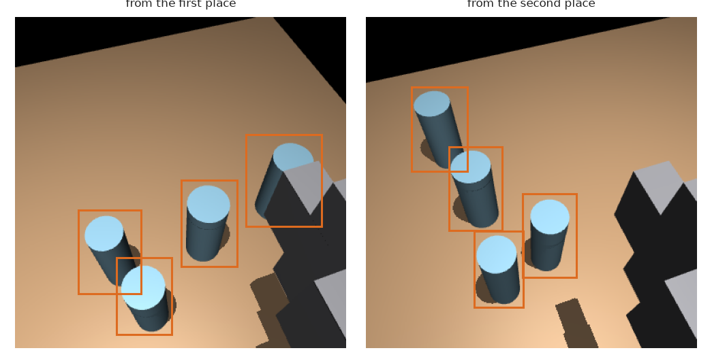

# Problem 4 — clear the table

A table holds three to five glasses, and some of them stand too close together for the
gripper to close round one. A UR5e arm, with a camera on its wrist, has to push the glasses
apart until every glass has room to be picked up, without tipping any. Then it has to say
for itself that it has finished. This page gives the whole picture and every result in one
place. The other pages each explain one part.

## The main idea: a learned model decides, MoveIt moves

A solution never writes a joint angle. The work is split into four jobs, and only the
middle two are what the solutions compete on.

| | Job | Who does it | Page |
|---|---|---|---|
| 0 | Draw a box round every glass, so MoveIt can plan round it | a network that reads the wrist picture | [the box model](the-box-model.md) |
| 1 | Choose which glass to push, and where it should go | the solution | [the solutions](#the-solutions) |
| 2 | Choose the settings handed to MoveIt, so the glass does not tip | the solution | [the solutions](#the-solutions) |
| 3 | Move the arm | MoveIt 2 | [the arm and MoveIt](the-arm-and-moveit.md) |

Jobs 1 and 2 are one answer. On each turn a solution chooses one **push**: this glass,
this direction, this distance, and six settings such as how high and how fast the hand
moves. Or it decides that the table is **finished**.

## One turn

A solution is handed the arm, with its wrist camera, and a clock, and it works through the
table itself, one turn at a time. On a turn it looks, and the box model turns each picture
into boxes. Then the solution chooses a push, or says "finished". MoveIt plans the push as
four motions, and the arm carries them out in the MuJoCo physics engine. Then the next turn
starts.

How much to look is each solution's own choice. At the start of a table every solution looks
from both viewing places, because a glass hidden behind another glass is missing from one
picture. After a push, a solution that reads only the boxes goes to the nearer place first,
and goes on to the other only when the first picture shows fewer glasses than before. SmolVLA
reads the pictures themselves, so it takes both on every turn. A push that MoveIt refuses
moves nothing, so after one, no solution looks again. Every solution also remembers the glass
whose push was refused and does not ask for it again on that table. It remembers the glass by
where it stands rather than by its number, because the next look can list the same glasses in
a different order, and then a number would name a different glass.

## The solutions

Every learned solution learns from the same thing: pushes that the arm really made, and
what happened to each one. [What the pushes show](what-the-pushes-show.md) describes
those pushes.

| # | Solution | How it chooses a push | Page |
|---|---|---|---|
| 1 | Geometry reference | The shortest safe push, with fixed settings; nothing is learned | [page](solutions/01-geometry-reference.md) |
| 2 | Geometry ranked | The same safe pushes, ordered by problem 3's fitted trees | [page](solutions/02-geometry-ranked.md) |
| 3 | Imitation | Copies pushes that worked | [page](solutions/03-imitation.md) |
| 4 | World model | Learns what a push will do, then searches for the best push | [page](solutions/04-world-model.md) |
| 5 | Reinforcement learning | Learns by trying pushes and being scored | [page](solutions/05-reinforcement-learning.md) |
| 6 | SmolVLA | A large vision-language-action model with a small fitted correction | [page](solutions/06-smolvla-fine-tuned.md) |

Two more things appear in the results. The [safety check](solutions/safety-check.md) lets
the world model reject another solution's push when it expects that push to tip a glass.
**The ceiling** is a search that tries 30 pushes in the physics before every move and makes
the best one. A real arm cannot try a push before making it, so the ceiling is not a
solution. It shows how much could be gained on these tables.

## Results

Each row walked the same 50 held-out tables, with the same 15 arm minutes for the whole
list. [The problem](problem.md#how-a-run-is-scored) explains each column. The range in
brackets shows how much the figure depends on which tables were drawn.

| Solution | Tables reached | Gain in pickable glasses (90 % range) | Glasses broken | Arm minutes |
|---|---|---|---|---|
| 1 Geometry reference | 50 | +11 (+4 to +19) | 18 | 6.8 |
| 2 Geometry ranked | 50 | +9 (+3 to +15) | 16 | 7.8 |
| 3 Imitation | 50 | +1 (−2 to +4) | 31 | 14.6 |
| 3 Imitation, with the safety check | 50 | +2 (0 to +4) | 1 | 4.8 |
| 3 Imitation, also copying the ceiling | 50 | +1 (0 to +3) | 10 | 6.4 |
| 3 Imitation, also copying the ceiling, with the safety check | 50 | +1 (0 to +3) | 2 | 3.2 |
| **4 World model** | **50** | **+6 (+2 to +11)** | **2** | **4.5** |
| 5 Reinforcement learning | 41 | +4 (0 to +8) | 4 | 14.9 |
| 5 Reinforcement learning, with the safety check | 50 | +1 (−4 to +6) | 1 | 4.7 |
| 6 SmolVLA | 50 | +1 (−3 to +6) | 24 | 14.4 |
| 6 SmolVLA, with the safety check | 50 | +1 (−2 to +4) | 3 | 6.3 |
| The ceiling (tries 30 pushes first) | 50 | +24 (+15 to +34) | 0 | 4.8 |

To see what each solution did on one table, open the [runs](../examiner/runs/results.md)
folder. It keeps the first 25 of these tables one by one: where every glass started, and where
it stood after each solution, as JSON and as a picture. It also lists every push each solution
asked for, with the direction, the settings handed to MoveIt and how the push ended, so you can
see whether the hand came down in the gap between two glasses or at the side.

## What the results say

- **Knowing which glasses tip matters most.** The two geometry solutions gain the most, +11
  and +9, because they push only crowded glasses and make every safe push the geometry finds.
  However, they break a glass on about one table in three. Problem 3's tipping rule calls
  most crowded glasses on these tables uncertain, because friction decides whether they slide
  or tip. Problem 3 settles that with a short test push, but on the arm a test push cannot
  tell a slide from a lean (see [the geometry reference](solutions/01-geometry-reference.md)),
  so the geometry pushes them anyway. The world model learns from every push, including the
  ones that tipped a glass, so it gains +6 and breaks only 2. That is why it is marked as the
  answer: of the solutions that break almost nothing, it gains the most. Reinforcement
  learning is also scored on its failures and breaks few, but it spends its arm time on a few
  tables where it keeps pushing, so it reaches only 41 tables.
- **Copying only successes breaks glasses.** Imitation and SmolVLA never saw a push that
  tipped a glass, so they push glasses that tip. The safety check removes most of that
  breakage. However, it does not add any gain, because a check can only reject pushes and
  cannot propose better ones.
- **An ordering learned in problem 3 adds nothing on the arm.** Solution 2 chooses from the
  same pushes as solution 1, with the same settings. It gains +9 and breaks 16, where
  solution 1 gains +11 and breaks 18, and that difference is within the noise of one run.
- **The arm cannot make most pushes.** About three pushes in four cannot be planned at all,
  and the push a person would try first is never possible. [What the pushes
  show](what-the-pushes-show.md) explains why.
- **There is much more to find.** The ceiling gains 24 glasses and breaks none. The world
  model finds about a quarter of that, and the geometry finds nearly half but pays for it in
  broken glasses.
- **One run is noisy, so small differences mean nothing.** These results were measured again
  after the solutions were given the choice of how much to look, with no model trained again.
  Several of them moved by two to four glasses. The cause is not the looking alone: a slightly
  different picture or a different random draw changes a borderline decision, and one
  changed push changes the rest of that table. The range in brackets covers only which
  tables were drawn, not this noise. So a difference of two or three glasses between two
  solutions should not be read as real.
- **Remembering refused glasses correctly made two solutions break more.** Every solution
  used to remember a glass MoveIt refused by its number in the list of boxes. After the next
  look that number could belong to another glass, which was then never pushed again on that
  table. Now the glass is remembered by where it stands, so imitation and SmolVLA have more
  glasses left to choose from. They push for longer and break more: imitation 31 glasses
  instead of 19, and SmolVLA 24 instead of 17. A run is not repeated exactly, because
  MoveIt's planner draws its arm paths at random, so a second run can end a few tables
  differently. However, a second run of imitation gave the same totals, and a change of
  seven to twelve glasses is much larger than the two to four that this noise moves a
  result by. So the change comes from the fix and not from noise.

## Films

Each film shows one solution on the same five held-out tables, so the films can be compared
table by table. The tables were chosen, with the solutions as they were when the films were
first made, so that every solution pushed on every one of them and some tipped a glass. In
the films as they are now, a glass goes over on two of the five tables. The words at the top of a film say
how many glasses could be picked at the start and at the end of each table. The table below
gives the same thing for every film: pickable glasses at the start → at the end, and ✗ where
a glass went over.

| Solution | 11158 | 11416 | 11716 | 11952 | 10490 |
|---|---|---|---|---|---|
| 1 Geometry reference | 1 → 3 | 1 → 1 | 2 → 4 | 2 → 2 | 1 → 3 |
| 2 Geometry ranked | 1 → 3 | 1 → 3 | 2 → 2 | 2 → 3 ✗ | 1 → 3 |
| 3 Imitation | 1 → 3 | 1 → 0 | 2 → 1 | 2 → 2 ✗ | 1 → 1 |
| 3 Imitation, with the check | 1 → 3 | 1 → 0 | 2 → 4 | 2 → 2 ✗ | 1 → 1 |
| 4 World model | 1 → 3 | 1 → 3 | 2 → 4 | 2 → 2 | 1 → 2 |
| 5 Reinforcement learning | 1 → 3 | 1 → 3 | 2 → 3 | 2 → 2 | 1 → 1 |
| 5 Reinforcement learning, with the check | 1 → 3 | 1 → 3 | 2 → 3 | 2 → 2 | 1 → 1 |
| 6 SmolVLA | 1 → 2 ✗ | 1 → 1 | 2 → 2 | 2 → 2 ✗ | 1 → 1 |
| 6 SmolVLA, with the check | 1 → 1 ✗ | 1 → 1 | 2 → 2 | 2 → 2 ✗ | 1 → 1 |

Every film was made with the solutions as they are now, so each one shows what its solution
does in the results above. Five tables are too few to rank the solutions; the results table
above does that. The films show what the ranking means. On table 11716, for example, imitation
leaves one glass fewer pickable than it started with, and with the safety check it frees both
crowded glasses instead. On table 11952 the geometry ranked solution, imitation and SmolVLA
each tip a glass, while the world model leaves the table as it found it.

Links to the films:

| Solution | Without the safety check | With the safety check |
|---|---|---|
| 1 Geometry reference | [film](../videos/1-geometry-reference.mp4) | |
| 2 Geometry ranked | [film](../videos/2-geometry-ranked.mp4) | |
| 3 Imitation | [film](../videos/3-imitation.mp4) | [film](../videos/3-imitation-with-check.mp4) |
| 4 World model | [film](../videos/4-world-model.mp4) | |
| 5 Reinforcement learning | [film](../videos/5-reinforcement-learning.mp4) | [film](../videos/5-reinforcement-learning-with-check.mp4) |
| 6 SmolVLA | [film](../videos/6-smolvla.mp4) | [film](../videos/6-smolvla-with-check.mp4) |

## Read in this order

1. [The problem](problem.md): the tables, what "finished" and "broken" mean, and the scoring.
2. [The arm and MoveIt](the-arm-and-moveit.md): job 3, and how the arm looks.
3. [The box model](the-box-model.md): job 0.
4. [What the pushes show](what-the-pushes-show.md): the data, and what it says about pushing.
5. The solution pages, in the order of the table above.

The code is in three kinds of folder. [`examiner/`](../examiner/README.md) holds the cell that
every solution runs in and is marked by: the arm in the physics engine, MoveIt, the camera, and
the scorecard. [`shared/`](../shared/README.md) holds what the solutions have in common: the
turn-by-turn loop, the box model, and how the learned solutions write a table down. Each
solution then has a numbered folder of its own, such as
[`04-world-model/`](../04-world-model/README.md), with its code and its trained weights.
