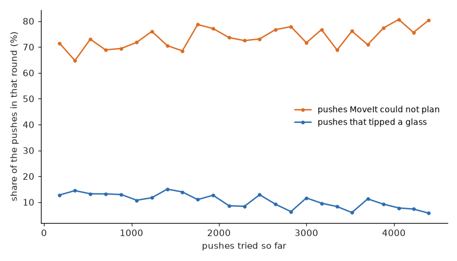

# Solution 5 — reinforcement learning

Reinforcement learning learns by trying. It is put in front of tables, it chooses pushes,
and it is paid a score for what each push did. Nobody tells it how to choose. This page
explains what it is paid, how it learns, and what a small amount of experience teaches it.
By the end you will know why it learned to be careful but not to be useful.

## What it chooses

It chooses the same push as the other solutions: a glass, a direction, a distance and the
six settings. One thing differs. The direction is measured from "straight away from the
nearest neighbour", and it starts out pointing sideways, because sideways pushes are the
ones [the arm can make](../what-the-pushes-show.md#the-obvious-push-is-the-one-the-arm-cannot-make).
That starting point is the only hint it is given.

## What it is paid

| For | Pay |
|---|---|
| each glass a push makes pickable (or no longer pickable) | +1 (or −1) |
| each centimetre of room the push takes off the table | +0.5 |
| a glass tipping over, which also ends the table | −3 |
| a push MoveIt cannot plan | −0.5 |
| each second of arm time | −0.01 |
| saying "finished" when every glass has room (or when one does not) | +1 (or −2) |

The pay for room exists because a push that loosens a table without yet freeing a glass is
still better than one that does nothing. Without it, almost every push would be paid the
same, and there would be nothing to learn from.

The pay had to be balanced with care. When "finished" was too cheap, the policy learned to
stop at once on every table. When a refused push was too cheap, it learned to ask only for
pushes MoveIt refuses, which is safe and useless.

## How it learns

The method is PPO, a standard reinforcement learning method. One network does two jobs: it
chooses pushes, and it estimates how good a table is. In each round, seven copies of the
cell run the current network on training tables, about 170 pushes in all. The network is
then changed so that pushes that were paid more than expected become more likely. After 25
rounds it has about 4,400 pushes of experience, about a third of what the other solutions
learn from.

During training it sees the simulator's glasses with errors added of about the size the box
model makes, because reading pictures for every training push would be very slow. On the
held-out tables it uses the real box model.

## What it learned

Over the 25 rounds, the share of pushes that tipped a glass fell from about one in eight to
about one in seventeen. The share it said "finished" rose from 6 % to 30 %. However, the
share of pushes MoveIt could not plan did not fall at all; it stayed between 65 % and 80 %.
So it learned to avoid the outcome that is punished loudly, a tipped glass, but not the one
that is punished quietly and often, a refused push.

How hard each round of experience is used matters a great deal. With about the same amount of
experience, making more learning passes over each round cut the glasses broken on the
held-out tables from 25 to 3.

## How it does

It gains 5 glasses and breaks 2 (see the [results](../README.md#results)). It is careful,
and it says "finished" on most tables without having changed them. On a few tables, however,
it keeps pushing until it has asked for the most pushes a table allows, so it uses all 15 arm
minutes and reaches only 43 of the 50 tables. Measured before the solutions chose how much
to look, it gained 3 and broke 3 on all 50 tables, so these few long tables are a matter of
borderline decisions going the other way, not of a new habit. The [safety
check](safety-check.md) changes little, because it was already careful. To make it useful,
it would need a better start, for example from imitation, or far more experience, which it
could gain cheaply by practising inside the world model instead of the physics.
