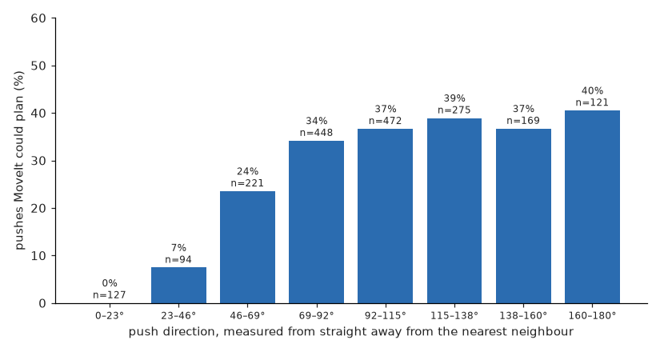
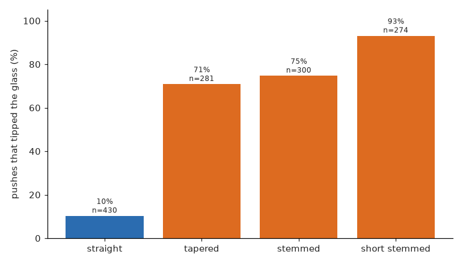
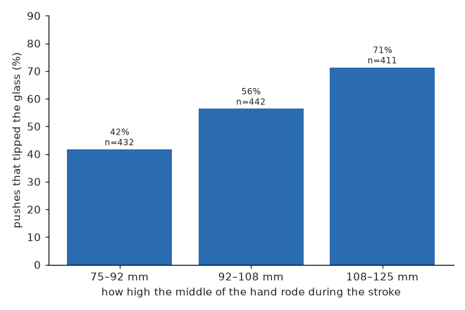

# What the pushes show

Every learned solution learns from pushes that the arm really made. This page describes
those pushes and the four things they show about pushing glasses with a whole arm. By the
end you will know which pushes the arm can make, which glasses tip, which settings matter,
and how each solution sets its push speed.

## How the pushes were made

Each push was asked of MoveIt exactly as a solution would ask: a glass, a direction, a
distance and six settings. The cell recorded whether MoveIt could plan it and, if it could,
what the physics did. A table was pushed up to four times in a row, so the data includes
tables that have already been pushed, not only fresh ones.

The pushes were collected in four rounds, 12,609 pushes in all, on training tables only.

| Round | Pushes | How each push was chosen |
|---|---|---|
| 1 | 1,927 | at random |
| 2 | 2,867 | about half by the geometry: pushes that, if they went as asked, would give a glass room |
| 3 | 4,043 | a mix of random, geometry and pushes the [world model](solutions/04-world-model.md) liked |
| 4 | 3,772 | more than half were pushes the world model liked |

The later rounds matter because random pushes rarely work. About one random push in fifty
gives a glass room, while in round 4 about one push in four chosen by the world model did.

## The obvious push is the one the arm cannot make

When two glasses touch, the natural way to separate them is to push one straight away from
the other. To do that, the hand must come down in the gap between them, and the hand and
wrist do not fit there.

The picture shows the 1,927 random pushes of round 1, which were spread evenly over every
direction. None of the 127 pushes within 23 degrees of straight away from the nearest
neighbour could be planned. Pushes at a right angle to that line could be planned about a
third of the time. So the pushes that separate glasses are sideways ones. Over all the data,
only about one push in four could be planned at all.

## The kind of glass decides whether it tips

The turned hand is narrow but tall, so it meets a glass along a band of the glass's height.
A glass with a wide foot and straight sides slides. A glass with a narrow foot or a stem
tips over.

The picture uses the first 4,794 pushes. Of the pushes MoveIt could plan, about one in ten
tipped a straight glass, and more than seven in ten tipped every other kind. Since each
table holds one kind, three tables in four have glasses that almost any push tips. On those
tables the right answer is usually to leave the table alone.

## Height matters, and speed does not

The lower the hand rides, the less often the glass tips. A straight glass pushed below
92 mm never tipped: none of 155 pushes. The hand cannot ride lower than 75 mm, because its
lower finger would then hit the table.

Stroke speed made no steady difference to tipping: in three bands from slow to fast, 59 %,
47 % and 61 % of planned pushes tipped a glass. Speed does change the time a push takes,
about 19 seconds of arm time for a slow stroke and about 8 for a fast one. The other four
settings changed whether MoveIt could plan the push and how far the glass moved, but not
whether it tipped.

## How each solution sets its speed

Every learned solution chooses the stroke speed for each push, so in principle the speed can
depend on the glass. The table shows what each one actually chose on 400 crowded training
tables, as the middle value in millimetres per second. A dash means it never chose to push
that kind of glass.

| Solution | Straight | Tapered | Stemmed | Short stemmed |
|---|---|---|---|---|
| 1 Geometry reference and 2 geometry ranked (fixed) | 50 | 50 | 50 | 50 |
| 3 Imitation | 51 | 20 | 36 | 44 |
| 4 World model | 119 | 89 | 54 | — |
| 5 Reinforcement learning | 14 | 11 | 12 | 7 |
| 6 SmolVLA (120 tables) | 25 | 24 | 28 | 22 |

The world model adapts the most sensibly. It pushes straight glasses fast, because they
rarely tip and speed saves arm time. For tapered and stemmed glasses it lowers the hand to
75 mm, against 96 mm for straight ones, so it changes the setting that matters. Imitation's
speeds differ by kind but vary widely within each kind. Reinforcement learning pushes every
glass slowly. SmolVLA gives every kind nearly the same speed and height, so it does not tell
the glasses apart. The [safety check](solutions/safety-check.md) never changes a push's
settings.
