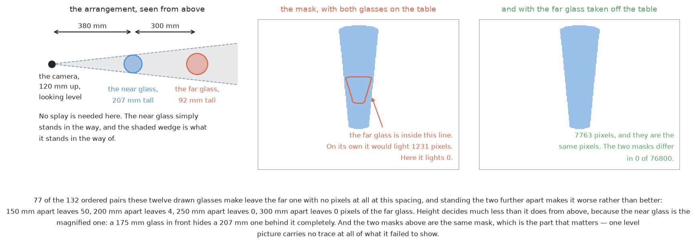
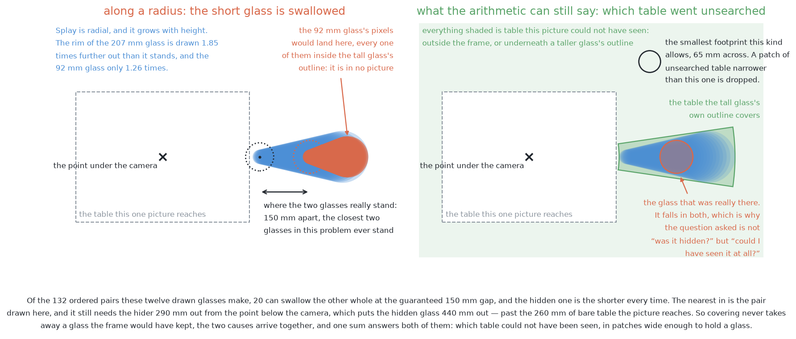
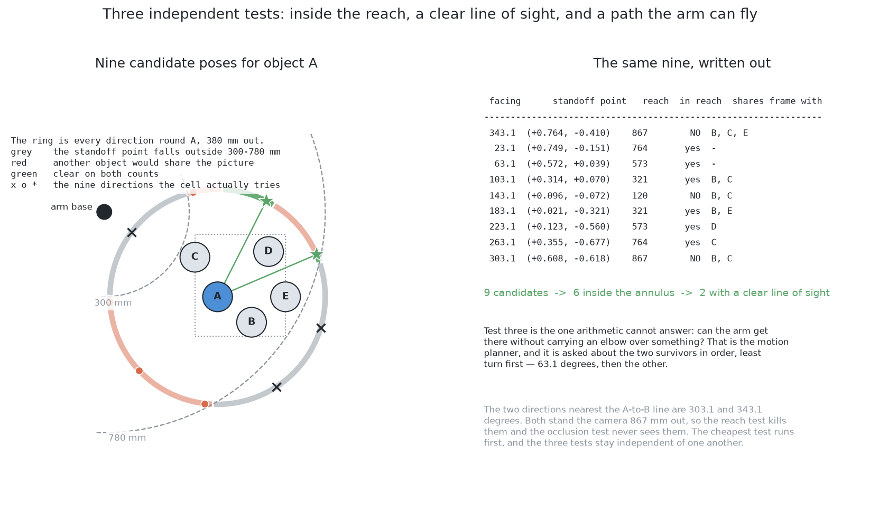
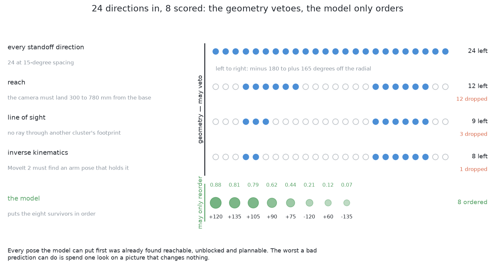
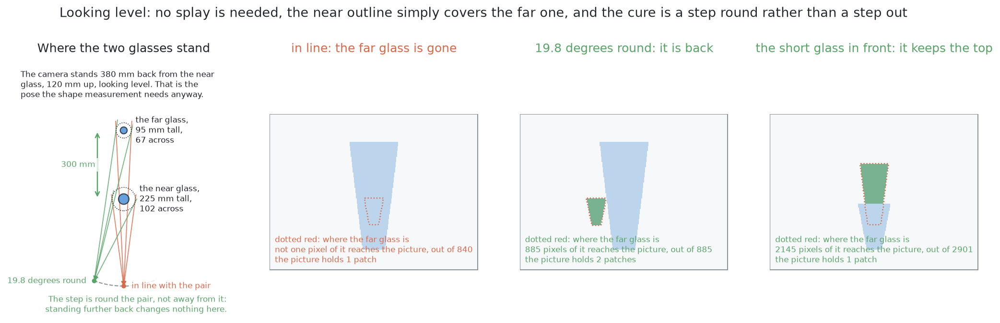

# Looking again at what was hidden

## Introduction

A tall glass's outline can cover a short neighbour completely. The short glass
then appears in no picture at all. [The
problem](problem.md#a-glass-can-be-missing-from-a-picture-altogether) explains
why.

This page says what is done about it. It is separate from the six solutions
because **every one of them needs it and none of them differs in it**. It covers
four things:

- why no work on the pixels can find a glass that left none;
- how the arm works out *where* a glass could hide without seeing it;
- how choosing where to look next becomes a known problem called set cover;
- why the one learned part sits where a wrong answer costs only a few seconds.

## Why no solution can answer this on its own

The six solutions differ in how they turn pictures into masks. Here that
difference does not matter. The problem is not a hard mask. There is nothing to
draw at all.

A method can only find objects that the picture contains. Where a tall glass
covers a short one, those pixels show only the tall glass. The short glass is
not measured badly. It is absent. No threshold, larger model or better training
changes that. The evidence is missing, not weak.

The view from the side has the same limit. Take two arrangements: one with a far
glass behind a near one, and one with the far glass removed. They give the same
picture, pixel for pixel. Any method that reads only the picture must answer
both the same way.

So the answer must come from **geometry**, not from the picture. The arm knows
where its camera was, what its lens does, and where the found glasses stand.
From those three it can work out which parts of the table no ray from the lens
reached. That is a fact about the world, so it still holds when a glass is
invisible.

## Step one: where could a glass have been hiding?

The arm starts from the glasses it found. It asks what each one could hide.

**Each found glass hides a wedge of table behind itself.** Draw a straight line
from the lens past the glass's widest part, down to the table. The table in the
shadow of that line was not seen. The shadow is a wedge that spreads away from
the point below the camera. A taller, wider glass casts a larger wedge.

**The edge of the picture hides the rest.** A camera sees a rectangle. Anything
outside it was not seen. The stations overlap on purpose, so a strip missed by
one station falls inside another. So the frame edge matters less than the
wedges.

**What is left over is reported.** Join all the wedges and frame edges from all
the stations. Take them away from the glass zone. What remains is table nobody
saw. Each piece big enough to hold the smallest footprint of this kind is
reported as an **unsearched patch**.

**An unsearched patch is not a glass, and it is not a guess that a glass is
there.** It says only that nobody looked there. Most patches are empty. Reporting
them turns a failure nobody can see into a job the arm can do.

## Step two: where should the camera stand?

The arm now has a list of places nobody saw. It must choose camera positions
that would see them.

This differs from measuring a glass. A glass has a position, so the arm can
stand around it and look at it. A patch has no glass in it. There is nothing to
look *at*. A patch also has an area, so one camera position may see all of it,
part of it, or none.

So the test is: **"does this patch fall inside what this camera position can
see?"** This is the wedge arithmetic from step one, run forwards. For a
candidate position, take away the wedges of the known glasses and the area
outside the frame. What is left is what that position sees. Then check whether
the patch lies inside it.

### Three tests, and why their order matters

Candidate positions are filtered before any are ranked. Three tests do it,
cheapest first.

**Can the arm reach it?** Simple arithmetic on the arm's size. It costs almost
nothing.

**Would something else share the frame?** A position is refused if a known
glass would block the view. It is also refused if the camera would sit where a
glass stands. This is also cheap arithmetic.

**Can the arm actually fly there?** This asks the motion planner. It is by far
the slowest test. So it runs last, and only on candidates that passed the other
two.

The order matters. A wasted planner query costs seconds, and this loop runs on a
time budget.

### Which makes it a covering problem

Each surviving position sees some of the unsearched patches. The run wants every
patch seen. Each position costs seconds. So the question is: **what is the
smallest set of positions that together see every patch?**

This is a known problem called **set cover**. You have a collection of sets and
a target, and you choose as few sets as possible to cover the target. Solving it
exactly is hard. But a simple method comes provably close. Take the position
that covers the most patches not yet covered. Repeat until all are covered. This
is the **greedy method**.

## Step three: which look to take first

Set cover says *which* positions are needed. It does not say which to take
first. The run has a time budget and may not finish the whole set, so order
matters.

Here sits the one learned part of the shared step. A small model puts the
surviving positions in order. For each candidate it reads a few plain numbers:
how many patches it would cover, how large they are, and how many glasses are
still missing. It returns a score used only for sorting.

**Where that model sits is the whole reason it is safe to have.** The geometry
makes every candidate and refuses the unsafe ones. The model only orders what is
left. So a bad order costs one wasted look and nothing worse. It cannot cause a
missed glass, because every patch stays on the list until something looks at
it. It cannot cause a collision, because the safety tests do not ask it.

**And it degrades to nothing.** With no model, the patches are covered in the
order the geometry gives. The run is slower, not wrong.

### One number the model needs that is not in any picture

One input comes from the problem, not from a sensor: **how many glasses are on
the table**. The problem says four to six. The run knows how many it has found.

That number says how seriously to take the patches. If six were expected and six
found, the patches are almost surely empty, and the looks can be skipped. If six
were expected and four found, two glasses are somewhere. The patches are the
only places left. An empty look then teaches something too. The count stays at
four, fewer places remain, and the rest become *more* likely to hold a glass.

## The honest limit

This step recovers a glass hidden from the top. The wedges can be computed, and
a new position can see into them. It does much less for a glass hidden from the
side.

Looking level, the table behind a near glass cannot be seen from anywhere on the
line through the two glasses, at any distance. So the arm needs a position off
that line. The overlapping survey stations already give one, so in practice the
survey closes this case first. One limit stays: two arrangements that give the
same pictures cannot be told apart by anything that reads only those pictures.

## Where to go next

- [The problem](problem.md): what is asked for, and the three difficulties.
- [The examiner](the-examiner.md): the shared input, output and marking.
- [The six solutions](solutions/overview.md): what each one puts between the
  pictures and the masks.
