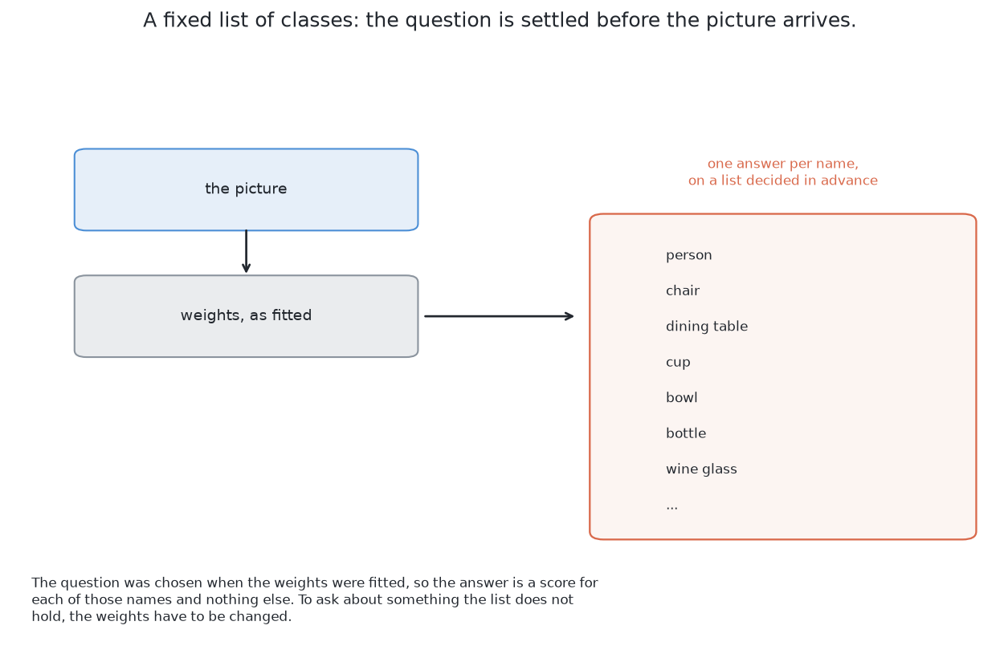
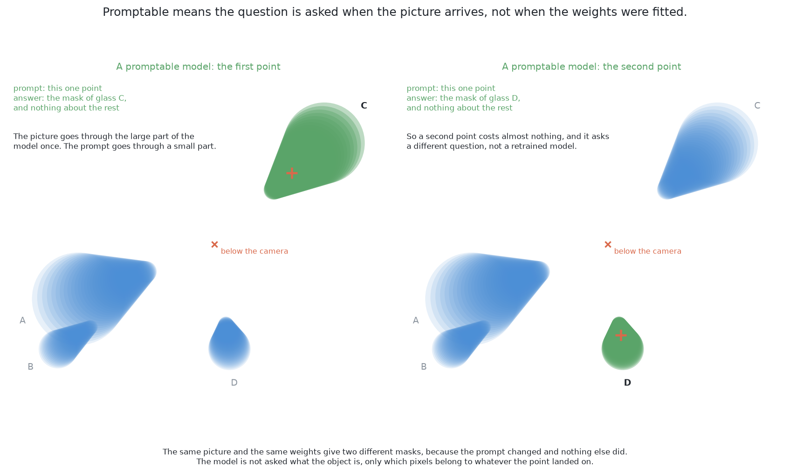
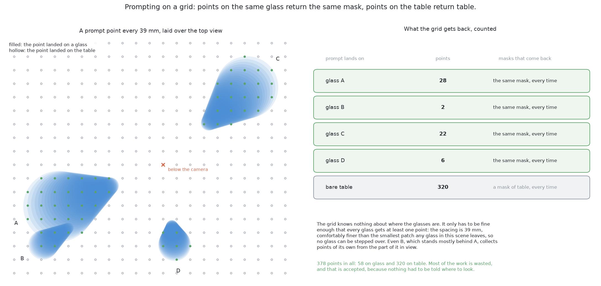
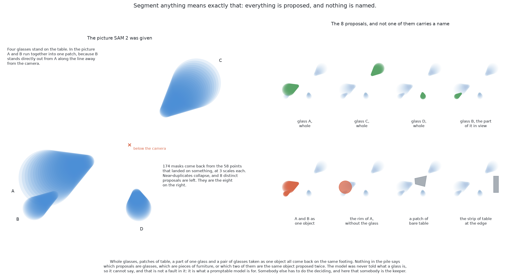
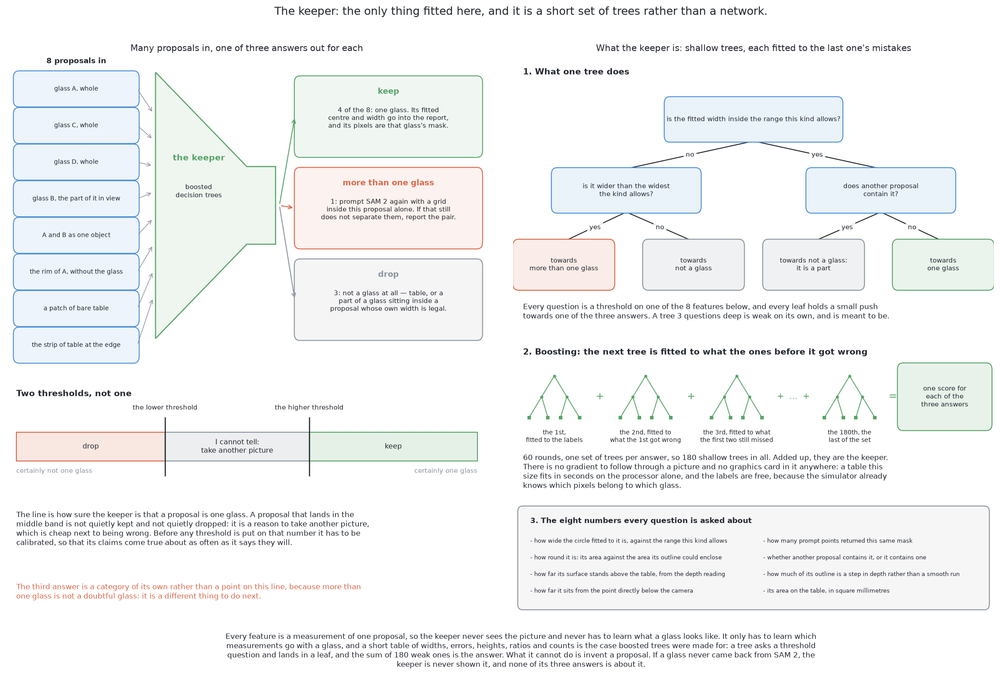
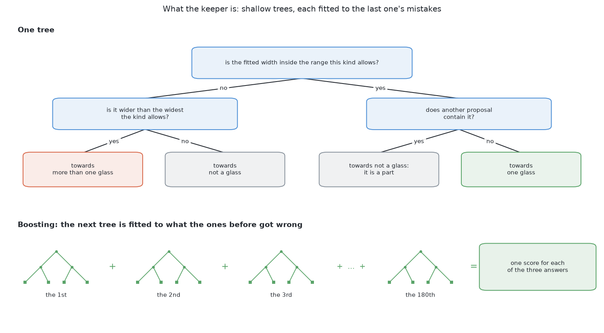
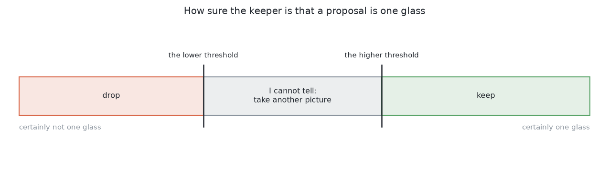
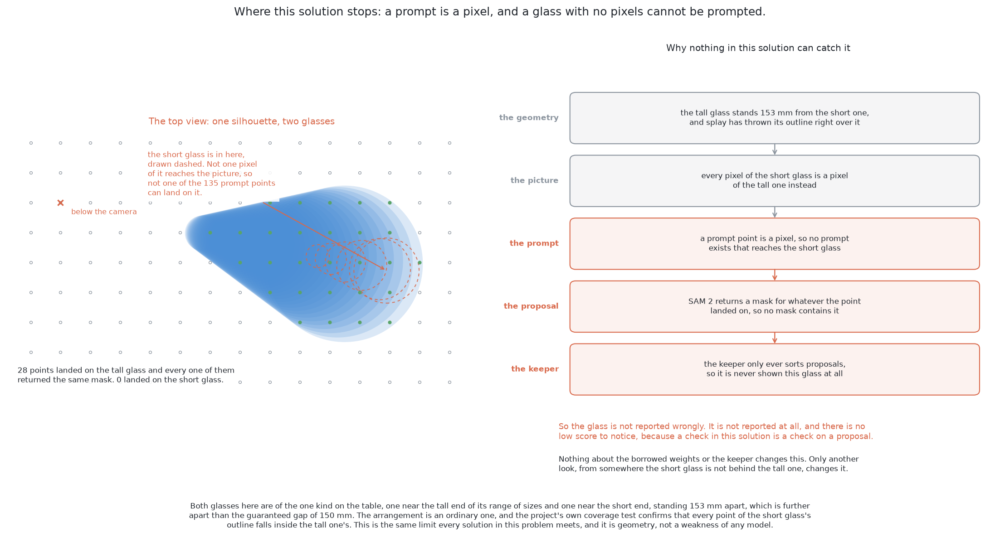
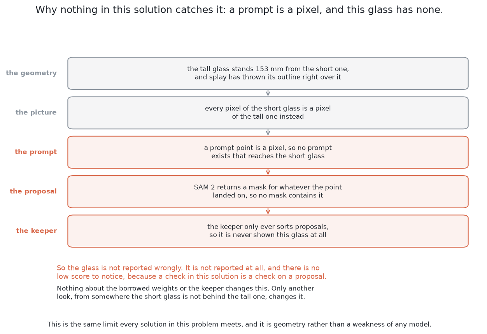

# Solution 5 — SAM 2 with a keeper

> **What it uses** — SAM 2, the second generation of the Segment Anything
> model. It is loaded through Hugging Face `transformers` and never trained
> here. scikit-learn fits the one small model this solution trains. PyTorch runs
> underneath and reaches this machine's integrated graphics through its MPS
> backend.
> **What it does** — SAM 2 outlines whatever is at a point you give it. It does
> not name what it outlines. Given a grid of points over the whole picture, it
> outlines everything: the glasses, the table, a rim, two glasses run together.
> A small model fitted here, the **keeper**, looks at each outline and decides
> whether it is one glass. So the finding is borrowed, and the deciding is
> replaced.
> **How the output is produced** — the depth is shaded into a grey picture.
> SAM 2 reads it once. A grid of point prompts gives a heap of outlines. Score,
> stability and duplicate checks cut the heap to a shortlist of **proposals**.
> Each proposal becomes a few measurements on the table. The keeper answers
> keep, drop, or more than one glass. A kept proposal must still pass a width
> check against the kind. The survivors are the masks this solution reports.

> **What it costs** — no hand labelling, because the examiner's answer key
> labels each proposal by arithmetic. Fitting the keeper takes seconds on the
> processor. Running SAM 2 over the arrangements is what takes time. At run time
> it costs one pass of the picture encoder per picture. The weights are large
> and not ours, so they must be fetched and pinned to a version. The licence is
> permissive, unlike the weights of solutions 3 and 4.

> **The cell is described once, in [the cell](../../the-cell.md)** — the layout,
> the two camera places (top and side), the four sensors, and the words this
> project uses. This page covers only what is special to this solution.

## Introduction

This page answers [problem 2](../problem.md) with almost nothing fitted in this
cell. A large borrowed model does the finding, exactly as it downloads. A small
model fitted here, the keeper, decides which of its outlines are glasses.

You will learn what a promptable foundation model is. You will see how a grid of
points makes it propose everything in a scene, and why it is never trained here.
You will learn what the keeper reads, why it is fitted, why it gives three
answers, and why its probability must be calibrated.

The solution has two **ways**, meaning two versions of one approach. The second
uses SAM 3, a newer model that takes a word instead of a point. Asked for
"drinking glass", it would remove the keeper. [The second
way](#the-second-way--a-word-instead-of-a-grid) weighs the two. The newer one is
not simply better. The keeper is the only place in the six solutions where the
decision can be explained by printing its inputs beside its answer.

## The code at the heart of it

Two models meet at one place, so this section shows that place first. Going in,
a grid of point prompts enters the borrowed model. Coming out, a short row of
measurements is made from each region. That row is all the keeper ever reads.

Going in, in `05-sam2-with-a-keeper/sam_keeper.py`: the grid spacing comes from
the narrowest glass the kind allows. The grid covers the whole picture. The
model runs on batches of points, with the picture already encoded.

```python
def prompt_spacing(kind: str) -> int:
    ...
    narrowest = data.widths(kind)[0] / _metres_per_pixel()
    return max(1, int(narrowest / POINTS_ACROSS_SMALLEST))

def _grid(spacing: int, inside: np.ndarray | None = None) -> list[list[float]]:
    """Prompt points (column, row) on a regular grid, optionally only where ``inside`` is true."""
    rows = np.arange(spacing // 2, render.HEIGHT, spacing)
    columns = np.arange(spacing // 2, render.WIDTH, spacing)
    points = [[float(column), float(row)] for row in rows for column in columns]
    ...

    def at(self, points: list[list[float]]) -> tuple[np.ndarray, np.ndarray, np.ndarray]:
        ...
        asked = [[[point] for point in points]]
        prepared = self.processor(original_sizes=self.sizes, input_points=asked, return_tensors="pt")
        all_points = _onto(prepared["input_points"], self.where)
        ...
            for start in range(0, all_points.shape[1], PROMPTS_AT_ONCE):
                chunk = all_points[:, start : start + PROMPTS_AT_ONCE]
                out = self.model(image_embeddings=self.embeddings, input_points=chunk, multimask_output=True)
```

Coming out, in the same file: each region that survived the cleanup becomes
numbers measured on the table, not in the picture. Six of the keeper's eight
numbers come from here. The calling function adds the other two: how many prompt
points returned this region, and how it nests among nearby regions. Neither can
be known from one region alone.

```python
def _measure(picture, mask, found, jumps, step, camera, widths) -> list[float]:
    ...
    rows, columns = found.pixels[:, 0], found.pixels[:, 1]
    points = render.to_world(picture, rows, columns)

    low, high = widths
    edge = mask & ~cv2.erode(mask.astype(np.uint8), np.ones((3, 3), np.uint8)).astype(bool)
    return [
        (found.width - low) / (high - low),  # where its width falls in the kind's range
        _roundness(mask),
        float(np.median(points[:, 2]) - TABLE_TOP_Z),  # how far its surface stands off the table
        float(math.dist((found.x, found.y), camera)),  # how far it sits from under the camera
        float(np.mean(jumps[edge] > step)) if edge.any() else 0.0,  # how much of its edge is a step
        _table_area(points),
    ]
```

The borrowed half is one call: `self.model(...)` on a `Sam2Model` loaded
through Hugging Face `transformers`. Every line around it belongs to this
project. The fitted half never sees a pixel. scikit-learn gets only the list the
second block returns. The model there is a `HistGradientBoostingClassifier`
wrapped in a `CalibratedClassifierCV`.

## The problem this solves

[The problem](../problem.md) asks for one mask per glass, for four to six
glasses of one known kind. The hard part is counting. [Two glasses that stand
apart can still join into one shape seen from the
top](../problem.md#glasses-merge-in-the-picture-even-when-they-stand-apart-on-the-table).

Solution 1 answers with rules a person writes. Solutions 2, 4 and 6 fit weights
to this cell. Those weights are a second copy of the cell, and they go out of
date when the cell changes. This solution borrows weights that never saw this
cell, so nothing in them can go stale. It fits only the last small decision.

The catch is simple. A model never fitted to this cell also never saw it. It
does not know about splay, that all glasses are one kind, or the gap the cell
keeps between glasses. There is no way to tell it.

## The main idea

Ask for everything, then throw away what is not a glass.

**First, ask for everything.** SAM 2 returns an outline of whatever is at a
point. Ask it at points spread evenly over the picture. Every point lands on
something. So you get the table, each glass, parts of glasses such as a rim, and
groups of glasses. None of them has a name. No gradient ever passes through
SAM 2 in this project.

**Second, decide what to keep.** Each outline that survives a first cleanup is a
**proposal**. The keeper reads a few measurements of one proposal and says
whether it is one glass. It is the only thing fitted here, and it fits in
seconds. Its labels are free, because the examiner knows which pixels belong to
which glass.

**The job is split along the line that transfers best.** A shape is a shape
everywhere. A step in distance between one surface and the one behind it is the
same evidence in a kitchen photo and in a shaded depth picture. So the proposing
half can be borrowed. What counts as a cup is a judgement fitted to somebody
else's pictures. It need not match what counts as a glass here. So the naming
half is replaced. Solution 3 makes [the opposite
trade](03-yolo-zero-shot.md#one-stage-detect-and-segment-against-propose-then-classify)
and borrows both halves.

## What a foundation model is

This section defines the borrowed half, because what this solution gains and
risks follows from it.

A **foundation model** is fitted once, on a very large and general set of data,
at a cost nobody wants to repeat. Then many people use it for tasks it was not
fitted for. One group with many machines does the fitting. Everyone else
downloads it.

SAM 2 is **class-agnostic**: it returns regions with no labels. It has no list
of object types and never needs the word "glass". So it learned on everyday
photos and not on this cell, but that alone does not rule it out.

SAM 2 has three parts. The **picture encoder** turns the whole picture into a
block of numbers. It is the expensive part, and it runs once per picture. The
**prompt encoder** turns one prompt into a small block of numbers. The **mask
decoder** combines the two into a mask. It is cheap, and it runs once per
prompt.

### What promptable means

A promptable model is not the same as a network that takes a picture and
returns an answer.

An ordinary network has a **fixed list of classes**, chosen before it was
fitted. It answers one question: how strongly does the picture show each name on
the list? To ask about anything else, you must fit it again.



A **prompt** is a second input that says *which* thing you mean. For SAM 2 it is
a point ("the thing here"), a box ("the thing in this rectangle"), or a rough
mask. Picture and prompt go in together, and one mask comes out. Change the
prompt and you get a different mask from the same weights. In code terms, the
model is a function of two arguments, not one.



**Ambiguity is returned, not resolved.** A point on a glass wall could mean that
patch of wall, the whole glass, or the glass with what stands behind it. The
model does not guess. For one point it returns several masks: roughly a part, a
whole, and something larger. Each has its own quality estimate, and the caller
chooses. This is why the proposals include a rim without its glass. It is also
what gives the keeper choices to make.

**A prompt selects; it does not add information.** It says which part of the
picture you care about. It cannot tell the model about anything the picture
holds no evidence of. [The hidden glasses](#when-the-glasses-are-completely-hidden)
section rests on this.

## Turning a promptable model into a proposer of everything

One prompt gives one thing, so many prompts give many things. That turns SAM 2
into something that finds objects on its own.

Lay a regular grid of points over the picture from the top, and prompt at every
point. The grid aims at nothing, so nothing needs to know where the glasses are
first. Each point returns whatever is under it. Bare table returns the table. A
glass wall returns the wall, the glass, and something larger. The grid puts
several points on the narrowest glass the kind allows, so it touches everything
in the scene at least once.



This is cheap because of the three parts named above. The picture encoder runs
**once**. Each prompt is one pass through the small mask decoder. So a whole
grid costs little more than one prompt.

### What comes back, and the cleanup that is not fitted

What comes back is a heap with three problems. Many points land on one glass, so
the same region arrives many times with slightly different edges. One point
returns a part, a whole and something larger, so the heap holds a rim, its
glass, and the glass with its neighbour. And some masks are unstable, which
shows the model is unsure of a boundary.

The fixes are standard, and none of them is fitted. **Drop the low-scoring
masks**, using the quality estimate the model returns. **Drop the unstable
masks**: move the cut-off that turns the model's output into a yes-or-no mask,
and keep only masks that barely change. Then **remove the duplicates** with
[non-maximum suppression](04-yolo-fine-tuned.md#non-maximum-suppression). The
**overlap** of two masks is the area both claim divided by the area either
claims. It is one for identical masks and zero when they share nothing.

The score and the stability are a **gate**, not evidence. They cut the heap to a
shortlist. The keeper never sees them, because it must decide what a region
*is*, not how sure SAM 2 was.

After the cleanup there is a shortlist of good regions, and **none of them has a
name**. Nothing says which are glasses, or that the largest is the table. Nothing
says that a joined shape is two glasses and not one wide one.



So SAM 2 answers *where are the regions*. The problem asks *which regions are
glasses, and how many*. The rest of this page closes that gap without training
SAM 2.

## Why the borrowed model is never trained here

The obvious way to close the gap is to train the model. This solution does not.
**Never trained** means the weights are used exactly as downloaded. No gradient
passes through them, no layer is replaced, and nothing about this cell reaches
them.

Four things follow. **There is no training set of pictures for the finding.**
Arrangements are still rendered, but the keeper learns from a short table of
measurements. **Nothing can go out of date**, because the model never saw this
cell. **It cannot overfit to the renderer**, so it needs no randomisation.
**Setup is a download**, not a training run.

One cost follows at once: **you cannot teach it anything.** Every difficulty
special to this cell is handled **before** the model or **after** it. Before
means choosing its picture. After means the keeper. Splay, the single known kind, the gap between
glasses, the range of sizes: the model knows none of these. So the next sections
are about the input and the output, not the model's insides.

Freezing a large model and fitting something small behind it is ordinary
practice. [A small head on frozen features](#a-small-head-on-frozen-features)
gives the sources.

## The picture the borrowed model is handed

The input is the riskiest choice in the design, so it comes before the keeper.

The examiner gives a grey picture shaded from depth, the depth at every pixel,
and the camera's pose. SAM 2 was fitted on colour photographs. So it sees a
picture of distances made to look like a photograph. The one grey channel is
copied into all three colour channels, so the model accepts it.


This is a **domain gap**: the data a model is used on differs from the data it
was fitted on. [Solution 3 explains the
risk](03-yolo-zero-shot.md#the-domain-gap-which-is-the-main-risk). A model
across a gap gives confident, wrong answers, so you must look for the gap on
purpose. Here it shows in four ways, and they do not all point the same way.

**Brightness means distance, not surface.** In a photo, a step in brightness is
often a change of material, a shadow or a highlight. Here it is only a step in
distance. The two agree at a glass's outline, where the wall and the table
really are at different distances. They disagree almost everywhere else.

**There is no texture.** Photos have grain, wood, print and dirt. A shaded depth
picture is smooth. A model that uses texture edges finds none.

**Glass does not look like glass.** In a photo, glass is clear, has highlights,
and bends what is behind it. Shaded depth draws it as a solid with a clean
outline. That helps here, because these glasses are opaque anyway. It helps by
accident, not by design.

**Missing readings leave holes.** Where the depth camera returns nothing, the
shading must invent a brightness. A hole filled with one constant value has a
sharp edge, and SAM 2 will propose it as an object.

Three fixes follow. They are advice, not something built. Scale each picture's
shading to the depth range it holds, so outlines are the strongest edges. Add
shading from the surface slope, which the depth readings give, so a curved wall
looks curved. Fill holes from their neighbours, not with a constant, so a hole
does not become an object.

None of this closes the gap. It only makes the picture more like a photograph.
The two stemmed kinds suffer most, because a thin stem gives almost no outline
in shaded depth. Where shading is not enough, the fix is outside this solution.
It is solution 4 or solution 6, whose weights can move towards this cell's
pictures.

## The keeper

Here the solution stops being borrowed. The keeper runs once per proposal. It
reads a short table of numbers about that proposal. It returns how likely the
proposal is to be exactly one glass.

### What the keeper is shown

The keeper is not shown pixels. The useful facts are not in the pixels but in
what they mean on the table, and this project already has the arithmetic for
that.

The glasses are opaque, so each proposal's pixels carry depth readings. They
become points in the room, the same way [the examiner measures a
mask](../the-examiner.md#what-must-come-back). That gives a width and a height
above the table. The other measurements come from the outline's shape, the
depth along the outline, and the nearby proposals. There are eight in all.

**Where the width falls in the kind's range** is the strongest input. The kind
is known, so its range of widths is known. Narrower than the narrowest glass of
the kind is a part of something. Wider than the widest is more than one thing.

**How round it is** compares its own area with the area its outline could
enclose. A filled disc is as round as a region can be. A ring, a crescent, and
two footprints joined by a strip of table all fall well short.

**How far its surface stands above the table** separates the table from what
stands on it.

**How far it sits from the point below the camera** is about the view, not the
glass. A glass right below the camera shows almost none of its wall. A glass far
out shows a lot of it. So the same glass gives a different proposal in the two
places, and the keeper is told which it is.

**How many prompt points returned this mask** is counted by the duplicate
removal anyway. A region many points agreed on is firmer than one a single
prompt found.

**Whether another proposal contains it, or it contains one** is the
**containment** measurement. A hand-written rule usually forgets it. A rim sits
inside a larger proposal with a legal width, and that larger proposal holds a
smaller one. So one count, read both ways, separates a part from its whole.

**How much of its outline is a step in depth** is the last thing the picture
gives. Where a glass ends, the depth jumps from its wall to the table behind. An
outline made of such jumps belongs to a thing on the table. An outline that
runs smoothly across one surface was drawn by the cut-off, not by the room.

**How much table it stands over** is an area on the table, not a pixel count. It
separates the table from anything that could be a glass of this kind.

The table below lists the eight. The left column is the measurement, and the
right column is why it helps answer "is this one glass?".

| What the measurement says | Why it bears on the question |
| --- | --- |
| where the measured width falls in the range this kind allows | the kind's range of widths is known, so a width outside it is not one glass of this kind |
| how round it is, its own area against the area its outline could enclose | a glass seen from the top is a filled disc whatever the splay, while a rim is a ring and a joined pair has a waist |
| how far its surface stands above the table | a proposal lying at the table's own height is the table |
| how far it sits from the point directly below the camera | splay grows with that distance, so the same glass gives a different proposal near the camera and far from it |
| how many prompt points returned this same mask | a region the grid agreed on many times is firmer than one a single prompt found |
| whether another proposal contains it, or it contains one | a proposal inside a legal glass is a part of that glass, and the glass is the proposal that holds it |
| how much of its outline is a step in depth rather than a smooth run | a thing standing on the table ends where the depth jumps to the table behind it |
| how much table it stands over | the table stands over far more of itself than any glass of this kind can cover |

Every one is a **length, a count or a ratio, and none is a place in the
picture**. This is a requirement. The camera is on the wrist and visits several
stations. The same glass sits at a different pixel in each picture. But its
width, roundness and height are the same from all of them. An input in pixels
would teach the keeper where the camera stood during training. It must not learn
that. The distance from the point below the camera is the one input about the
camera. It is there on purpose, because it says how much splay to expect.

One worry is worth settling now. Seen from the top, the **mouth** of a glass is
a filled disc with that glass's footprint. It has a legal width, it is round,
and it stands clear of the table. So the keeper may keep a mouth as a glass.
That does no harm, because the mouth lands at the place its own glass already
stands. [One report per place](#the-arithmetic-still-decides) then merges the
two.

### Why the keeper is fitted rather than written

Every input could be a written threshold instead. There are three reasons to fit
them.

**First, the evidence is many weak pieces, and none is decisive.** A proposal
about one glass wide, round, and clear of the table could be one glass, the near
part of two, or a mouth. No single measurement tells them apart. A proposal a
little too wide could be two glasses, or one glass whose mask leaked onto the
table. A threshold cuts on one measurement at a time. A fitted model can learn
that a width near the top of the range matters only when roundness is also low.
Writing that by hand needs a cut for every combination, and there are too many.

**Second, this solution's purpose.** A page of thresholds is a programmed
solution, and problem 2 already has one in solution 1. This solution asks how
little has to be written down.

**Third, the labels are free.** The examiner's answer key says which glass owns
each pixel. So a proposal's overlap with each real glass is simple arithmetic.
Good overlap with one glass means one glass. Overlap with none means not a
glass. Good overlap with two means more than one glass. No person labels
anything. The labels come only from the training half of the arrangements, and
the keeper is never run on the answer key.

### Three answers, not two

In this cell, "more than one glass" is the usual way for a proposal to be wrong.
So the keeper gives three answers.

**Keep** means the proposal is one glass. Its pixels are that glass's mask.

**Drop** means the proposal is not a glass. The table, a rim and an unstable
region are all dropped.

**More than one glass** is handled, not thrown away. SAM 2 is prompted again
with a fresh grid only inside that proposal. This can work where the whole
picture failed. When one glass stands in front of another, the near rim is much
closer to the camera than the far wall. SAM 2 can find that step in depth. If at
least two returned regions stand at different places, with widths in the kind's
range, they are reported as two glasses.

If not, the pair is **reported as an unseparated pair** with its reason. It is
handed to [problem 3](../../03-push-glasses-apart/problem.md). That is not a
failure. This project reports anything doubtful and never guesses.



### What kind of model the keeper is

The keeper's input is a short table of mixed numbers: widths, heights,
distances, ratios and counts. Its output is one of three answers.
**Gradient-boosted decision trees** were made for this (Friedman, *Greedy
Function Approximation: A Gradient Boosting Machine*, Annals of Statistics,
2001). scikit-learn provides them.

A tree asks threshold questions and ends in a leaf that holds a prediction.
Boosting fits one weak tree, then fits the next tree to the first one's errors,
and adds them up.



Each question is a threshold on one measurement from the table above. Each leaf
gives a small push towards one answer. A tree three questions deep is weak on
its own, on purpose. 60 rounds, one set of trees per answer, make 180 shallow
trees. Added up, they are the keeper.

Trees suit this table for three reasons. They ignore scale, so a length and a
ratio need no rescaling. They find combinations of conditions by themselves,
which is the argument above. And they fit in well under a second on an ordinary
processor.

**This is the only solution of the six where a classical model decides.**
Solutions 2, 4 and 6 decide with a network fitted here. Solution 3 uses a
borrowed network's names. Solution 1 uses arithmetic a person wrote. Here, the
keeper's inputs are named measurements. Printed beside its answer, they are an
explanation a person can read and argue with.

### Calibration, and why the probability needs it

The keeper returns a probability. Before a threshold is put on it, it must be
**calibrated**: its claims must come true about as often as it says. [Solution 3
defines
this](03-yolo-zero-shot.md#the-number-beside-each-outline-and-why-it-is-not-a-probability).
Boosted trees tend to push scores towards 0 and 1. So a raw score of 0.9 does not
mean nine in ten such proposals are glasses.

This matters because the score is compared with a threshold. A threshold on a
meaningless number is just a knob turned until the results look good. So a small
correction from raw score to honest probability is fitted with the keeper, in
**folds**. The table of proposals is cut into parts. Each part in turn is held
back. The trees are fitted on the other parts, and the correction on the part
held back. So the correction never sees rows the trees were fitted on. If it
did, it would learn the keeper's overconfidence instead of correcting it. The
correction is only a few numbers.

**One weakness will not show in any run.** The folds cut the table row by row.
One arrangement gives many rows. So proposals from the same table can land on
both sides of a fold. The correction then sees an easier test than a fresh
arrangement, and its probabilities are a little too kind. The fix is to cut the
folds by arrangement, not by row. It is cheap, but the code does not do it
today.

With a calibrated probability, the keeper can use **two thresholds**. The band
between them means "I cannot tell". A proposal in that band is neither kept nor
dropped. It is a reason to take another picture from another place. That costs
arm time, but it is cheaper than being wrong. A glass half hidden behind another
should land there, because its footprint is too narrow, less round, or both.



"More than one glass" is not a point on that line. It is not a doubtful glass
but a different next step, so it is a category of its own.

### The arithmetic still decides

One thing is the same as in solution 1, and it keeps this solution inside the
project's safety argument.

A proposal the keeper keeps still has its width checked against the kind. If the
width is outside the kind's range, it is **not reported as a glass**, whatever
the keeper said. It becomes a doubtful report with its reason. [Solution 1
explains this
check](01-rules-on-the-table.md#checking-a-group-against-the-widths-the-kind-allows).

**There is one exception: a glass the frame cut short.** At survey height one
picture does not hold the whole glass zone. A glass at the edge of a frame shows
only part of its footprint, so its width is only part of a width. Handed the
examiner's exact masks, one station at a time over 20 held-out spawned
arrangements, the kind's range refuses 66 of 297 glass sightings. **Every one of
those 66 reaches the frame edge.** So a proposal whose mask reaches that edge is
not checked. The survey answers it instead. The cell looks from three
overlapping stations, and the report kept is from the station where the glass
stood nearest the middle. [Solution 4 gives the full
argument](04-yolo-fine-tuned.md#the-masks-are-what-this-contributes).

**Two reports at one place are one glass reported twice.** Two glasses of one
kind stand with their centres at least the kind's narrowest width apart. So a
report nearer than that to one already kept is the same glass again. Only the
surer of the two keeps the place. The cell guarantees this geometry, and nobody
tuned it. It keeps the count honest when a mouth and its glass are both kept.

So SAM 2 proposes, the keeper sorts, and the geometry decides. A rule nobody
trained checks every fitted choice. That makes a model this foreign safe to use
here.

## The second way — a word instead of a grid

Everything above is the first way. The second way would remove the keeper.

SAM 3 is in the same library. It takes **open-vocabulary text prompts**. The
prompt is a phrase, not a point, and it is not limited to a fixed list. The
model returns every instance of what the phrase names. So one request for
"drinking glass" would replace the grid and the keeper, with one outline per
glass. There is no heap to clean, because nothing proposes the table or a rim.
There is nothing to fit, because the naming happens inside the borrowed model.

**Both ways are the same solution.** Both borrow a promptable foundation model
and train nothing here. They differ only in where "this is a glass" is decided.
In the first way it is a small fitted model in this folder. In the second it is
inside borrowed weights, reached through a word.

The gain is real. There is **less code**: no grid, no gate, no duplicate
removal, no measurements, no classifier, no calibration and no training. There
is **nothing fitted**, so there is nothing to keep in step with the cell. And
the outlines are already about glasses, so the mistakes the keeper catches, such
as the table or a rim, do not arise.

The loss is the thing this page values most. **The keeper is the one place in
the six solutions where the decision can be explained by printing its inputs
beside its answer.** When it drops a region, the reason is a short list of named
measurements. A person can read it, disagree, and point at the wrong
measurement. A text prompt moves the decision inside a model nobody here can
inspect. When it misses a glass, there is nothing to print. You can only try
another phrase.

There is a second loss. **With a text prompt, this solution starts to look like
solution 3**, because both rely on a borrowed model's idea of a glass. An open
vocabulary is better than solution 3's fixed list, because the phrase can say
"drinking glass" directly. But it is the trade this solution was built to avoid:
borrowing both halves instead of only the half that transfers.

**The second way has not been run on this machine.** A newer generation's
licence must be read on its own; it is not inherited from SAM 2. And SAM 3's
weights are gated: they download only to an account that has been granted
access. The code for this way is written, but it has no scorecard, and none has
been invented. Only the first way has been measured.

So do not choose once. Fit the keeper, because it is small and fast. Run both
ways on the same held-out arrangements, on a machine with access to the newer
weights. The examiner makes that comparison fair. If the text prompt wins, the
keeper still explains why a region was refused.

## The masks are what this contributes

Like every solution here, this one contributes only masks. [The
examiner](../the-examiner.md#what-must-come-back) turns each mask into a place
and a width, the same way for all six. So any difference in score belongs to the
mask. **No model here produces a pose.** The place comes from depth and the
camera's pose, by arithmetic.

## How the concepts fit together

Here is the whole pipeline in order. Each stage works only on what the stage
before it passed on.

The depth readings are **shaded** into a grey picture. The **picture encoder**
runs once over it. A **grid of point prompts** goes through the mask decoder,
one cheap pass each. Score, stability and duplicate removal cut the results to a
shortlist of **proposals**. Each proposal's pixels become **points in the
room**. A width, a height above the table and the other **measurements** come
from those points and from nearby proposals. The **keeper** reads them and gives
one of three answers. Its probability is **calibrated**, so its two thresholds
mean what they say. A kept proposal must still pass the **width check** against
the kind. Where two reports land at **one place on the table**, only the surer
one survives. A proposal called more than one glass gets a **second round of
prompts inside itself**. Anything left over is **reported doubtful**, and a pair
goes to problem 3.

Three points matter most. **The keeper is the only fitted stage**, and it reads
numbers, not pictures. **The shading is the riskiest stage**, because no
arithmetic can check it and it changes what every later stage sees. **The width
check comes after the keeper**, so a wrong keep becomes a doubtful report, not a
wrong glass.

## When the glasses are completely hidden

A glass can be fully covered and leave no pixel in any picture. [What is asked
for](../problem.md) gives the geometry. [Looking again at what was
hidden](../hidden-glasses.md) is the shared answer: work out where a glass could
stand unseen, and go and look there. No method that reads pictures can do
better, because the picture is the same with or without the hidden glass. Below
is only what is special to this solution.

**The keeper is never asked.** SAM 2 grows a mask from what the picture shows at
the prompt. A prompt over the hidden glass lands on the covering glass and
returns it, and that answer is correct. More prompts do not help, because **a
prompt selects and does not add information**. With no proposal for the hidden
glass, the keeper has nothing to judge.

The first picture shows the arrangement from above. The short glass is entirely
inside the tall one's outline, so none of the 464 prompt points can land on it.



The second picture follows that through the solution, step by step. No stage
could have noticed.



A foundation model can handle objects it never saw. That does not help here. The
problem is not an unfamiliar object but **an absent one**, and there is no
evidence of any kind.

## A worked example

One picture from the top shows the chain working, and failing once. It walks
through the design. It is not a record of a run.

**The picture.** Five glasses stand in the glass zone, across the kind's range
of sizes. Two of them stand on a line running out from the point below the
camera. The depth is shaded grey. It is scaled so the tallest rim and the table
sit at the two ends of the grey range.

**The proposals.** After the cleanup the shortlist holds the table, four regions
about one glass wide, one region far wider than the kind allows, three rims and
two mouths.

**The keeper.** The table is dropped: it is too wide and lies at table height.
The rims are dropped: they are rings, and they sit inside proposals with legal
widths. The mouths are harder, because their footprints are legal, so the keeper
may keep one. Four proposals are kept as one glass each. The wide one is
answered "more than one glass".

**The width check and the second round.** All four kept proposals pass the width
check. The wide one fails it, as it should. A fresh grid inside it returns two
masks, split at the step between the near rim and the far wall. Both widths are
legal, so they are reported as two glasses.

**One report per place.** The near glass of that pair was also proposed on its
own, so it arrives twice. The kept mouth stands where its own glass already is.
Both are second reports at a place already taken, so both are dropped. Five
glasses are reported where five stand.

**Where it fails.** A sixth glass stands behind the tallest one. It cast no
pixels, so no prompt reached it, no proposal exists, and the keeper was never
asked. The report gives five glasses and one region of table that could not have
been seen. That second statement is all this solution can do to find the sixth.

**What it costs.** Running SAM 2 is nearly the whole cost. The picture encoder
runs once per picture, each prompt is cheap, and the keeper is too small to
notice. The whole chain costs far less than one movement of the arm.

## What it needs

It needs a **deep learning framework** and its environment. That is a large
dependency for a cell whose simplest answer is a page of arithmetic.

It needs a **weights file this project does not own**. Solutions 2, 4 and 6
make their weights here and can make them again. These cannot be made here, so
they must be fetched, pinned to a version, and stored where a run can find them.

It needs **arrangements for the keeper**, which the examiner renders and labels
for free. It needs far fewer than a network fitted from scratch, because it
learns from numbers, not pictures. Calibration needs no extra arrangements,
because it uses folds of the same table.

Fitting the keeper takes **seconds** on the processor, once the proposals exist.
Running SAM 2 to get them is where nearly all the cost sits, at fitting time and
at run time. The machine is an Apple processor with integrated graphics and
memory shared with the processor. PyTorch reaches the graphics through its MPS
backend, and falls back to the processor without it. There is no separate
graphics card and no CUDA. The shared memory is why a model this size fits.

It needs **the shading got right**. That is the one place where a careless
choice harms everything after it, and nothing complains.

The **licence is permissive**. Solutions 3 and 4 use weights under the AGPL,
which [solution 3 explains](03-yolo-zero-shot.md#the-licence-which-is-the-real-cost-here).
If this cell becomes a product, those two have a question to answer and this one
does not.

## Where it is strong and where it breaks

Most of these points are argued above, so this list only names them. The
measured scores are in [the code's README](../../../02-segment-glasses/05-sam2-with-a-keeper/README.md#results).

**Almost nothing is fitted, and what is fitted is small, fast and readable.**
The borrowed part cannot fall out of step with the cell. The keeper fits in
seconds, and its inputs can be printed beside its answers. No other solution
here has that.

**It needs the least data of the four that fit anything**, because it learns
from a table of numbers, not from pictures.

**It splits the job along the line that transfers**, as [the main
idea](#the-main-idea) explains. That is the clearest reason to prefer it to
solution 3.

**It notices things nobody described.** The grid proposes every region. So a
spoon left on the table arrives as a proposal and is answered "not a glass". The
other solutions are blind to anything outside the one class they know.

**Its doubt is cheap and explicit.** Three answers, two thresholds, a width check
after the keeper, and one report per place each turn a wrong answer into a
doubtful report.

The weaknesses are not small.

**The domain gap is the largest risk, and it cannot be closed from inside.** The
only levers are the shading and the grid, because nothing is trained. The two
stemmed kinds suffer most. Where the levers fail, the answer is solution 4 or
solution 6.

**It cannot be taught this cell's hard cases.** Pairs closer than the cell's
rule, touching pairs, a half-hidden glass: solutions 2, 4 and 6 can train on
these. SAM 2 cannot be told about them.

**It finds regions by their boundaries.** Where there is no boundary, nothing
finds one. Two glasses joined with no seam become one region. A rule that
follows connected pixels would join them for the same reason.

**It depends on depth twice.** The keeper's best inputs, the footprint width and
the height above the table, come from depth. So does the picture itself. If the
glasses become real clear glass and the depth camera sees through them, this
solution has no input at all.

**It is blind to a fully hidden glass**, as [shown
above](#when-the-glasses-are-completely-hidden). That is a fact about the input,
not the model.

## The general ideas behind this

Nothing here is new. Each piece has its own sources and its own cases where it
is the right tool.

### Foundation models — one very expensive fit, reused many times

[What a foundation model is](#what-a-foundation-model-is) defines the idea. The
term and the argument come from Bommasani and colleagues, 2021
([arXiv:2108.07258](https://arxiv.org/abs/2108.07258)). The general mechanism is
[transfer learning](https://en.wikipedia.org/wiki/Transfer_learning), which
[solution 4 covers](04-yolo-fine-tuned.md#transfer-learning-and-fine-tuning).

It is the right tool when the fit is too expensive to repeat and your labels
are scarce. It helps most when your task is one of many similar ones. It is the wrong tool when the
task is narrow, the labels are free, and the borrowed model's world differs from
yours. That is solution 2's argument for fitting a small network here.

### Promptable segmentation — Segment Anything

[What promptable means](#what-promptable-means) explains the idea. Kirillov and
colleagues, 2023 ([arXiv:2304.02643](https://arxiv.org/abs/2304.02643))
introduced it. The second generation adds video by carrying a memory between
frames (Ravi and colleagues, 2024,
[arXiv:2408.00714](https://arxiv.org/abs/2408.00714)). This problem works one
picture at a time, so the video memory is not used. The reason to prefer SAM 2
is its stronger picture encoder.

It is the right tool when you need outlines of things you cannot name in
advance. It also suits a person picking among proposals, or a first stage
before a classifier. It is the wrong tool when you need a decision, because it names
nothing. It is also wrong when objects are not defined by their visible
boundaries, and when the input is not a photograph.

### Open-vocabulary segmentation — a phrase instead of a point

A model takes a phrase and returns every instance of what it names, with no
fixed list. Matching phrases and pictures in one space became common with CLIP
(Radford and colleagues, 2021,
[arXiv:2103.00020](https://arxiv.org/abs/2103.00020)). Models built on that idea
give this solution its second way.

It is the right tool when the thing is easy to say but hard to write a rule
for. Nobody must need to check the decision. It is the wrong tool when the decision
must be explained. It is also wrong when what you mean is narrower than the
phrase, because you cannot say which reading you meant.

### Propose, then classify

Make many candidate regions with a cheap general method, then decide about each
one. R-CNN worked this way (Girshick and colleagues, 2013,
[arXiv:1311.2524](https://arxiv.org/abs/1311.2524)), with selective search
(Uijlings and colleagues, *International Journal of Computer Vision*, 2013) as
the proposer. This solution has a far better proposer and a far smaller decider.
[Solution 3 compares it with doing both in one
pass](03-yolo-zero-shot.md#one-stage-detect-and-segment-against-propose-then-classify).

It is the right tool when missing an object early is worse than proposing too
many, because a later stage can always reject. It is the wrong tool when the
proposer and the decider disagree about what one object is. That is this page's
"more than one glass".

### Zero-shot transfer — using a model on a task it was never fitted for

[Solution 3 covers this
idea](03-yolo-zero-shot.md#zero-shot-transfer--using-a-model-on-a-task-it-was-never-fitted-for);
the general notion is [zero-shot
learning](https://en.wikipedia.org/wiki/Zero-shot_learning). It costs only a
download, so it is the first thing to try. But once you have labels and a narrow
task, fine-tuning nearly always wins. That is the argument solutions 4 and 6
make against this one.

### A small head on frozen features

Freeze a large borrowed model, and fit something small on what it produces. This
worked early and well (Donahue and colleagues, 2013,
[arXiv:1310.1531](https://arxiv.org/abs/1310.1531); Razavian and colleagues,
2014, [arXiv:1403.6382](https://arxiv.org/abs/1403.6382)). It is the standard
first thing to try with a borrowed model. The keeper differs in one way. It
reads measurements of each proposal, not the model's own internal numbers.
Measurements on the table mean the same from every view, and a person can read
them.

It is the right tool when data is small and the borrowed features already hold
what the task needs. It is the wrong tool when they do not. No small head can
recover what the frozen part threw away, and then the weights must move.

### Gradient-boosted decision trees

[What kind of model the keeper is](#what-kind-of-model-the-keeper-is) explains
the idea (Friedman, 2001). It is the right tool for a short table of mixed
numbers with a category to predict, and it needs no rescaling. It is the wrong
tool for raw pixels, sound or text. There, a network that learns its own
features wins easily.

### Calibration — making a score mean what it says

A small correction turns a model's output into an honest probability. It is
fitted on data the model was not fitted on. It is either a curve with two
parameters (Platt, 1999) or a staircase that never goes down ([isotonic
regression](https://en.wikipedia.org/wiki/Isotonic_regression), Zadrozny and
Elkan, 2002). Boosted trees often need it, because boosting pushes scores
towards the ends. [Solution 3 explains why calibration breaks when the input
changes](03-yolo-zero-shot.md#calibration-under-changed-input).

It is the right tool whenever a threshold or a cost is applied to a score, as
with the keeper. It is not needed when only the order is used, because such a
correction cannot change an order. It does not fix a wrong model. A calibrated
bad model is honestly unsure instead of secretly unsure.

### The domain gap, and sim-to-real

A model carries the habits of the data it was fitted on (Torralba and Efros,
*Unbiased Look at Dataset Bias*, CVPR 2011). The general problem is [domain
adaptation](https://en.wikipedia.org/wiki/Domain_adaptation), which [solution 4
covers](04-yolo-fine-tuned.md#domain-adaptation). There are three usual repairs.
Make the synthetic pictures look more real. Vary everything that is not the
task, which is domain randomisation (Tobin and colleagues, 2017,
[arXiv:1703.06907](https://arxiv.org/abs/1703.06907)). Or translate one look
into the other with a fitted model (Zhu and colleagues, 2017,
[arXiv:1703.10593](https://arxiv.org/abs/1703.10593)).

Two things are unusual here. The gap runs **the opposite way** from the usual
sim-to-real case: the weights come from photos, and the pictures come from a
renderer. And randomisation is **not available**, because it happens during
training and nothing here is trained. The only lever is the input. When a model
cannot be trained, the honest options are to change the input or to stop
borrowing.

## Where it sits among the other five

The scores side by side are in [the results
table](../../../02-segment-glasses/results/README.md). This section compares the
designs.

**Against solution 3**, the question is what to borrow. Both fit nothing that
finds objects. Solution 3 borrows shapes and names together. This solution
borrows the shapes and replaces the names with a fitted, readable keeper. That
is the better half to replace, because surface boundaries transfer from photos
far better than categories do. The second way gives that advantage back.

**Against solution 4**, the question is where the adaptation happens. Solution 4
moves the borrowed weights towards this cell's pictures. That is the real fix
for the domain gap, and it is the one fix this solution lacks. Solution 4 pays
with a training run that must be repeated when the cell changes. This solution
has nothing to go stale. It pays with worse outlines where the shading serves
the kind badly. Solution 6 makes the same trade as solution 4, with a different
model.

**Against solution 2**, the two sit at opposite ends of one line. Solution 2
borrows nothing and fits everything here. This solution borrows almost
everything and fits almost nothing. Solution 2's weights are a copy of this cell
and must be kept in step with it. These weights are owned by somebody else and
know nothing of this cell. Solution 2 costs hours of rendering and fitting. This
costs a download and minutes. But solution 2 can be taught this cell's hard
cases, and this one cannot.


The bars say how much is fitted. The table says what that difference buys and
costs. Read one row at a time: the left column is the question, and the other
two columns are how each solution answers it.

| the question | solution 5: borrow almost everything | solution 2: fit everything from scratch |
| --- | --- | --- |
| what it brings in, fitted somewhere else | 93,314,184 weights, used exactly as downloaded | nothing |
| what is fitted here | 180 shallow trees: 2,700 thresholds and leaf values | 482,211 weights, every one of them |
| what kind of thing is fitted | threshold questions and leaves, fitted on the processor in seconds | weights, fitted by following a gradient through a picture |
| what the fitted part has to learn | which measurements of a proposal go with a glass | which pixels are glass, and where each centre is |
| training scenes needed | a few, because so little is being fitted | many, because everything is being fitted |
| what it was fitted on | everyday photographs, for the part that finds objects | this cell's own pictures, and nothing else |
| where the risk sits | the borrowed part has never seen a picture like this one | the fitted part has seen nothing but pictures like it |

The last row is the trade in one line. Borrowing buys a small training set. It
also brings a risk, because a borrowed weight cannot be corrected here.

**Against solution 1**, the comparison is the least flattering. Solution 1 is a
page of arithmetic. It has no training set and no weights. Its run time is tiny
beside one pass of a picture encoder. Its failures are explained by one printed
number. When the depth readings work, it is the simpler tool. This solution
needs depth too, for the keeper and for the picture. So it does not survive real
glassware either. It survives having almost no training data, which is a
narrower virtue.

This solution asks two questions. How far do borrowed weights get in this cell
with almost nothing fitted behind them? The examiner answers that by running it
beside the other five. When is an explainable decision worth more than a shorter
program? The two ways of this solution ask that of each other, and it is a
judgement, not a measurement.

← [The same model, fine-tuned here](04-yolo-fine-tuned.md) · [RF-DETR-Seg,
fine-tuned here](06-rf-detr-fine-tuned.md) →
