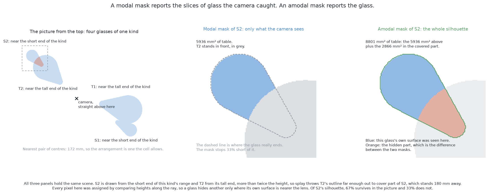

# Solution 6 — RF-DETR-Seg, fine-tuned here

> **What it uses** — the RF-DETR package, with PyTorch under it, on this
> machine's graphics processor through the MPS backend. The model is
> **RF-DETR-Seg**, a transformer that detects and segments in one pass. Its
> licence is Apache 2.0. It comes in several sizes, so a size can be chosen to
> fit the machine.
> **What it does** — it takes one picture from the top and returns one mask per
> glass. No step has to cut a joined region apart. The model arrives already
> fitted to ordinary labelled pictures. Training then continues on this cell's
> pictures, with one class, "glass". The first of its two ways is built and
> scored. The second was never fitted to the end and claims no number. It is
> the one solution of the six that can be asked for the part of a glass nobody
> saw.
> **How the output is produced** — the grey picture shaded from depth goes in.
> The model's body describes every part of the picture. A fixed set of
> **queries** reads that description. Each query returns a class, a rectangle
> and a mask over the whole picture, or "nothing". The empty ones are dropped.
> Each mask goes to the examiner, which turns it into a place and a rough width.
> **How it differs from the other five** — it is the same amount of fitting as
> [the same YOLO fine-tuned here](04-yolo-fine-tuned.md), with a different
> architecture and licence. That is the closest comparison in the set.
> [Where it sits among the other five](#where-it-sits-among-the-other-five)
> gives the rest.
> **What it costs** — the labels cost nothing, because the examiner renders
> them. The fine-tune is the largest cost. It runs on one laptop through MPS,
> with no NVIDIA card and no CUDA. Apache 2.0 puts no obligation on the code
> around the model.

> **The cell is described once, in [the cell](../../the-cell.md)** — the
> layout, the two camera places (top and side), the four sensors, and the words
> this project uses. This page covers only what is special to this solution.

## Introduction

This page describes the sixth answer to problem 2. It is for a reader who has
read the problem and, ideally, [solution 4](04-yolo-fine-tuned.md). The problem
asks which pixels belong to which glass. This solution takes RF-DETR-Seg, a
transformer that detects and segments objects. It continues its training on
this cell's pictures with one class, "glass".

Two things make it worth its own page. First, its masks are not drawn inside a
rectangle. Older segmenters find a rectangle first and paint the mask inside
it, so the mask cannot reach past the rectangle. This model has no such limit.
Second, that freedom lets it mark the part of a glass that the picture does not
show. That is this solution's **second way**.

**The first way is built and scored. The second way is not.** Its fine-tune
used the same settings as the first. It stopped unfinished when the machine
filled up, so it claims no number. The first way's numbers are beside its code,
in [`06-rf-detr-fine-tuned/`](../../../02-segment-glasses/06-rf-detr-fine-tuned/).
Where this page says what the second way would do, that is the design, not a
run.

By the end you will know what a query is and how set prediction removes a
cleanup step. You will know why this shape suits a request for a glass's whole
silhouette. And you will know the one mistake that would do the most damage.

## The code at the heart of it

Two pieces of code carry this solution. The first is the **fine-tune**. It
turns a model fitted on everyday photographs into a finder of glasses in this
room. The second is the **split**. It separates the pixels the camera really
saw from the pixels the model only asserts. Without it, the second way could
not be let near the arm.

The fine-tune is two steps, in `06-rf-detr-fine-tuned/rf_detr_seg.py`. The
borrowed weights are built into a model. Then the package's own training loop
runs over the pictures and labels this cell wrote, with one class.

```python
def fresh():
    ...
    weights.borrowed()
    import rfdetr

    return getattr(rfdetr, SIZE)(device=str(device.pick()))
    ...
    model = fresh()
    model.train(
        dataset_dir=str(folder / "dataset"),
        output_dir=str(folder / "run"),
        epochs=epochs,
        batch_size=batch,
        lr=LEARNING_RATE,
        class_names=[labels.CLASS],
        tensorboard=False,
    )
```

The split is this project's own arithmetic, in the same file. It asks the
simulator nothing. A camera looking down throws every outline outwards from
the point below it. So of two overlapping reports, the one nearer that point is
in front. Every pixel both claim belongs to it. The function returns, for each
report, the pixels that a nearer report covers.

```python
def hidden_by_others(picture, masks: list[np.ndarray], nadir: tuple[float, float]) -> list[np.ndarray]:
    ...
    usable = [mask & np.isfinite(picture.depth) for mask in masks]
    ...
    contested = np.sum(np.stack(usable), axis=0) > 1
    away = []
    for mine in usable:
        alone = masks_to_glasses.one_glass(picture, mine & ~contested)
        away.append(np.inf if alone is None else float(np.hypot(alone.x - nadir[0], alone.y - nadir[1])))

    behind = []
    for index, mine in enumerate(usable):
        theirs = np.zeros_like(mine)
        for other, nearer in enumerate(usable):
            if other != index and away[other] < away[index]:
                theirs |= nearer
        behind.append(mine & contested & theirs)
    return behind
```

The first block is the borrowed work: the `rfdetr` package, PyTorch, and one
`train` call. The second block is the part nobody can borrow. Its result goes
to `masks_to_glasses.one_glass` as pixels whose depth readings must be left
out. A second, smaller set of asserted pixels comes from a check described
later, and it is left out the same way.

## The problem this solves

[The problem](../problem.md) sets the task: four to six glasses of one known
kind, and for each a set of pixels, a place and a rough width. The outward
throw of a tall glass's outline in a top picture is called **splay**. [Solution
1](01-rules-on-the-table.md#why-a-picture-from-the-top-joins-two-glasses-that-stand-apart)
explains it.

Splay causes two failures, and this solution aims at both:

- **Two glasses become one joined region.** Two outlines meet in the picture.
  A method that calls each joined region one object then reports one glass
  where two stand. [The
  problem](../problem.md#glasses-merge-in-the-picture-even-when-they-stand-apart-on-the-table)
  describes this.
- **A glass is partly covered by the glass in front.** Its mask stops where the
  near glass begins. What is left is a slice of the glass, all to one side.
  This failure is quiet, and [the second
  way](#the-second-way--training-against-the-whole-silhouette) is about it.

A third case is a glass covered completely, with no pixels at all. [When the
glasses are completely hidden](#when-the-glasses-are-completely-hidden) covers
it, and the answer is short.

## The main idea

Use a model whose output already holds separate objects, and whose masks are
not shut inside rectangles.

These are two claims. The first is shared with other solutions: a model that
returns one mask per object never has to divide a joined region. The second
belongs to this solution alone. The second way rests on it, because a mask
that covers more than the camera saw must be free to grow.

The weights come from fine-tuning. The model arrives fitted to many ordinary
labelled pictures, and training continues on this cell's pictures. [Solution
4](04-yolo-fine-tuned.md#fine-tuning--continuing-somebody-elses-training)
explains fine-tuning in full. It is why a model this size fits on one laptop.

## What a transformer segmenter does differently

This section explains how this model's shape differs from the older shape. The
rest of the page depends on that difference.

**The older shape is propose, then refine.** The detector first proposes
rectangles that might hold an object. It then takes each rectangle, decides
what is inside, and tightens it. It paints the mask **inside that rectangle
only**. The mask is made on a small grid over the rectangle and stretched to
fit, so it cannot reach past the rectangle's edge. The list of proposals starts
long and is cut down in a separate step.

**This model's shape is a fixed set of slots.** It carries a fixed number of
**queries**. A query is a small list of numbers that the model updates as it
reads the picture. Each query asks one question over the whole picture: *is
there an object here, and which pixels are it?* The number of queries is fixed
before training. It is set well above the number of objects any picture holds.

In programming terms, the older shape is a list that grows and is then pruned.
This shape is a **fixed-size array of optional values**. Each slot holds one
object or is empty. A picture with two glasses and one with six give arrays of
the same length. Only the number of filled slots differs.

The masks follow from that. Each filled query becomes a short description of
its object. The model also describes every pixel in the picture. The mask is
the set of pixels that match the query's description, computed over the whole
frame. So **there is no rectangle for a mask to escape**. The model does report
a rectangle too, but the rectangle is worked out from the mask. It is not a
frame the mask was drawn in.

## Why that matters for this problem

There are two reasons, one immediate and one that the second way depends on.

First, two glasses whose outlines join are two different slots from the start.
The queries look at the whole picture at once, so nothing treats the joined
region as one thing. Nothing has to find a seam. Two masks come out, and they
may overlap, because each one is about a different object.

Second, a mask has room to grow. A partly covered glass shows evidence only on
one side. So the smallest rectangle round its visible pixels is smaller than
the glass. In the older shape, that rectangle clips the mask. Here there is no
such edge. A mask may claim any pixel. So asking for the whole shape of a glass
is a request this architecture can express. That request is [the second
way](#the-second-way--training-against-the-whole-silhouette), and it is why
this architecture was chosen.

## One class

The class list is cut to one entry, "glass". This is the same change [solution
4 makes](04-yolo-fine-tuned.md#what-one-class-does), and that page explains its
effects. Each query now chooses between "glass" and "nothing". A high score
means "something is here", not "this is a glass rather than a bowl". That is no
loss here, because the kind is known. It becomes a loss in [problem
5](../../problem-5/problem.md), where naming the kind is the question.

Cutting the list does not make the model smaller or the training much shorter.
Almost all the weights are in the part that reads the picture, and that part
does not know the class list.

## Set prediction

This section explains how training gets one answer per glass, not several.
This is where this family differs most from the older one.

**Set prediction** treats the model's whole output as one set of answers. That
set is compared with the set of real objects. At each training step, the
filled slots are matched to the real glasses **one to one**. Each real glass
gets exactly one query. Each query gets at most one glass. The pairing chosen
is the best fit overall. Every leftover query is told its right answer was
"nothing".

So a query that reports an already-matched glass is not rewarded for being
nearly right. It is told it should have said "nothing". Duplicates are trained
out of the model rather than removed from its output. A picture with four
glasses comes back with four filled slots, because that is what training
rewarded.

The older shape needs **non-maximum suppression** to remove duplicates.
[Solution 4](04-yolo-fine-tuned.md#non-maximum-suppression) explains it. It has
one setting, how much overlap counts as a duplicate. It assumes that heavy
overlap means a duplicate. In this cell, splay can push one glass's outline
across another's. Then two real glasses overlap heavily, and one can be thrown
away.

Set prediction removes both the setting and the assumption. There is one fewer
number to justify. Two overlapping glasses do not compete, because each has its
own slot. That is a design expectation, not something this folder measured.

Set prediction has a cost. Early in training, which query owns which glass can
change from step to step. So models of this family need patience in training.
Much published work on them is about making the matching settle faster.

## Fine-tuning this model here

The architecture is settled. This section is about where its weights come
from.

[Solution 4](04-yolo-fine-tuned.md#fine-tuning--continuing-somebody-elses-training)
explains training, fine-tuning and why fine-tuning needs less data. Here, almost
all the weights are in the part that reads a picture. What is borrowed is
mostly a general answer to "what is in this part of the picture". So a few
hundred pictures is a sensible training set, and this cell makes that many
easily.

The labels are free. The examiner renders which glass owns each pixel, so each
mask is a selection over that image. It gives labels only for the training
half of its arrangements. [Solution
4](04-yolo-fine-tuned.md#where-the-training-set-comes-from) explains this.

The pictures carry a **domain gap**. That is the gap between the pictures a
model was fitted on and the pictures it now sees. [Solution
3](03-yolo-zero-shot.md#the-domain-gap-which-is-the-main-risk) explains it.
Here the input is depth shaded into grey, with no colour or texture. But the
model is fitted on those grey pictures. So the gap should cost accuracy and
training time, not correctness. That is reasoning, not a result.

The training set must also include hard cases. The cell's placement rule keeps
glasses apart. So the training set must include crowded pairs and heavy
overlaps as well. [Solution
4](04-yolo-fine-tuned.md#where-the-training-set-comes-from) states the rule:
the edge of what the model will face should sit in the middle of its training
set.

## The second way — training against the whole silhouette

Everything above marks the pixels the camera sees of each glass. This section
is the step up. It belongs to this solution, because only this architecture has
room for it.

The step is one sentence: **train each mask against the glass's whole
silhouette, not only the pixels the camera sees.** The whole silhouette is the
shape the glass would have if nothing stood in front of it.

Two words name the two masks. A **modal** mask covers the pixels where the
camera saw the glass's own surface. ("Modal" comes from "mode", meaning a
sense, such as sight.) An **amodal** mask covers every pixel the glass would
occupy if nothing stood in front. You know that part is there, but no light
from it reached the camera. The amodal mask always contains the modal one. The
difference between them is the **hidden part**.



People see amodally all the time. A cat behind a railing reaches your eyes as
strips of cat between bars. You still report one cat. A model that marks only
visible pixels reports the strips. That is correct, but it misleads the next
step if that step assumes a whole object.

**On a glass with nothing in front of it, the two masks are the same.** So
training against whole silhouettes costs nothing on easy pictures. It also
gives a free test: on a glass with a clear view, anything the model adds is
wrong.

### Why it helps

This is the quiet failure from [the problem this
solves](#the-problem-this-solves). [Solution
4](04-yolo-fine-tuned.md#what-training-closes-and-what-it-cannot-touch) shows
the cause: a modal mask of a partly hidden glass is a slice. The examiner reads
a slice as a glass that is **smaller than the truth and standing where no glass
stands**.

The danger is that nothing objects. The width is still one the kind allows, so
the slice looks like a smaller glass. The arm is sent to an empty place.
Compare the loud failure: two glasses as one region give a width too large for
the kind, and the check fires. **A loud failure is a result; a quiet one is a
trap.**

A whole-silhouette mask fixes the cause. The far glass becomes its own region,
with its outline where it really runs. Its visible slice is credited to it, not
absorbed into the glass in front. A slice too thin to report alone is reported
as part of a whole glass.

### Why this architecture suits it

A whole silhouette reaches beyond the visible evidence. In the older shape, the
rectangle comes from the evidence, so the mask is clipped at that edge. Making
that work would mean training the rectangles to be larger than the evidence
too. Here nothing needs fixing, because the mask covers the whole picture from
the start. **With no rectangle to escape, a mask is free to grow.** Only the
training target changes.

That is a useful general lesson. **One network can answer a different question
by changing its target, not its shape.** The body learns to describe the
picture. The question lives in what the output is compared with.

A small code change is not a small task change. Marking visible pixels traces
an edge the picture shows. Marking a whole silhouette traces an edge the
picture does not show. The model must know the shape of the kind. It must also
know which of two objects is in front. If it completes the wrong one, the mask
spreads over the nearer glass. So this way may need more training, or a larger
model size. Whether it does is **not known here**.

### The trap, and it is the one thing most easily got wrong

This mistake is invisible. It makes the mask look better and the answer much
worse.

A whole-silhouette mask claims pixels where the camera saw another object. That
is an assertion, not an observation. **The depth reading at such a pixel belongs
to whatever stood in front.** Feed it into the shared arithmetic, and it gives a
point on the near glass. A patch of such points drags the computed place onto
the object in front.

So the rule is absolute. **A mask that claims pixels the camera never saw the
glass at must say which pixels those are.** It hands on the observed part and
the asserted part separately. The examiner then **leaves those readings out**
and does not guess values for them. [The
examiner](../the-examiner.md#the-ceiling-what-the-best-possible-answer-would-be)
states this rule and measures it with exact masks. Naming and leaving out those
pixels puts a glass much closer to where it stands.

Finding the asserted pixels costs nothing. The split in [the code at the heart
of it](#the-code-at-the-heart-of-it) reads them off the answer itself, with no
reference to the truth.

If the split is skipped, every check still passes. The mask looks better, the
footprint is round, and the width is legal. The result is a plausible wrong
answer, the very kind this way exists to prevent.

### What the completion actually buys

The asserted pixels are left out, so they add nothing to the place or the
width. The measurement is what the observed pixels alone would give. **What the
completion buys is attribution, not measurement.** Each glass gets one region of
its true shape. The hidden glass's visible part is credited to it. A glass that
would have been left out is reported as itself, in roughly the right place. Its
width comes from the seen part, so it is under the truth.

Two things follow. First, such a width is for planning, not for gripping. In
this project the fingers close until they touch and then check the width. Second,
where the camera barely saw a glass, the outline has too little inside it to
place. It should be reported as doubtful. A doubtful glass is a result in this
project, not a failure.

One more number comes free. Divide the size of the observed part by the size
of the whole mask. That is the **visible fraction**: how much of the glass the
camera saw. It costs one division and comes from the answer, not from the
model's opinion. It should travel with every reported glass. Each later step
has its own limit on how much may be asserted. None can apply that limit once
the two parts are merged.

### The risk of inventing glass, and what bounds it

A model trained to extend evidence can extend it too far. It can extend
evidence that needed no extending. It can also turn a scrap into a glass that
is not there. In this cell, a thin strip of glass pixels may be a hidden glass.
It may also be the edge of something that ends there, and the two look the
same. And splay
stretches every outline outwards, so a far edge can look cut off when the glass
simply ends.

This failure is loud, not quiet. Two cheap checks bound it. Both are in the
code, and each can only refuse.

**The width must lie inside the range the kind allows, unless the picture ran
out before the glass did.** An invented glass needs a width. A width outside
the kind's range is reason to refuse the report as doubtful. But this holds
only when the mask lies inside the frame. At the survey height, one picture
does not hold the whole glass zone. A glass at the far side of a frame is cut
in half, and its width is wrong. [Solution
4](04-yolo-fine-tuned.md#the-masks-are-what-this-contributes) gives the
measurement: with exact masks over 20 held-out spawned arrangements, the range
refuses 66 of 297 sightings, and **every one of those 66 reaches the frame
edge**. The three overlapping stations answer such a report instead.

This check cannot catch a slice cut short by the glass in front, because the
slice has a legal width. It does catch an invention, because an invented
footprint either fits the kind or does not.

**The asserted part must lie where the camera could not see.** Claiming a glass
continues behind the near glass is allowed. Claiming it continues across a
patch the camera saw clearly contradicts an observation. So each mask pixel no
nearer report explains is placed in the room with its own depth reading. If
that surface stands further from the report's middle than the kind's widest
footprint, the camera saw something else there. Such pixels are left out like
the rest of the asserted part. A report with more than a small share of them is
refused. This is the stronger check, because it is pure geometry. It is the
reason a learned completion can be let near the arm.

There is also a free test for a quiet kind of invention. A model might add a
little to every glass. Then every footprint is slightly too wide and slightly
moved outwards, and no single answer looks wrong. **On a glass with nothing in
front of it, the amodal mask must equal the modal one.** So take only the
unobstructed glasses in the marking half and measure what the model adds. The
right answer is nothing.

### How to tell whether the completion works at all

The usual score for a segmenter misleads here. A model could be built and
declared a success while completing nothing.

The usual score is **overlap**: pixels in both masks, divided by pixels in
either. Against the visible truth, it punishes a correct completion, because
every completed pixel counts as a mistake. The best score goes to a model that
ignores the amodal target. **A score that rewards doing nothing will be
optimised by a model that does nothing.** Against the whole silhouette it is
better but still weak. For most glasses the hidden part is small, so the score
mostly measures the visible edge.

So watch the **overlap over the hidden part alone**. The examiner can give it
exactly by subtracting one of its masks from the other. Beside it, watch the
counts of glasses found, missed and merged. A good completion first shows up as
an extra glass found, not as a better footprint.


## The masks are what this contributes

This solution stops at the masks, as all six do. The examiner turns each mask
into a place and a width, by the same function for all six. [The
examiner](../the-examiner.md#what-must-come-back) explains that step. So a
difference in score belongs to the mask, and no model here produces a pose.

The one extra thing this solution owes the examiner is the split from [the
trap](#the-trap-and-it-is-the-one-thing-most-easily-got-wrong). A mask that
claims pixels the camera never saw the glass at must say which ones.

## How the concepts fit together

Here is the whole chain, in order.

1. A **grey picture**, shaded from depth, goes in.
2. The model's body describes every part of it. Its weights came from ordinary
   pictures and were then fine-tuned on this cell's pictures.
3. A fixed number of **queries** read that description. Each returns
   "nothing", or a class ("glass"), a rectangle and a **mask** over the whole
   picture.
4. Training matched queries to glasses **one to one**, so filled slots do not
   repeat each other. No cleanup step is needed.
5. On the second way, each mask covers the **whole silhouette**. It is split
   into the **observed part** and the **asserted part**.
6. The observed pixels go to the shared arithmetic. The asserted pixels are
   left out, because their readings belong to whatever stood in front.
7. Out come a **place**, a **rough width** and a **visible fraction**.
8. Two checks can refuse a report: the width check (unless the mask reaches the
   frame edge), and the check that nothing is asserted where the camera saw
   clearly. A refused glass is reported as doubtful, with the reason.
9. Where two reports land at one place, only the surer one keeps it. All six
   solutions end with this rule.

Three things carry the design. The **fixed set of slots** separates glasses
without dividing a joined region. The **lack of a rectangle round each mask**
makes the second way a change of target only. The **split of observed from
asserted pixels** keeps the second way honest.

## When the glasses are completely hidden

A glass can be covered completely, with no pixel in any picture. [The
problem](../problem.md#a-glass-can-be-missing-from-a-picture-altogether)
explains how. [Looking again at what was hidden](../hidden-glasses.md) is the
shared answer for all six. No method that reads pictures can do better here.
The picture with the hidden glass and the picture without it are identical.

**This solution moves the limit but does not remove it.** Completion extends
evidence. The model sees an edge that stops at a surface in front, and
continues it behind. Take away the last sliver and there is nothing to extend.
But completion needs less of a glass than any other method here. So hiding has
to go further before it is complete.


The table below compares the two cases. Each row is one thing the model needs
before it can answer. Read across to see whether each case has it.

| what the model needs | partly covered | covered completely |
| --- | --- | --- |
| pixels in the picture | 67 per cent of the glass | none at all |
| a slot filled by it | yes | nothing fills a slot |
| a mask to complete | yes | no mask to extend |
| a place on the table | from the pixels seen | no glass is reported |

The fully covered glass fails at the first row, and training cannot reach the
rows below. Every check here checks something that was found. The tall glass
in front still comes back with a correct mask and a legal width, so nothing
says a glass is missing. The fix is a second look from elsewhere. Turn the
camera about the pair and the hiding is undone, because splay acts outwards
from the camera, not across.

A model **could** be trained to mark a glass that might be behind another. But
it would report where glasses tend to stand, not what this picture shows. That
is **inventing a scene rather than reading a picture**. It would mark a glass
behind every tall glass, even when none is there.

## A worked example

This example follows the design. It is not a record of a run, and nothing in
it is a measurement.

**The arrangement.** Five glasses of one kind stand on the table. The camera
looks down. Three stand clear. Two stand much closer than the rule allows,
roughly on a line out from the point below the camera. The taller one is
nearer that point, so its outline stretches over part of the shorter one. In
the picture, their outlines join into one region.

**What the first way would return.** The two close glasses fill two different
slots. Five slots come back filled. No sixth slot repeats either glass, so
nothing has to discard a duplicate. The two masks overlap, which is allowed.
There was never a joined region to divide.

**What the first way would still get wrong.** The shorter glass's mask stops
where the taller one begins. It is a slice. The examiner reads a width under the
truth and a place off to one side. The width is legal, so nothing objects.

**What the second way would return instead.** The shorter glass's mask also
covers the part behind the taller one. Its visible slice is credited to it. The
mask is split: the slice is observed, the rest is asserted. The asserted pixels
carry the taller glass's readings, so the examiner leaves them out. The place is
good enough to send a camera to. The width is still too small, and the low
visible fraction says so. The asserted part lies where the camera could not
see, so neither check refuses.

**What the flag then buys.** The low visible fraction means the width is for
planning only. The arm goes to the side and looks level. From there nothing
blocks the shorter glass, and its footprint is measured. The completion decided
**where to look**. The side view decides **what is true**.

**Now the case neither of them answers.** Move the shorter glass right behind
the taller one, so its outline is covered completely. No slot fills with it,
and there is no sliver to extend. Four glasses are reported where five stand.
Every report is correct and confident, and no check fires. That case goes to
the geometry.

## What it needs

This is one of the harder solutions to set up.

- A **deep learning framework** and its environment. That is a large
  dependency, when the simplest answer here is a page of arithmetic.
- A **downloaded weights file**. It is large, it is fetched rather than
  committed, and this project cannot make it. It is taken on trust.
- A **training set**. The examiner renders and labels it for free, including
  crowded arrangements. This is the cheap part.
- **Time** for the fine-tune. It is far less than training from random numbers,
  but it is still the largest cost. The second way may need more.
- **Hardware it fits on.** The laptop's graphics processor shares memory with
  the main processor. PyTorch reaches it through MPS and falls back to the main
  processor otherwise. There is no NVIDIA card and no CUDA. A smaller model size
  can be chosen if needed.
- **A weights file kept in step with the world.** Change the camera, the grey
  shading or a kind's proportions, and the file is quietly out of date. No code
  test will notice. [Solution
  4](04-yolo-fine-tuned.md#two-ways-training-on-one-cells-pictures-goes-wrong)
  explains this risk.

At run time it is cheap. One pass over one picture takes a small part of the
seconds an arm movement takes.

The licence is Apache 2.0, which is permissive. The model can be used, changed
and shipped with no obligation on the code around it. Solutions 3 and 4 use
YOLO under the AGPL. [Solution 4](04-yolo-fine-tuned.md#the-licence) explains
what that costs.

## Where it is strong and where it breaks

Strengths:

- **It answers the question asked.** The output is one mask per glass. No extra
  machinery converts a different answer.
- **It separates joined outlines without cutting.** Two glasses that meet in the
  picture fill two slots.
- **It has one fewer number to justify.** One-to-one matching removes the
  overlap setting of non-maximum suppression. Only a plain score threshold is
  left.
- **It alone can be asked for the part of a glass nobody saw.** That follows from
  its shape. The completion is only a change of target.
- **Its licence is permissive.**

Weaknesses:

- **Its second way is the easiest thing in the set to build wrongly.** If the
  asserted pixels are fed in, the answer gets worse and nothing complains.
- **It wants patience in training.** The one-to-one matching takes time to
  settle, and there is a domain gap to close. That costs time, not correctness.
- **It cannot see a glass hidden completely**, and neither can its second way.
  No pixels means no slot.
- **It cannot explain itself.** When it is wrong, you can only look at examples
  and guess. The width check and the clear-view check make that bearable.
- **Its weights are a second copy of the world**, and most came from elsewhere.
  Keeping them in step is a job the arithmetic solution does not have.

## The general ideas behind this

Every part of this is a standard piece of modern detection. Only four things
are special to this cell: one class, free labels, grey pictures from depth, and
the request for whole silhouettes.

### Detection as set prediction

A detector outputs a **set** of fixed size and is trained by matching that set
to the true objects one to one. Duplicates are trained away, not pruned.
**DETR** (Carion and colleagues,
[arXiv:2005.12872](https://arxiv.org/abs/2005.12872)) did this first. It used a
fixed number of queries, a transformer over the whole picture, and the
**Hungarian algorithm** (Kuhn, *Naval Research Logistics Quarterly*, 1955) for
the matching. That algorithm finds the cheapest complete pairing between two
sets.

It suits crowded scenes, because overlapping objects do not compete. It fails
when a picture holds more objects than there are slots. It is a poor choice when
training time is short, because the matching is slow to settle. For more, see
[object detection](https://en.wikipedia.org/wiki/Object_detection).

### Attending to a few places rather than everywhere

Letting every query look at every position is expensive. Instead, each query
samples a few positions it chooses. **Deformable DETR** (Zhu and colleagues,
[arXiv:2010.04159](https://arxiv.org/abs/2010.04159)) introduced this, over
several scales at once. It made the family practical and sped up training.
Later work, including **DINO** (Zhang and colleagues,
[arXiv:2203.03605](https://arxiv.org/abs/2203.03605)), makes the matching
settle faster and the model run in a fixed small time.

Nearly every current transformer detector uses it. It is not needed when every
object is about the same size. That is not this cell: a glass is small from the
top and fills much of the frame from the side.

### A mask per query, over the whole picture

Stop painting masks inside boxes. Give each query a description of its object,
describe every pixel, and take the mask as the pixels that match. **MaskFormer**
and **Mask2Former** (Cheng and colleagues,
[arXiv:2107.06278](https://arxiv.org/abs/2107.06278) and
[arXiv:2112.01527](https://arxiv.org/abs/2112.01527)) set this out. They showed
that one model of this shape can segment by class, by instance or both. Only
the training target changes.

It is right when objects of one class touch and must be reported separately.
It is also right when a mask may need to reach past the evidence, which is why
it is chosen here. It is wrong when one map of classes is all you need.

### Transfer learning and fine-tuning

[Solution 4](04-yolo-fine-tuned.md#transfer-learning-and-fine-tuning) covers
this, with the main references. One addition matters here. A backbone may be
fitted without labels at all, as in **DINOv2** (Oquab and colleagues,
[arXiv:2304.07193](https://arxiv.org/abs/2304.07193)). Recent detectors in this
family favour that route. Yosinski and colleagues
([arXiv:1411.1792](https://arxiv.org/abs/1411.1792)) measured how much
transfers, and COCO (Lin and colleagues,
[arXiv:1405.0312](https://arxiv.org/abs/1405.0312)) is the usual source of the
borrowed pictures. [A network trained from scratch](02-train-from-scratch.md)
argues the other side, and this solution takes this side on purpose. For more,
see [transfer learning](https://en.wikipedia.org/wiki/Transfer_learning).

### Amodal segmentation

Mark the whole object, including the part another object covers. Li and Malik
posed **amodal instance segmentation** as a task
([arXiv:1604.08202](https://arxiv.org/abs/1604.08202)). Zhu and colleagues gave
an earlier form over whole scenes
([arXiv:1509.01329](https://arxiv.org/abs/1509.01329)). Later work predicts the
visible and the whole mask side by side, so the hidden part is available on its
own (Follmann and colleagues,
[arXiv:1804.08864](https://arxiv.org/abs/1804.08864)).

It is used in robot picking, in driving, and wherever a partly covered object
must be treated as whole. On real photographs it is hard to label. Someone must
draw an edge nobody can see, and two people will disagree. **None of that
applies in a simulator.** The examiner renders the scene again with the other
glasses removed. The mask that comes back is the exact whole silhouette.


## Where it sits among the other five

This solution is at the far end of the ladder: everything fitted here, on the
newest architecture.

The key comparison is with [the same YOLO fine-tuned
here](04-yolo-fine-tuned.md). Both are fitted the same way, on the same
pictures, with one class and free labels. **The amount of fitting is held still
and the architecture changes.** So the gap between them is about design. Two
design differences matter: one-to-one matching, and no rectangle round each
mask. The licence differs too: AGPL there, Apache 2.0 here. Solutions 3 and 4
are the pair that show what training alone buys.

Against [SAM 2 with a keeper](05-sam2-with-a-keeper.md), the trade is reversed.
That solution never adjusts its borrowed model, so it needs almost no training
data but leaves the domain gap open. This one fits the whole model to the
cell's pictures.

Against [a network trained from scratch](02-train-from-scratch.md), both fit
everything here. That network owns every weight in a small file. It finds
separate glasses by counting votes after the network. This solution gets
separate glasses from the model itself, in exchange for a large file it cannot
make.

Against [rules on the table](01-rules-on-the-table.md), the rules win on most
days: they are readable, need no training and explain their failures. This
solution still needs depth too. What it buys is no length to defend, no joined
region, and a way to ask for the hidden part.

No solution can notice a glass absent from the picture. [Looking again at what
was hidden](../hidden-glasses.md) handles that by geometry. The scores of all
six side by side are in [the results](../../../02-segment-glasses/results/README.md),
and [the overview](overview.md) maps the set.

← [SAM 2 with a keeper](05-sam2-with-a-keeper.md) · [The six solutions
compared](overview.md) →
