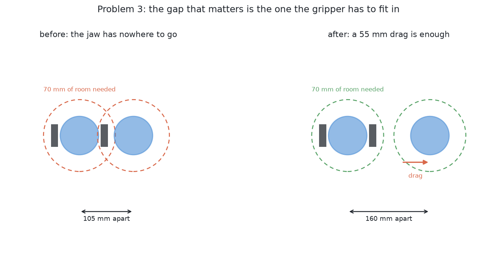
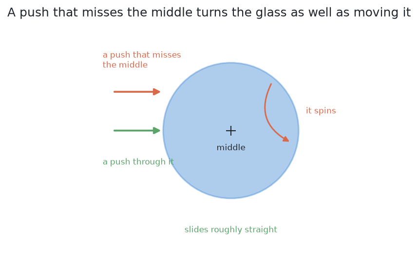

# Problem 3 — push the glasses apart

[Problem 2](../02-segment-glasses/problem.md) has ended. The arm knows which
pixels are which glass and where each one stands. Some glasses stand too close
together. The gripper cannot reach round one without hitting its neighbour.

The arm has to **move them apart by dragging them across the table**. It must
not lift them. Dragging is the whole point of the problem.

## Why dragging and not lifting

Lifting is not possible yet, and the reason is circular:

- To lift a glass, the fingers must close on it in a chosen place.
- To choose that place, the arm needs the glass's profile.
- To measure the profile, it needs a side-on photograph from 300 mm away.
- To take that photograph, it needs a clear viewpoint. The crowding has taken
  that away.

Dragging breaks the circle because it needs very little. A push needs a contact
and a direction. It does not need the glass's height, shape, weight or stem.
It needs only where the glass stands and how wide its base is. Problem 2
already gives both.

## What is on the table

The same glasses as problem 2: four to six, one known kind, upright and opaque.
The difference is that some of them stand close together. They are close
enough for the numbers below to matter.

## What goes in

Every answer gets exactly this and nothing more:

- **The readings from the camera work.** For each standing glass: where it
  stands, how tall it is, and how wide it is at its widest and at its foot.
  Every reading carries problem 2's measured error.
- **A view of the table from the top**, for the answers that read pictures.
- **What the jaw felt on the last push.** This force reading matters more than
  it looks, because it is the only evidence about friction.

No answer may read the simulator's record of what it placed, or the friction
it uses. Both are used only to mark the run.

Several different methods answer this question. A comparison only means
something when the question is identical, so [the examiner](the-examiner.md)
gives exactly this to every one of them.

## What must come out

**A jaw trajectory**, then another, until the table is done or the push budget
is spent.

Some answers think in whole pushes: a contact, a direction and a distance. The
examiner turns such a push into a trajectory. Other answers give waypoints
directly. Both are allowed, because **the score is the table afterwards, not
the push**. [The examiner](the-examiner.md#the-shared-output-and-why-it-is-a-jaw-trajectory)
explains why.

**An answer may also refuse.** A glass that tips before it slides, or has
nowhere clear to go, is reported with the reason. A refusal is a result.

## The gap that matters is not the gap between the glasses

Two glasses with a centimetre of space between them are not touching. A person
would call them separate. But the gripper cannot pick up either of them,
because the gripper is not a point.

To close on a glass, the open hand must be **around** it, with a finger on each
side. The room this needs is not half the opening. That is a common mistake.
It is how far the widest part of the open hand reaches from its own middle. On
a Robotiq 2F-85 the fingers stand further out than the pads. The result is
**76 mm of clear room in every direction**.

That room is measured to the **neighbour's edge**, not to its middle. So the
test is **not symmetric**. A narrow glass beside a wide one is crowded first,
because the wide glass's rim reaches further into the gap. A method that only
compares distances between middles will call such a pair fine when one glass
cannot be gripped.

So three different distances are in play. The table below names each one and
gives its rough size.

| | What it is | Roughly |
| --- | --- | --- |
| glasses touching | the failure problem 2 could not even see | the two rims meet |
| glasses grippable | the hand fits round one of them | 76 mm clear of the neighbour's **edge** |
| glasses measurable | a clear line of sight from 300 mm back | depends on the angle |

Problem 3 must get every glass past the second line. The third belongs to
problem 2, but moving a glass changes it too.

## How low the push has to be, and why it is a property of the glass

A pushed glass either slides or tips over. Pushed near the base, it slides.
Pushed near the rim, it tips. With `h` the push height, `2a` the width of the
foot and `μ` the friction with the table, the glass slides while

    h  <  a / μ

and tips above it. The height that counts is the top edge of the jaw, 107 mm,
not its middle at 75 mm.

Three things follow, and they shape the problem:

- **The push height must be checked for each glass**, from its measured foot
  width.
- **Some glasses cannot be pushed.** They tip before they slide, so the only
  correct answer is to refuse them.
- **μ is not known.** Nothing in the cell measures it. So the arm always pushes
  as low as it can, and it watches what really happens.

[Pushing without toppling](pushing-without-toppling.md) owns this rule. It
derives it, shows how many glasses of each kind are safe, and explains the
refusal.

## What else makes this hard

**Where to push it *to*.** The destination must be clear of every other glass,
clear of the rack, inside the arm's reach, and inside the glass zone. Moving one
glass out of a crowd can easily push it into another crowd.

**A push does not go where you aimed it.** Friction under a glass is not even,
the contact is not a point, and the glass turns as well as slides. Predicting
the result exactly needs numbers nobody here has. So the arm must look again
after each push.

**Which glass to move.** Moving the wrong glass of a pair can make things
worse. It can hit a third glass or leave the arm's reach. The choice needs the
whole table, not just the crowded pair.

**Pushing is contact, and contact is where things break.** The arm touches a
glass without knowing its weight. A push that is too fast is a knock, and a
knock on a tall glass is exactly what this problem must avoid.

## What is deliberately not in this problem

**Lifting anything.** No grasp, no weighing, no rack.

**Measuring a profile.** Problem 3 works from a footprint and a position.

**Deciding the kind.** Still one known kind.

**Tidying.** The glasses do not have to end up in any particular place. They
only have to end up far enough apart.

## What "done" means

A run is **done** when every glass has at least 76 mm of clear room around it,
at least one usable viewpoint for a side-on photograph, and nothing has been
knocked over.

A run is **correct but incomplete** when a glass could not be moved safely and
is reported with the reason. The usual reasons are that it tips before it
slides, or that there is nowhere clear to push it.

A run is **wrong** if a glass is toppled, pushed out of reach, pushed off the
table, or pushed into the rack. Toppling is the failure to watch. Nothing else
in this project can recover a toppled glass.

The numbers worth watching are: how many glasses ended up grippable, how many
pushes it took, how far each glass ended from where the push aimed it, and how
many glasses were refused.

## Where to go next

Three documents describe what every answer shares. Read them before any
solution.

- [The examiner](the-examiner.md): the crowded tables, what an answer is
  given, and how a run is marked.
- [The target layout](the-target-layout.md): where the glasses should end up,
  and the least movement the task needs.
- [Pushing without toppling](pushing-without-toppling.md): when a glass slides
  and when it tips, and the loop of plan, feel and look again.

Then the solutions themselves:

→ [The solutions](solutions/overview.md)
