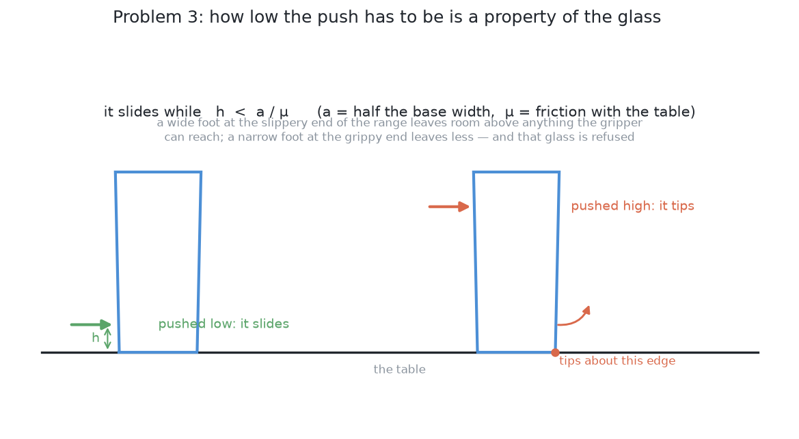
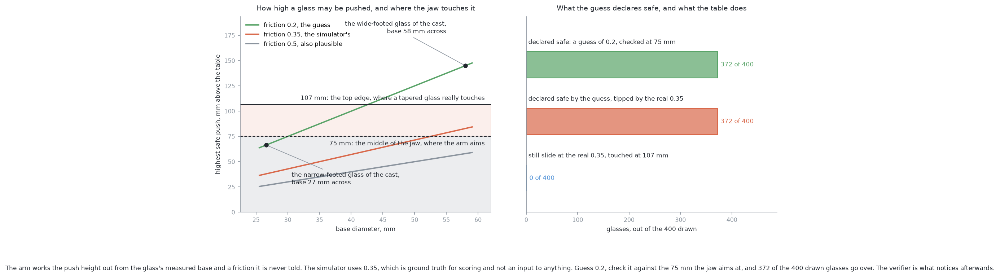
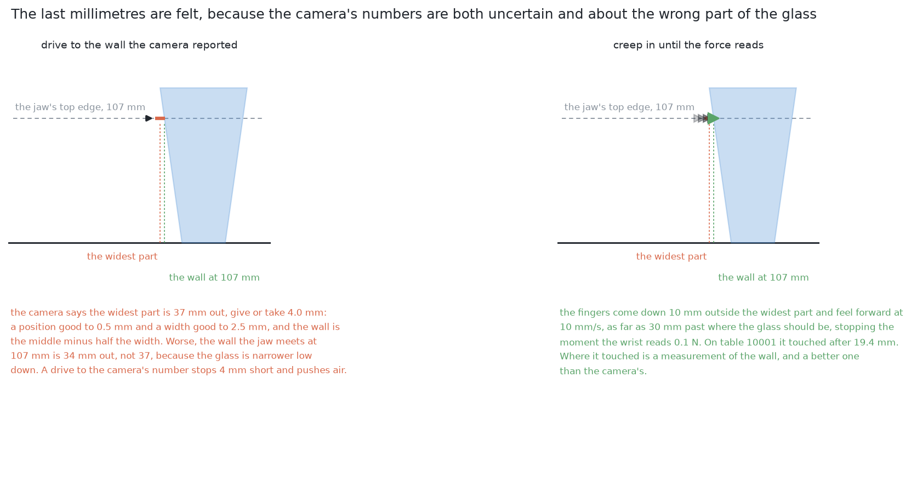
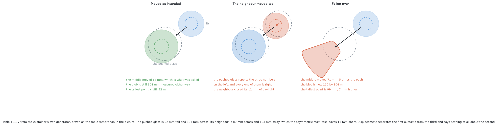
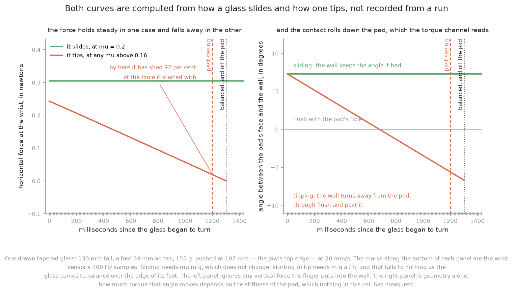
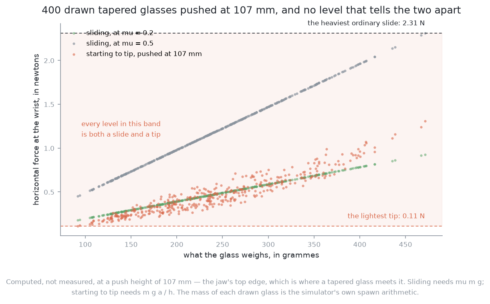

# Pushing without toppling

## Introduction

A glass pushed sideways either slides or falls over. This is not luck. It is
decided before the arm moves, by how far up the glass the jaw touches it.

This page explains that rule. It shows why the rule must be checked for every
glass, why some glasses must be refused, and what the arm does about a number
in the rule that nothing in the cell can measure. It also shows where a trained
model could sit inside the loop without being able to break it.

This page is separate from the solutions because **every solution needs it and
none of them differs in it**.

## Why no solution can answer this on its own

The solutions differ in how they choose a push: which glass, which direction,
how far. That difference stops here, for two reasons.

First, the table does not know which method chose the push. A glass touched
above its limit falls whether simple geometry or a large trained policy chose
the contact. So the limit belongs to the situation, not to the method, and it
holds for every solution in the same form.

Second, no solution can predict exactly where a pushed glass ends up.
[The problem](problem.md#what-else-makes-this-hard) explains why. So every
solution must act, measure what really happened, and correct. That loop is
shared too.

So this page holds two things: **the limit, which says whether a push may
happen at all**, and **the loop, which runs around every push that does**.

## The limit: slide, or tip

The whole rule comes from comparing two forces.

A glass on a table is held down by its weight and held still by friction. Push
it sideways at some height, and one of two things gives way. The foot can
**slide**. That happens once the push is larger than friction, which is the
friction coefficient times the weight. Or the glass can **tip**. It turns about
the bottom edge furthest from the jaw. That happens once the turning effect of
the push about that edge beats the turning effect of the weight.

Whichever gives way first is what happens. Write `h` for the height where the
jaw touches the glass. Write `a` for half the width of the foot. Write `μ` for
the friction coefficient between glass and table. Sliding needs a push of `μ`
times the weight. Tipping needs a push of the weight times `a / h`. This is
because the push acts at height `h`, and the weight acts at distance `a` from
the edge. Sliding comes first while

    h  <  a / μ

and tipping comes first above it.

Two facts about this rule matter. The weight appears on both sides and cancels.
So **the limit does not depend on how heavy the glass is**, which is good,
because nothing weighs a glass before it is pushed. And nothing in the rule
depends on how hard or how fast the jaw pushes. A gentler push does not make a
high contact safe. A push that is too high just tips the glass more slowly.

### The push height is worked out per glass

`a` is half the foot width, and every glass has its own foot. So the highest
safe contact is a different number for every glass.

That is why the limit is **computed from the measurement, not chosen once**.
Problem 2 gives the foot width of each glass, so the limit can be checked
before the arm touches it. One safe height for the whole kind would have to
suit the narrowest foot. Set low, it refuses glasses that were fine. Set
higher, it pushes glasses that were not. The whole project follows this
pattern: compute what the measurement allows, instead of one tolerance for
every case.

### The height that counts is the top edge of the jaw

The arm cannot choose `h` freely, and the right value is not the obvious one.

The jaw has a height of its own. Its middle rides 75 mm above the table. Its
leading part is 63 mm tall, so its top edge is at 107 mm. These are the
gripper's own numbers. What changes from glass to glass is which part of the
jaw the glass meets. **A glass that is wider higher up meets the top edge
first.** The tapered kind is wider higher up by definition, so for those
glasses the contact is at the top edge.

So `h` is 107 mm for such a glass, not the 75 mm the arm aims at. That is 32 mm
more, on a limit that is often only a few tens of millimetres. It is not a
rounding question. The table below shows the share of each kind that is safe to
push, at the friction this cell's examiner really uses. The middle column
checks the rule at the jaw's middle. The last column checks it at the top edge.

| kind | checking at the jaw's middle | checking at its top edge |
|---|---|---|
| straight | 57% | 7% |
| tapered | 10% | none |
| stemmed | 86% | 22% |
| short stemmed | 55% | none |

All the mistakes point the same way. Every glass the middle check wrongly
allows will be touched above its limit and will fall. The top-edge check only
errs by leaving alone a glass that could have moved. The first mistake loses a
glass for good. The second costs a refusal that can be reported. **Getting this
wrong errs in the direction that cannot be recovered**, so the rule is fixed
here and not left to each solution.

This got much worse when the invented blade became the real gripper. The hand
must be turned on its side to fit between the glasses. On its side, its leading
part is 63 mm tall, where the old blade was 30 mm. It also has to ride 25 mm
higher to keep its fingers off the table. Both raise `h`.
[The bench's notes on the jaw](../../03-push-glasses-apart/bench/README.md#the-jaw)
give the hand's sizes.

### Some glasses cannot be pushed at all

Put the last two sections together and a third fact follows.

The limit `a / μ` is small when the foot is narrow or the friction is high. It
can be below 107 mm. It can even be below 75 mm, which is already the lowest
the hand reaches without its fingers hitting the table.

With the real gripper this is no longer rare. Two of the four kinds, tapered
and short stemmed, have **no** glass that is certainly safe to push at the top
edge. For those kinds the arm relies on the friction being kinder than its
worst case, or it refuses. For such a glass, no contact height the arm can
offer is below the limit. The glass tips before it slides, whatever the arm
does.

**The only correct answer for that glass is to refuse it.** A refusal is a
result, not a failure. The run ends *correct but incomplete*: the glass stays
where it was, reported with the reason. The alternative cannot be repaired. A
refused glass still stands on the table, and a later step may still move it or
measure it. A toppled glass is finished, and the arm keeps working beside it.
The project follows the same line wherever there is contact. Anything doubtful
ends with the glass untouched and a line in the report. No solution may add a
fallback that tries anyway.

**Solutions reach that refusal in two ways.** Five of the six check the rule
above, from the measured foot width, before any model is asked. That puts a
ceiling on how badly a model can fail. Solution 4 learns what a push does and
holds no friction value for the rule. So it refuses when its own learned model
rejects every push its search tried. Its ceiling therefore comes from the
model, not from the arrangement. The limit is the same either way. What
differs is what applies it.

## The number nobody has

Everything above depends on `μ`. That number comes from nowhere.

**No solution is ever told the friction, and nothing in the cell measures
it.** None of the cell's four sensors reports how slippery the table is. The
examiner holds its friction values privately. It uses them to move the glasses
and to score the outcome, never as an input to the arm. So the arm does not
know the friction roughly. It has to supply a number the world never gave it.

Glass on a dry wooden top is roughly 0.2 to 0.5. At the top of that range,
`a / μ` is less than half its value at the bottom. So a computed limit is only
as good as the guess, and the guess can decide whether a glass should be
pushed at all.

Two habits follow, and every solution keeps both.

**Always push as low as the gripper can reach.** The height is fixed at the
lowest the hardware allows, so the arm never trades away safety. The only
question left is whether that lowest contact is below the glass's limit. There
is nothing to tune. Pushing higher never helps.

**Watch what really happens, instead of trusting the prediction.** If the
guessed friction is too low, the limit comes out too generous. Only evidence
from the table can catch that. The evidence comes during the push and just
after it. The rest of this page is about that evidence.

## The loop: plan, feel, look again

No solution acts on a prediction and walks away. Every one acts, senses what
happened, and decides again.

In programming terms, a plan made once and then run blindly is a fixed list of
steps, with nothing read back. These solutions instead keep **state that is
read again**. The table's layout is a value. The arm measures it, acts on it,
and measures it again. The loop runs while that value says there is work left.
Each pass does the same step: look at the table, choose one push, make it, look
again. It stops when every glass has room, or when every glass left has been
refused.

Each pass has three parts.

**Plan.** From the measurements, choose which glass to move, where to, and
from which side the jaw comes. The topple limit is checked here. A glass that
fails it never reaches the next part.

**Feel.** The jaw does not drive to a computed contact point. Every measurement
has error, and a step that drives to a computed position will hit a glass the
day a reading is a few millimetres out. Instead the closed jaw comes down
behind the glass, moves forward slowly until it touches, pushes, backs off, and
**reports what it felt**. The last millimetres are felt, not driven, which is
how this project handles contact everywhere. The programmed solution goes one
step further. It makes a small test push first, to see how the glass responds.

**Look again.** Fresh measurements show where the glass really ended up. This
is compared with where it was sent. The difference is the only honest
information about a push, because no model could have known it in advance. The
loop then starts again from the table as it is now, not as it was planned.

There is room inside the loop for two learned helpers. **Neither is a solution
on its own.** Neither chooses a push or a destination, and neither can approve
anything. They are checkers, one on each side of the moment the jaw moves.
Both are **designs in this project, not built code**. They are described here
because every solution could use them in the same way.

### A change verifier, placed after the action

The first helper would answer the question the look-again step asks: did this
push do what it was meant to do?

Geometry answers part of that well. It can compare how far the glass moved with
how far it was sent. It answers the most important part badly. Seen from
straight above, a fallen glass looks like a wider blob. A glass that slid a
long way also leaves a blob somewhere new. A small trained model, shown the
scene before and after the push, would answer three questions instead: did the
intended glass move as intended, did anything else move, and has anything
fallen over?

**Its place in the loop is what makes it safe.** It runs after the push, so it
can only be wrong about something that already happened. It cannot cause a
topple, because the push is over when it speaks. It cannot cause a collision,
because it does not choose where the arm goes. A wrong verdict costs at most a
few seconds: an extra look, or a run stopped early. A model placed *before* the
action would choose contacts, and its mistakes would be made with the arm. A
checker after the fact has a ceiling on how bad it can be. The ceiling comes
from where it sits, not from the model being good.

### An early abort, acting during the push

The second helper answers a different question. The difference is timing.

The jaw reports the force it feels during the push, far more often than any
camera takes pictures. A sliding glass and a glass starting to tip feel
different in that signal, because they develop differently as the push goes
on.

A monitor reading that signal could stop the arm as soon as the contact stops
behaving like a slide. It would back the jaw off a short way and hand over. A
single force level would not work. Across the glasses of one kind, every force
a tip produces is also a force some slide produces. So the signal must be read
as it develops, not compared with a threshold.

**This is what separates it from the verifier: it acts during the push, not
after.** The verifier can only describe a glass already on its side, because
its evidence is a picture taken after the arm has finished. The monitor is in
contact while the glass is still deciding what to do. So **an early abort
would be the only thing in this problem that could prevent a topple rather than
report one**. That is the whole argument for building it. But nothing in this
project builds it, and the solutions that topple glasses do so partly for want
of it. Solutions 4 and 6 topple the most, and they measure what its absence
costs.

Its powers are deliberately small. It cannot steer, choose a target or approve
a push. It can only stop one. A false alarm costs one abandoned push and a few
seconds. That is the same kind of cost as a wrong verdict from the verifier,
for the same reason: each can only interrupt or describe.

The two helpers work together. The monitor knows only that the contact stopped
feeling like a slide. It cannot say what the glass did, or whether a neighbour
was involved, because a force signal has one contact in it. The verifier can
say exactly that. It would be the natural thing to ask after an abort.

## The honest limit

Looking again recovers a run from a bad prediction. It is worth being exact
about which failures it recovers and which it does not.

A push that fell short, a push that went too far, a glass that turned, a glass
that landed in a new crowd: all of these are states of the table. The next pass
measures them and plans from them. Nothing is lost. A wrong friction guess
shows up here as a push that missed its aim.

**But nothing in this loop stands a toppled glass back up.** Problem 3 lifts
nothing. The arm cannot right a glass on its side, and everything later works
beside it. That is why the topple limit is a refusal rule, not a risk to weigh
against the value of a move. A risk is worth taking only if the system can
absorb the bad outcome. This one it cannot. So the arithmetic is used to say
no, and the two helpers exist to catch cases where the arithmetic said yes on a
guessed number.

## Pushing more slowly does not help, and that has been measured

About a fifth of chosen pushes topple a glass. A natural idea is to push more
gently. It is worth settling, because it would be a cheap fix if it worked.

The limit compares half the foot width, divided by the friction, with the
contact height. **No term in it mentions speed.** So the arithmetic predicts
that slowing down changes nothing. Whether a glass slides or tips is a balance
of distances, not of momentum. A slow push and a fast push lean the glass the
same amount. They only take different times.

That prediction was tested. The teacher chose one push on each of 367 tables.
The same push was carried out five times on fresh copies of the table, at
speeds from a quarter of the bench's speed to four times it. Each row of the
table below is one speed.

| push speed | glasses toppled, of 367 | median distance the glass moved |
|---|---|---|
| 0.005 m/s | 73, or 19.9% | 34.7 mm |
| 0.01 m/s | 71, or 19.3% | 41.9 mm |
| 0.02 m/s, the bench's speed | **66, or 18.0%** | **45.5 mm** |
| 0.04 m/s | 73, or 19.9% | 41.3 mm |
| 0.08 m/s | 92, or 25.1% | 32.2 mm |

**Pushing four times more slowly toppled slightly more glasses, not fewer.**
The difference is 1.9 percentage points against a standard error of 2.9. So
nothing really changed, as the arithmetic says. Speed is no way out of this
limit.

Two smaller results are worth keeping. Pushing four times *faster* is really
worse, by 7.1 percentage points. That is 2.3 standard errors, so it is a real
effect, not noise. And slow pushes moved glasses less far. The bench's speed
moved the median glass 45.5 mm, while a quarter of that speed moved it 34.7 mm.
The point of a push is to make room, so slowing down would cost room and buy
no safety.

So the refusal rule above is the only defence against toppling in this
problem. That is why so much of this page is spent getting it right.

## Where to go next

- [The problem](problem.md): why dragging rather than lifting, the distances
  that matter, and what "done" means.
- [The examiner](the-examiner.md): the shared input, output and marking.
- [The target layout](the-target-layout.md): where the glasses should end up,
  and the least movement the task needs.
- [The solutions](solutions/overview.md): what each one puts between the
  measurements and the pushes.
