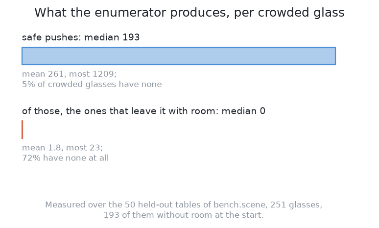
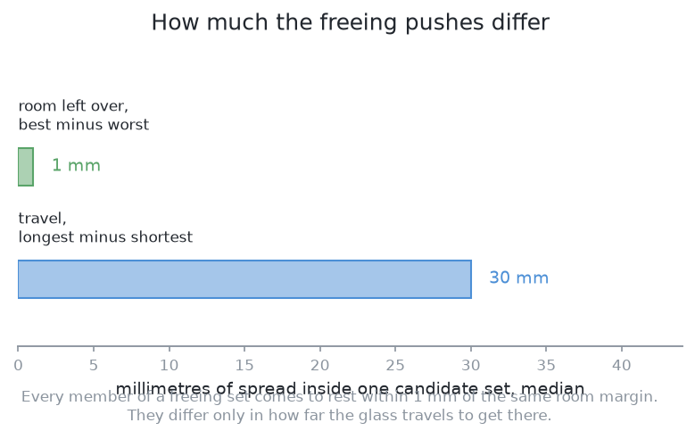
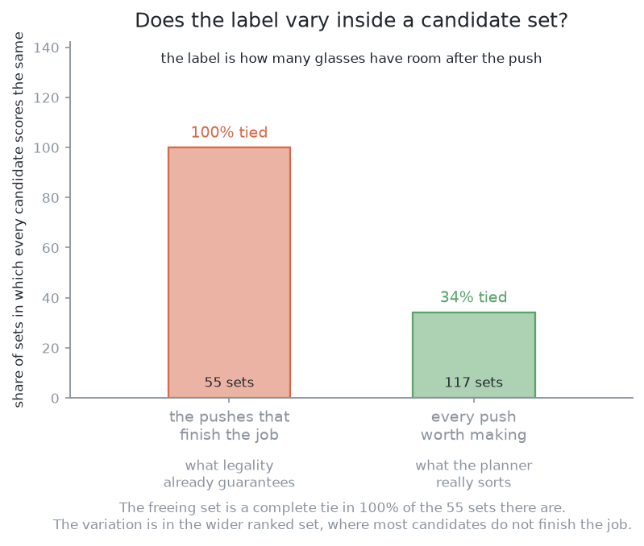
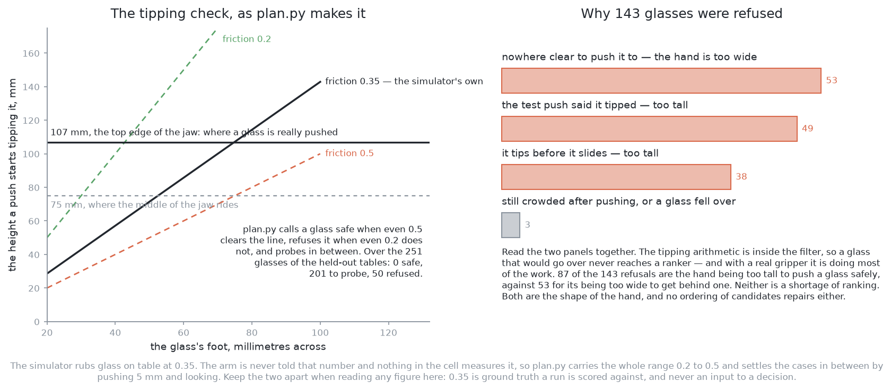

# Solution 2 — geometry generates, a model ranks

> **What it uses** — NumPy for the geometry, and scikit-learn for the one
> fitted part. The model is a set of about two hundred **gradient-boosted
> regression trees**. This is the standard tool for predicting a number from a
> short list of mixed quantities. There is no neural network and no
> accelerator.
> **What it does** — Plain geometry lists every legal push. A legal push is one
> the arm can reach, that keeps the glass and the jaw clear of every neighbour,
> that lands inside the glass zone, and that touches the glass below its tipping
> height. That list is usually long. The fitted model gives each push one score,
> the list is sorted, and the arm makes the first push. The model can never add
> a push or bring back one the geometry rejected. It decides the order, never
> the safety.
> **How the output is produced** — `look()` gives each glass's position and
> its widest and foot widths. The geometry sweeps every heading round each
> crowded glass, steps the travel out, applies its tests, and keeps the
> survivors. Each survivor becomes a short list of lengths, angles, counts and
> ratios. The model turns that list into one number. The best push goes to the
> examiner as a parameterised push.
> **How it differs from the other five** — [Solution
> 1](01-one-fixed-nudge.md) is this solution with the listing and the choosing
> removed. Solutions 3 to 6 fit a model that chooses the push itself.
> [The overview](overview.md) maps all six.
> **What it costs** — The labels are free, because the examiner measures the
> table after every push anyway. The training set is a few thousand pushes,
> which is minutes of examiner time. Fitting takes seconds on an ordinary
> processor. scikit-learn and NumPy are both BSD 3-clause, so the licence costs
> nothing.

> **The cell is described once, in [the cell](../../the-cell.md)** — the
> layout, the two places the camera works from, from the top and from the
> side, all four sensors, and the words this project uses them with. What
> follows is only what is specific to this solution.

## Introduction

This page shows the safest way to put a fitted model inside a machine that can
break things. Then it says what that model is worth on these tables.

The pattern is called **generate, veto, then rank**. Arithmetic lists every
allowed action. Arithmetic then rejects the unsafe ones. A fitted model puts
the rest in order. The arm makes the first push on the list. The model cannot
invent a push or overturn a rejection, so **the worst a wrong prediction can do
is waste one attempt**.

All of it is built. The candidates come from
`03-push-glasses-apart/01-one-fixed-nudge/plan.py`. The trees are in
`03-push-glasses-apart/02-geometry-ranked`. Both the ranker and the printed rule
ran over the same fifty held-out tables, on the same candidates. Only the
chooser differs. **The ranker loses.** It racks the same 107 glasses, but uses
more pushes and more travel. [Where it is strong and where it
breaks](#where-it-is-strong-and-where-it-breaks) gives the numbers and the
reason.

This page also explains two things that matter more than the score. The first
is where the learned part sits, which makes it safe. The second is that this
solution is **the teacher** for solutions 3 and 6.

## A film of one table

This is the same table, 10025, that every solution is filmed on. [Solution 1's
film section](01-one-fixed-nudge.md#a-film-of-one-table) explains how the table
was chosen and what the drawn pick and the hand shell mean.

[Watch the film (13 s)](../../../videos/03-push-glasses-apart/02-geometry-ranked.mp4)

In the film the ranked geometry makes the same two pushes as the printed rule.
It racks the same one glass and refuses the same five. It names the refusals a
little differently: two tip before they slide, two tipped when tried, and one
is still without room after being pushed.

How each solution does over all fifty tables is in
[the comparison](../../../03-push-glasses-apart/results/README.md).

## The code at the heart of it

This solution adds two things to [solution 1](01-one-fixed-nudge.md). The first
is the model: scikit-learn's boosted trees, fitted once and then asked for one
number per candidate. The second is the label the trees learn to predict. The
candidates themselves come from solution 1's enumerator unchanged. So the
choosing is the only new part.

The library does its work in a constructor and one call to `fit`. The sort that
follows is the model's whole effect on the run. Both are in
`03-push-glasses-apart/02-geometry-ranked/ranker.py`:

```python
from sklearn.ensemble import GradientBoostingRegressor
...
TREES = 200
DEPTH = 3
LEARNING_RATE = 0.05
...
    @classmethod
    def fit(cls, rows: np.ndarray, labels: np.ndarray, seed: int = 0) -> Ranker:
        trees = GradientBoostingRegressor(
            n_estimators=TREES, max_depth=DEPTH, learning_rate=LEARNING_RATE, random_state=seed
        )
        trees.fit(rows, labels)
        return cls(trees)
...
def ranked(
    seen: list[Seen], skip: set[int], score: Scorer
) -> tuple[list[Candidate], np.ndarray, dict[int, str]]:
    """Every safe push on the table, best first, with its score and the refusals.
    ...
    """
    kept, why = survivors(seen, skip)
    if not kept:
        return [], np.zeros(0), why
    scores = np.asarray(score(features.rows(seen, kept)), dtype=np.float64)
    order = np.argsort(-scores, kind="stable")
    return [kept[i] for i in order], scores[order], why
```

The label is made by trying one candidate on the examiner's table and measuring
the result, in `03-push-glasses-apart/02-geometry-ranked/rollout.py`:

```python
def roll(table: Bench, before: Before, candidate: Candidate) -> Rolled:
    """Put the table back as it was, make the push, and measure what it did."""
    restore(table, before)
    felt = table.push(candidate.push)
    after = table.look()
    gained = nudge.shortfall(before.layout) - nudge.shortfall(truth(table))
    fell = any(table.tilt(i) >= STANDING_TILT_DEG for i in table.on_table())
    return Rolled(
        label=TOPPLED if fell else gained,
        ...
    )
```

Two things show in these blocks. `survivors` runs before the model, and `score`
only reorders what it returns. That is the safety argument. And the label is
`gained`: metres of room the whole table gained. But the run is scored on how
many glasses end up grippable. That mismatch is why the ranker loses.

## The problem this solves

[Problem 3](../problem.md) gives the arm four to six glasses, some too close for
the open jaw. The arm must drag them apart.

A push needs three choices: which glass, which direction, and how far. Sweeping
headings and travels round one glass gives many legal pushes, not too few. So
the question here is not how to find a safe push. It is **how to choose among
safe pushes**.

Safety is not the complaint. The geometry toppled one glass over the fifty
held-out tables. The complaint is the number of attempts. That run spent **173
pushes on 251 glasses, and 63 were repeat pushes of a glass already moved**. A
repeat push did not do what it was chosen for. A better chooser would need
fewer.

This solution cannot help the largest refusal in that record. **53 of the 251
glasses were refused for having nowhere clear to push them to.** That is a lack
of candidates, not a bad order. A ranking over an empty set is still empty.

## The main idea

Ask the geometry for **every** safe push, not just the best one. Let a fitted
model put them in order.

Three things follow.

**Everything that can reject a push is arithmetic.** Reach, the swept paths of
the glass and the jaw, the glass zone, the rack and the tipping limit are all
tests. They all run before the model. The model cannot make an unsafe push
available.

**The model's whole output is an order.** It gives one number per candidate,
and only the order of those numbers is used. A model wrong by the same amount
on every candidate would still order them perfectly. That is much easier than
predicting the outcome.

**Without the model, it falls back to what exists.** Delete the model and keep
the printed rule, which takes the shortest push that finishes the job. The run
is then exactly the geometry in `03-push-glasses-apart/01-one-fixed-nudge`. So
this solution can be tried and dropped at no cost.

The obvious alternative is a model that chooses the push directly. It reads the
table and emits a heading and a distance. **Its output can be any push, safe or
unsafe.** So a geometric check must follow it, doing the same safety work as
here, for a model that is harder to fit. Solutions 3 to 6 work that way. In
return they can express pushes the enumerator never offers.


## What the geometry proposes

The enumerator decides what the model is handed, so it comes first.

For one crowded glass it sweeps **72 headings**, one every 5°. Along each
heading it steps the travel out in **2 mm steps up to 150 mm**. At every step it
asks four questions. Does the glass's own path clear every other glass? Does
the fingers' path clear them? Does the path of the wrist and gripper body clear
them? Is the destination inside the glass zone and within easy reach? The
first failure ends that heading, because a clash at one length is still there
at any longer length.

Two properties of that loop decide everything after it.

**Each heading stops at the first travel that gives the glass room.** So there
is **at most one job-finishing push per heading**, at most 72 per glass. Each
is the shortest push that works along its line.

**Pushes that do not finish the job are kept too.** A push that leaves the glass
crowded, but less so, is kept if it cuts the table's total shortfall by at
least 10 mm. The printed rule uses these only when no push anywhere finishes a
glass. This set is large. It holds every 2 mm step along every heading, up to the
first clash. Over 269 groups on the training tables, the middle glass is offered 84
candidates and the middle whole-table decision 261. `spread.json` holds the
counts.

The first property matters most. Each heading stops as soon as the push works.
So **every job-finishing candidate lands on the same line**: just past where
the glass has room, plus the planner's 10 mm aiming margin. On the score that
counts, how many glasses have room, those candidates **tie**. They differ only
in how far the glass travels, and the geometry already prints that.


**A group of tied candidates gives a ranker nothing to learn.** A model fitted
to it returns the same value for all of them. Any useful signal lives in the
wider set of pushes that only ease the crowding. There the candidates really
differ.

Three measurements over fifty held-out tables test this. The three pictures
take them one at a time.

The first counts what the enumerator makes for each crowded glass. The geometry
almost always finds a safe push. It rarely finds one that finishes the job. So
72 per cent of the time the planner falls back on a push that only helps a
little.



The second asks how much the job-finishing pushes differ when there are
several. They all end within a millimetre of the same room margin. They differ
only in travel.



The third asks whether the ranker's label varies inside a candidate set at all.
In the job-finishing set it never does. In the wider set it sometimes does. That
is the only place a ranker could learn anything.



So the arrangement is sound, but the arithmetic has already answered most of
the question it asks the model.

## What the filter removes before the model is asked

One of the four tests can cause the failure nothing can repair: a toppled
glass. [Pushing without
toppling](../pushing-without-toppling.md#the-limit-slide-or-tip) sets out the
rule in full. A glass pushed at height `h`, on a foot `2a` across, with friction
`μ`, slides while

    h  <  a / μ

and tips above that. The height that counts is the jaw's top edge, 107 mm. The
limit is worked out for each glass from its measured foot. The friction is
unknown, so the geometry checks both ends of **0.2 to 0.5**. If the two ends
disagree, it makes a **5 mm** test push and looks before and after. [Solution
1's code](01-one-fixed-nudge.md#the-code-at-the-heart-of-it) shows this test.

What matters here is the order. All of this runs inside the filter, **before**
the model. A glass that would tip never reaches the ranker. No score can bring
it back. **Everything that can reject a push is arithmetic, and the model comes
after all of it.**

## The model: boosted trees that score one candidate at a time

Now the fitted half. It turns a short list of numbers into one number.

**A decision tree** is a set of threshold questions arranged as a tree. Each
branch point asks one question about one input, such as "is the travel more
than 50 mm?". The candidate goes left or right. It ends at a leaf, which holds a
number: the prediction. One tree is crude. It can only give as many answers as
it has leaves, and its answer changes in steps.

**Boosting** turns many crude trees into a good model. Fit one shallow tree.
Find what it got wrong. Fit the next tree to those errors. Add the two. Find
what the sum still gets wrong, and fit a third tree to that. Repeat. The sum of
all the trees is the model. This is gradient descent where each step adds a
small tree instead of changing a number. **About two hundred trees** is a
normal size for a few thousand rows, which is what this solution has.

This solution uses the **regression** form, which predicts a number. It uses it
**pointwise**: the model sees one candidate at a time and scores it alone. The
candidates are then sorted by score. [Learning to rank](#learning-to-rank)
names the other two ways.

### Why trees rather than a network

The input is a short table of mixed quantities: an angle, some lengths, a
count, a ratio. Boosted trees were made for this, for four reasons.

**The inputs have different scales, and trees do not care.** Radians,
millimetres and counts have different ranges. A network adds weighted inputs,
so it needs them on similar scales. A tree only compares one input with one
threshold. Rescaling an input changes nothing.

**A threshold is the natural shape of the answer.** Much of what makes a push
good is a comparison with a limit. Is the destination clear by enough? Is the
push below the tipping limit? A tree asks each of these in one question. A
network must build a sharp step from smooth sums, and needs data to do it.

**It is cheap and needs few rows.** A few hundred shallow trees on a few
thousand rows train in seconds on an ordinary processor. So the whole question,
does ordering help, can be answered in an afternoon.

**It says which inputs mattered.** The model reports each input's share of the
predictions. A person can then find out why it was wrong.

**A network would also work**, with a trade. On this input, a small network
needs more rows and explains nothing. But the input could change. If the table
were given as an **occupancy grid**, a picture of the zone with the glasses
marked, a network would be right and a tree wrong. So the real choice is a short
list of relations against a picture of the table. The model follows from that.
This solution picks the short list, for the reason the next section gives.

## The inputs are lengths, counts and ratios

Every input is a length, an angle, a count or a ratio. **None is a position on
the table.** This choice is about generalising.

For each candidate push the model sees:

- **the contact angle**, measured from the line between the glass's middle and
  the nearest neighbour's edge, so "straight away from the crowd" is one value;
- **the push distance**, how far the glass travels after the jaw touches it;
- **the room the destination would have**, with the glass moved there;
- **how far the destination is from the edge of the glass zone**, and **from
  the rack**, because a push that lands close to either has little margin;
- **how many neighbours sit within a radius** of the glass, as a count;
- **the foot width of the glass**, which sets the tipping limit and how the
  glass turns as it slides;
- **the push height as a fraction of the tipping limit**: the jaw's top edge
  divided by this glass's limit at the worst friction. It says how close the
  push is to the line.

Each is a relation between two things in the scene, a property of the glass,
or a comparison with a limit. None is "this push happens at x = 430,
y = −290".

**Positions are left out on purpose.** The examiner places glasses close to
ones already down, and the rest wherever they fit, as [the
examiner](../the-examiner.md#what-the-examiner-draws) describes. So crowds form
more often in some parts of the zone. Give the model positions, and it learns
that pattern, because it predicts the labels. It would then score a push by
**where on this table it happens**. That is a fact about this examiner, not
about pushing. Move the rack or the zone, and the model describes a cell that
no longer exists. Nothing would error or look wrong.

Relations avoid this. Slide or turn the whole arrangement, and every input
stays the same. So **the model must score the two arrangements the same**,
which is correct. A model given positions would have to learn this from data,
and would learn it imperfectly.

Two inputs look like positions but are not. The distances to the zone edge and
to the rack are distances to fixed parts of the cell. A destination 15 mm from
a boundary has 15 mm of margin wherever the boundary is. A coordinate pair is
an address, and an address does not generalise. The rule is: show the model the
quantities the physics depends on. A push depends on distances, angles and
widths, not on where the table's origin is.

## How it is trained

Collecting the training set needs no extra work.

**Generate candidates on the training tables.** The examiner numbers its
tables. Everything above a fixed line is kept for testing. Training uses only
tables below it, so no solution is scored on a table it was fitted on. For each
crowded table, the enumerator makes its candidates as at run time.

**Make every candidate on the examiner's table.** Reset the table, push,
measure. This would be far too slow on a real arm. Here a push in MuJoCo is
cheap and the examiner runs faster than real time. **A few thousand pushes take
minutes**, so the data costs almost nothing.

**Label each one with what happened.** The label has two parts. The first is
**how much room the whole table gained**, not just the pushed glass. A push
that frees one glass by crowding another is not rewarded for half its effect.
The second is **whether a glass toppled**. A topple makes the push the worst
possible candidate.

**Fit the regression on those labels.** One row per candidate, one number per
row. Only the order of the predictions is used afterwards.

Two points about the labels need more than a line.

**Topples appear in the training set even though the filter rejects unsafe
pushes.** The filter uses a guessed friction. When the guess is too kind, the
limit is too high, the filter passes a push it should not, and the glass falls.
Those rows are valuable. They teach the model to prefer pushes further from the
limit. That is why the ratio of push height to tipping limit is an input. It
lets the model be careful about a number nobody measured.

**The labels are only as honest as the examiner.** The examiner's private
friction decides every topple in the training set. It is three fixed numbers,
not a measurement of anything real. A model fitted on these labels has learned
what topples on this examiner.

One guard belongs on retraining. **During a run, only the chosen candidate is
really made.** So a log from a run holds outcomes only for pushes the model
already likes. Retraining on it locks in the model's first beliefs. The usual
fix is to take the second-ranked candidate now and then. Retrain only between
runs, never during one. A model that changes mid-run makes the run impossible
to reproduce or debug.

## Where the learned part sits is what makes it safe

What happens when the model is wrong? The answer comes from the arrangement,
not from the model being good.

**A wrong answer costs one wasted push and nothing worse.** The model's output
is an order. The only mistake it can make is to put a worse push before a
better one. The arm then makes a safe, legal, less useful push. It looks again
and chooses again. That costs seconds and one push from the budget.

**It cannot topple a glass.** The tipping limit rejects pushes before the model
runs. No score can bring a rejected push back. The same holds for leaving the
glass zone, leaving the arm's reach, and hitting the rack. All are tests on the
destination, all run first, and none asks the model.

**So the worst case comes from the arrangement, not from the model's
accuracy.** A better model makes wasted pushes rarer. Only the geometry decides
how bad things can get.

Problem 2's learned ranker sits in the same position. There, the machinery for
[looking again at what was
hidden](../../02-segment-glasses/hidden-glasses.md) lists candidate camera
positions and rejects the unreachable or blocked ones. A small model orders the
rest. A bad order costs one wasted look.

The two cases differ in one way, and it raises the bar here. **A wasted look
costs seconds. A wasted push costs seconds and a contact with a glass**, and
contact is where things break. So a push ranker must be better than a viewpoint
ranker to be worth the same.

## It is the teacher

Two other solutions cannot start without this one. This is the largest thing it
contributes.

[Solution 3](03-imitation-from-demonstrations.md) and [solution
6](06-smolvla-fine-tuned.md) learn from **demonstrations**. A demonstration is
a recorded run of a crowded table: the measurements, then each push made, until
every glass has room. Demonstrations are usually the expensive part of
imitation learning, because a person must drive the arm by hand.

**Here they cost nothing.** This solution can run over as many training tables
as the examiner can draw. Each run records a full demonstration with no person
present. The pushes are safe by construction, because the same filter
protects a recorded run. The cost is minutes of examiner time.

That gift has two costs, and both reach the solutions that learn from it.

**They inherit this solution's ceiling.** A policy fitted on demonstrations
learns to copy them. Every push here came from the enumerator. If the heading
sweep is too coarse, or a test rejects a push that would have been fine, that
push is in no demonstration. The policy cannot discover it. The usual fix is to
let the policy act, score the result, and learn from that too. That is no
longer imitation learning, and it costs more.

**Keeping only successes trains on a biased sample.** It is natural to keep the
runs that finished and drop the rest. But the finished runs are the tables this
solution is good at: a job-finishing push existed, the crowd suited its inputs,
the glasses were far from the tipping limit. The hard tables, with nowhere
clear to push, are the ones most likely dropped. A policy trained on the rest
sees easier tables than it will be scored on. It will look better in training
than in testing. One fix is to keep the failures with their outcomes. Another
is to weight the kept runs so hard tables are not under-represented. Training
on successes alone is the default mistake, so it is named here.

## The pushes are what this contributes

This solution hands over **parameterised pushes**, as [solution
1](01-one-fixed-nudge.md#the-pushes-are-what-this-contributes) does. The
examiner's macro turns each into a jaw path, the same way for every solution.
So **this solution contributes the choice of push and nothing else**.

One limit is real. A parameterised push is a straight drag along one heading.
A policy that emits waypoints can curve, slow down, or change direction partway.
No candidate here can do that. This is part of the ceiling named in the
previous section.

## How the concepts fit together

The pieces join into the loop that [pushing without
toppling](../pushing-without-toppling.md#the-loop-plan-feel-look-again)
describes: plan, feel, look again.

First, once, the model is fitted. Candidates are made on the training tables,
each is tried on the examiner, each is labelled with room gained and with
whether a glass toppled, and about two hundred trees are fitted.

At run time, one pass goes like this:

1. `look()` gives each glass's position and widths, with problem 2's error.
2. Every glass that already has room is racked.
3. Each crowded glass gets the tipping check. A glass that tips at every
   friction in the range is refused with its reason.
4. The enumerator sweeps headings and travels and keeps the survivors.
5. Each survivor becomes the short list of inputs, and the model scores it.
6. The best push goes to the examiner, which carries it out and reports what
   the jaw felt.
7. The arm looks again and repeats.

Three points to keep:

**The geometry owns safety and the model owns order.** Delete the model and the
run still works.

**The loop recovers from a bad prediction.** The table is read again after
every push. A push that fell short, went too far or turned the glass is just
the new state.

**The loop cannot recover a toppled glass**, because nothing in problem 3 lifts
anything. That is why the tipping limit is a refusal, not a risk to weigh.

## When a glass cannot be pushed safely

[Solution 1](01-one-fixed-nudge.md#when-a-glass-cannot-be-pushed-safely) and
[pushing without
toppling](../pushing-without-toppling.md#some-glasses-cannot-be-pushed-at-all)
explain why some glasses must be refused. This section is only about this
solution.

**Refusal belongs to the arithmetic. The model is never asked.** The tipping
test runs inside the filter, so a refused glass has no candidates. A glass whose
every push clashes, leaves the zone or leaves reach also has none. **A ranking
over an empty set is still empty.**

The refusals in the record this solution extends split three ways. **53
glasses had nowhere clear to go, 49 tipped when tried, and 38 tip before they
slide.** This solution's own run separates glasses with no candidate at all from
those whose candidates were all too slight to be worth making. So it names the
refusals differently, but counts the same glasses.



This picture was drawn before the real gripper. It shows the old split, when
no glass was refused for tipping. The counts above are the current ones.

## A worked example

One crowded table, followed through the method.

**The table.** Four tapered glasses of different sizes. Two stand clear of
everything. The other two stand close together and neither has room. The room
test measures to the neighbour's edge, so the narrower glass is the more
crowded: its wider neighbour's rim reaches further into the gap.

**Two glasses leave first.** The two with room are racked. The planner now has
a two-glass table. This is the cheapest step in the problem, and it comes first
on every table.

**The tipping check runs next, and says "try".** Both remaining feet pass at
low friction and fail at high friction. So the arm makes a 5 mm push on each
and looks before and after. Both move, so both slide. The model plays no part.
A glass that failed at both ends would be refused here, and the model would
never see it.

**The geometry proposes many pushes.** For each glass it sweeps 72 headings and
steps out to 150 mm in 2 mm steps. It drops every step where a path, the zone
or the reach fails. Dozens of pushes per glass survive, and hundreds across the
table.

**A few of them finish the job.** They fall in two arcs: one roughly away from
the neighbour, one round it the other way. There is at most one per heading.

**And they all score the same.** Each leaves both glasses with room. Each stops
just past the line plus the 10 mm margin. They differ only in travel, which the
geometry already prints.

**The printed rule takes the shortest.** A model can agree, prefer a longer
push, or take longer to give the same answer. It can do nothing else, because
the candidates are equal on what it was trained to predict.

**The wider set is where a model could help.** Each glass has many pushes that
ease the crowding without clearing it, and these do differ. But their outcomes
depend most on friction and on how the weight sits under the glass. Those are
the quantities [solution 4](04-a-world-model.md) learns a model of.

## What it needs

- **scikit-learn and NumPy**: small, pure software, BSD 3-clause.
- **The enumerator**, in `03-push-glasses-apart/01-one-fixed-nudge/plan.py`. It
  is loaded from there, not copied, so the sweep, the tests and the tipping rule
  have one definition. It also sets the ceiling.
- **A training set** of a few thousand candidates and their outcomes, from the
  training half of the tables. That is minutes of examiner time and no human
  labelling. The **held-out half** is kept for scoring.
- **No accelerator.** This is the clearest cost difference from the four
  solutions after it. There is nothing to rent.
- **One pass of the trees per candidate** at run time. That is a few hundred
  threshold comparisons per tree and no matrix multiplication. Its compute
  column is close to the fixed nudge's.
- **A model file kept in step with the cell.** Change the sweep, the step, the
  zone or how tables are drawn, and the model quietly describes an old cell. No
  code test would notice.

## Where it is strong and where it breaks

The strengths are real.

**The model cannot cause the failure that cannot be undone.** Toppling and the
other unsafe outcomes are settled before the model runs. [Where the learned
part sits](#where-the-learned-part-sits-is-what-makes-it-safe) explains why.

**Without the model, the printed rule still runs the table.** It is never
broken, only unimproved.

**It can be checked.** Every candidate prints with its score. Every refusal
prints with a reason. The model reports which inputs mattered.

**It is cheap in every way.** No accelerator, no licence condition, no human
labelling, minutes of examiner time.

**And it is the teacher**, which matters even if its own score is ordinary.

Against that, the weaknesses.

**The measurement, which is this solution's main finding.** The job-finishing
candidates tie by construction, so the order carries no information exactly
where the task gets finished. This was checked. `spread.py` made 4,511 real
pushes over 60 training tables and wrote `spread.json`. Within one glass's
job-finishing candidates, the room gained varies by **0.0 mm at the median**
over 161 groups: an exact tie. Pushes that only ease the crowding vary by
11.9 mm. For one glass, the printed rule already matches the best candidate in
**159 of 206 groups**. The best choice beats it by 0.0 mm at the median.

**So the ranker did not beat the rule.** Both ran the same loop over the same
fifty held-out tables, with the same budget and the same candidates. Only the
chooser differed. Both end the same: **107 of 251 glasses, fourteen tables
finished, one glass toppled**. The cost differs. The ranker takes **182 pushes
and 4,325 mm of travel**. The rule takes **173 pushes and 2,844 mm**. That is
half again as far for the same result.

An earlier version of this page recorded a different defeat: 185 glasses for
the ranker against 195 for the rule. The change came from the gripper, not the
model. The examiner now pushes with a real Robotiq 2F-85, which is 139 mm
across its fingers. It must be turned on its side to fit between glasses, and
then it cannot push lower than 75 mm. [The
comparison](../../../03-push-glasses-apart/results/README.md#the-results) shows
what that does to every solution. With this hand, most tables are settled
before any choosing. 53 refusals are the hand too wide to get behind a glass.
87 are it too tall to push one without tipping it. Ordering cannot change
either number.

The ranker takes the longer route because of its label. The model learns
**room gained**. The run is scored on **glasses that end up grippable**. A push
that spreads room over three glasses scores higher than one that frees a glass
outright. On the validation tables in `training.json`, the ranker's top pick
finishes the job in **47 of the 83 decisions that offer one**. The rule does
every time. By its own label the ranker is the better chooser: it gives up
4.4 mm of room against the best candidate, where the rule gives up 18.7 mm.
Yet it clears no more tables. The fit agrees. The topple ratio (0.43) and the
foot width (0.38) mattered most. The push distance mattered least (0.01). The
model mostly learned which glass is risky to push, not which push is good.
**The verdict is to keep the simpler one.**

**What the design cannot do.** It cannot invent a candidate, so its quality is
the enumerator's. It cannot express a push that is not a straight drag. It does
not transfer to a different number of glasses. A model fitted on tables of five
has never seen the crowds that eight make, and nothing errors. And it cannot
help the commonest refusal: a glass with nowhere clear to go.

**What it cannot survive.** [How it is trained](#how-it-is-trained) names the
retraining trap and the private friction behind every label. A change to the
sweep or to how tables are drawn also makes the model silently out of date.

**When it fails, it fails quietly.** A badly fitted ranker orders candidates
roughly at random. Nothing errors or topples. The run just spends more pushes
than it needs. That is exactly how it failed here. It was caught only because
the test was run: the ranker against the printed rule, on the held-out tables,
with everything else the same.

## The general ideas behind this

None of this was invented for glasses. Four ideas here are worth knowing on
their own.

### Generate, veto, then rank

Arithmetic lists the candidates and holds an absolute veto. The fitted part
only reorders what survives. [The main idea](#the-main-idea) explains it. It is
the standard answer wherever a fitted part sits in a system that can cause
harm: motion planning, grasp selection, flight control.

It is the wrong shape in two cases. One is when the set of actions is too large
or awkward to list. That is when a policy earns its place. The other is when
the enumerator can already tell which survivor is best. Then the model is asked
a question already answered. This cell is close to the second case.

### Learning to rank

Only the order of the predictions is used, not their values. That is called
[learning to rank](https://en.wikipedia.org/wiki/Learning_to_rank). It is
easier than predicting the value, because a model wrong by the same amount
everywhere still ranks perfectly.

There are three ways to fit it. **Pointwise**, used here, scores one candidate
at a time. **Pairwise** shows two candidates from a group and asks which is
better. **Listwise** shows the whole group and scores the order. Pairwise and
listwise match the real goal more closely, because the goal is an order. They
are usual where groups are large and differences small. Pointwise is used here
because it is simplest. Its label is the one the examiner already gives. And
nothing in these candidate sets suggests more would pay. If
the spread inside a group turned out large, pairwise would be the next thing
to try.

Learning to rank is used in search, recommendation and advert placement. It is
also used to order grasps, viewpoints and motions. It is wrong where the value
itself matters, such as deciding whether to act at all. **Ranking tells you
which candidate is best, never whether the best is any good.** And it needs the
candidates in a group to differ in what is ranked. This cell mostly fails that.
When a group ties, the training signal is empty. The model's accuracy will look
perfect and tell you nothing. **Check the spread of the label inside each group
before building the model.**

### Gradient boosting on tabular inputs

[The model section](#the-model-boosted-trees-that-score-one-candidate-at-a-time)
explains how boosting works. With shallow trees, it is **gradient boosting**.
It is still the first thing to try when the input is a short table of mixed
quantities, not a picture, a sound or a sentence.

It is usually right on tabular data of up to a few hundred thousand rows. It is
usually wrong when the input has structure a tree cannot see: neighbouring
pixels, samples of a sound, words in order. A tree asks about one input at a
time. It cannot express "this region is crowded" over a grid without many
questions. That is why an occupancy grid would need a different model too.

### Learning a utility rather than a perception

The model here does not say what is on the table. It says how much an action
would help. That is **utility** or **value** estimation. It works because the
answer is cheap to check: try the action in the simulator and see.

It has a known ancestor in grasping. Nobody could write a rule for whether a
grip would hold. So attempts were collected and a function was fitted. Pinto
and Gupta's [*Supersizing
Self-supervision*](https://arxiv.org/abs/1509.06825) (ICRA 2016) is the clearest
example. A robot made tens of thousands of grasps and labelled each by whether
the object came up. For pushing, Agrawal and colleagues' [*Learning to Poke by
Poking*](https://arxiv.org/abs/1606.07419) (2016) fits a model from a poke to
the movement it caused. Zeng and colleagues' [*Learning Synergies Between
Pushing and Grasping*](https://arxiv.org/abs/1803.09956) (2018) learns where to
push and where to grasp in a cluttered bin. It scores pushes by whether they
make a later grasp possible.

This is not reinforcement learning, and that is why it is cheap. There is no
episode and no reward. There is only an input, an attempt and a recorded
outcome. The world gives the label.

Utility estimation suits choosing among actions when the outcome can be
simulated or replayed: view planning, grasp ranking, move ordering in games. It
is wrong when the outcome can only be judged by doing it for real. Then labels
are not free and it becomes reinforcement learning. And it is pointless when
the utility is a simple formula of numbers the planner already has. That is
this cell's case. The two pushing papers above are set in cluttered bins, where
geometry cannot list the good actions. Objects overlap, shapes are unknown, and
one push moves several things. A few upright glasses, each a circle of measured
width, are not that case.

The mechanics underneath is older. [Solution
1](01-one-fixed-nudge.md#quasi-static-planar-pushing-which-this-solution-deliberately-does-not-use)
covers Mason's 1986 paper and Lynch and Mason's 1996 paper on pushing. Their
lesson here is simple. Where the mechanics has an answer, arithmetic gets it.
The doubt left over sits in the numbers nobody measured: the friction, and how
the weight sits under the foot.

## Where it sits among the other five

[The six solutions](overview.md) form a ladder, ordered by how much of each one
was fitted in this cell. This one is the lowest rung with anything fitted. The
full results table is in [the
comparison](../../../03-push-glasses-apart/results/README.md).

**Against [solution 1](01-one-fixed-nudge.md)**, the question is whether
choosing is worth anything. Solution 1 pushes straight away from the worst
neighbour, with no listing and nothing fitted. The gap between the two measures
the whole geometric search. The gap between this solution's printed rule and
its model measures the ordering alone. Keep those two questions apart.

**Against [solution 3](03-imitation-from-demonstrations.md)**, it is imitation
against listing. Solution 3 fits a policy that emits the push directly. It can
express motions this candidate set cannot. In exchange it has no built-in
safety, because a policy can output any push. It also learns from this
solution's demonstrations. So the pair tests whether a student can beat its
teacher. [It is the teacher](#it-is-the-teacher) explains why that is hard.

**Against [solution 4](04-a-world-model.md)**, the question is which quantity
deserved a model. This is the sharpest comparison. This solution learns **how
much a push would help**, which the geometry already computes. Solution 4
learns **what a push will actually do**, which the geometry gets wrong, because
it needs the friction and the weight under the foot. Both ran on the same
tables. Solution 4's first way racked 146 of the 251 glasses. This solution's
geometry racked 107. **The learning that paid attacked the quantity the
geometry gets wrong, not the one it gets right.**

That gain had a price. The geometry toppled one glass on the fifty tables.
Solution 4 toppled twenty and lost nineteen tables to them. A model that
predicts outcomes is right more often, but it is also confidently wrong often
enough to break things. A toppled glass is the one failure this cell cannot
undo. So the two are not ranked on one number. The learned approach clears half
again as many glasses. The geometry is the only one of the two you could leave
to run unwatched.

**Against [solution 5](05-smolvla-as-it-downloads.md) and [solution
6](06-smolvla-fine-tuned.md)**, the question is scale. Those two are the same
large vision-language-action model. One is used as it downloads. The other has
its training continued here. Both read a picture and emit waypoints. This
solution is the other end of the ladder: a few hundred shallow trees over eight
numbers, trained on a processor, with safety held by written arithmetic. If a
scorecard ever shows this solution close to those two, the lesson is not that
the trees are clever. It is that the geometry did most of the work.

← [One fixed nudge, then look again](01-one-fixed-nudge.md) · [Imitation from
demonstrations](03-imitation-from-demonstrations.md) →
