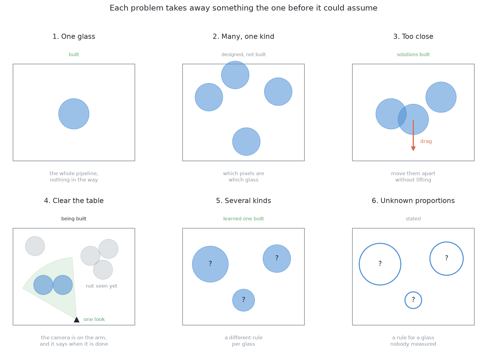

# The six problems

This project is not one task. It is six, and they get harder in a particular
way: **each one takes away something the one before it was allowed to assume.**
One folder each.

Read [`../problem-statement.md`](../problem-statement.md) first if you have
not. It says what the task is, why glasses were chosen, what the arm is allowed
to know, and what counts as done. Everything here follows from it.

| | Problem | Where it stops | State |
| --- | --- | --- | --- |
| **1** | [One glass, start to finish](problem-1) | the glass is on the rack | **built** |
| **2** | [Segment the glasses](02-segment-glasses) | a set of pixels per glass | designed, not built |
| **3** | [Glasses standing too close](03-push-glasses-apart) | the glasses are far enough apart to grip | designed, six solutions built |
| **4** | [Clear the table](04-clear-the-table) | every glass has room, and the arm has said so | built on a UR5e with MoveIt 2, six solutions |
| **5** | [Several kinds at once](problem-5) | the table is clear | learned version built |
| **6** | [Kinds whose proportions are unknown](problem-6) | the table is clear | stated |

## Why they are in this order

Each problem is the one before it with one assumption removed, so each answer
is something the next problem can stand on.

**Problem 1** has one glass on a bare table. Nothing hides anything, the camera
can go wherever it likes, and the glass is reachable where it stands. That
leaves the difficulties that are about the *object* rather than about the
scene. Its size has to be measured. Its weight cannot be seen at all. There is
usually only one place it may be held. And the set-down has to be felt rather
than driven.

**Problem 2** puts several glasses of the same kind on the table. The kinds are
known, so naming is not the difficulty. Telling one glass from another is — and
worse, the arm can no longer photograph each one from whichever side it likes,
because the other glasses are in the way of the camera or of the arm.

**Problem 3** starts from problem 2's answer. Some of those glasses are close
enough together that the gripper cannot get round one without fouling its
neighbour. They have to be moved apart by **dragging them across the table**,
because lifting one is the thing that is not possible yet.

**Problem 4** keeps problem 3's task and takes away the help that came from
outside the arm. In problem 3 a camera fixed above the table sees every glass
at once, and the arm is handed one push at a time: something outside it decides
whether that push may be carried out, marks it, and says when the table is
finished. Neither of those is part of the arm. Here the only camera is the one
the arm carries, so looking at a corner of the table costs a movement, and
nothing is handed over push by push. The arm looks, pushes, looks again, and
says for itself when it has finished. The table is then marked once, on how
the glasses are arranged when the arm stopped. It ends where problem 3 ends,
with every glass given room, so problem 5 can stand on either answer.

**Problem 5** joins the first three up and adds the part none of them has:
several kinds at once, so the rule changes per glass and naming the kind
becomes load-bearing.

**Problem 6** takes away the proportions. The kinds are still the four shapes,
but no two glasses of a kind are alike and nothing is written down. This is the
problem the whole project exists for, and the reason every earlier problem
refuses to record a measurement.

## What is in each folder

Each problem folder has a `problem.md` that states the problem in full — what
is on the table, what the arm is not told, what makes it hard, and what "done"
means. After that they differ, because the problems do:

- **Problems 1, 5 and 6** are the whole pipeline, so they are written as the
  same six *steps*: find it, measure it, name it, choose the grip, squeeze,
  turn it over. Problem 1 gives each step a document of its own, because it is
  built. Problems 5 and 6 take the six as a section of `problem.md`, saying
  what changes at each and nothing else.
- **Problems 2 and 3** are not the whole pipeline and do not have all the
  steps. Problem 2 stops at a set of pixels per glass; problem 3 stops at
  glasses far enough apart to be gripped. Each has a `solution-overview.md`
  instead — nine and eleven solutions respectively, grouped as programmed,
  hybrid and learned, with which one is chosen and why. Both open with the three
  ideas the comparisons turn on. Where a learned part can sit in a pipeline.
  What it takes for a machine to choose its own next measurement. And the rule
  that every solution in them can be built inside the simulator. Each
  folder also has a `learned-with-hardware.md` holding the answers that cannot
  — a foundation model, a fine-tune, a reinforcement-learning policy — beside
  the condition each one fails.
- **Problem 4** does not pick anything up either, so it has no six steps. Its
  `README.md` holds the whole picture and every result, `problem.md` says how a
  run is scored, three pages explain the arm, the box model and the data, and
  `solutions/` has one short page per solution.
- **Problem 5** has both: the six steps in `problem.md`, and a `solutions/`
  folder with a `solution-overview.md` and nine solutions, split into
  `programmed/` and `learned/` as problem 2's are. Most of them are
  combinations of problem 1, 2 and 3 pieces, and the overview says which piece
  sits at which stage of a run. The learned one is built, in
  [`problem-5-learned`](../problem-5-learned/README.md).

## What does not work yet

[`known-gaps.md`](known-gaps.md) lists the failures that are known but not yet
fixed, such as the glass sizes the grip rules cannot handle. It is about the
code as it stands, which is to say about problem 1.

## The cell

[**The cell**](the-cell.md) describes the room every problem works in: the
layout with its dimensions, the two poses the camera is ever put in, all four
sensors, the four kinds of glass, and the vocabulary — survey, station,
standoff, nadir, splay, footprint. Every number on it is read from the
project's own constants rather than typed in. The solution documents point at
it rather than restating it.

## The pictures

Every diagram in these documents is drawn by a script, and every script lives
in [`images/generators/`](../images/generators/), next to the pictures it
writes. Nothing in this project is a hand-drawn picture kept in step by hand.

There are three families, and the difference between them matters.

[`make_images.py`](../images/generators/make_images.py) draws everything in the
problem-1 walkthrough by importing the project's own modules and plotting what
they return. Nothing there is illustrative: if a rule changes, the picture
changes with it the next time the script is run.

[`make_problem_images.py`](../images/generators/make_problem_images.py) draws
the diagrams in the problem documents. Those describe problems that are not
built, so there is no function to plot. They are drawn from the geometry
written beside them, and the two have to be kept in step by hand.

[`generators/02-segment-glasses/`](../images/generators/02-segment-glasses/) holds
the scripts that draw them, plus
[`diagram_style.py`](../images/generators/02-segment-glasses/diagram_style.py), the
shared palette and page setup that keeps every diagram looking like one
document. A script is named for the material it draws rather than for one
document, because several documents share a subject. These compute their own geometry, so the
arithmetic in a picture and the arithmetic in the prose beside it come from the
same numbers.

## Where the techniques come from

None of the perception or the gripping here is invented for this project. Each
step is one named technique, and the places they are set out side by side are
the **object perception** and **gripping** areas of robotics-basics:
[finding and measuring](https://github.com/RobinNagpal/robotics-basics/blob/main/docs/06_object-perception/01_overview.md)
and [gripping](https://github.com/RobinNagpal/robotics-basics/blob/main/docs/07_gripping/01_overview.md).
[The problem-1 walkthrough](problem-1/README.md#where-the-techniques-come-from)
has the full map, and every document links to the sections it uses.

There is also a design document for this exact task, written before any of the
code: [standing an empty glass upside down on a drying
rack](https://github.com/RobinNagpal/robotics-basics/blob/main/docs/10_one-arm-training/07_case-study/01_place-glass.md).
